# BLUEPRINT — 《QCD 因子化定理：严格证明、全阶论证与适用边界》

**Author of this file:** proof-architect agent (research phase).
**Input:** `CONTEXT.md` (binding conventions + OUTLINE v0), the Furry monograph as quality bar, and (read-only) intermediate results of the `c_dis` and `c_pdf` agents.
**Output:** a chapter-by-chapter, statement-by-statement plan that a writer can turn into LaTeX without re-deciding structure, conventions, rigor tags or proof strategy.

**Contents of this blueprint:** §0 global architecture (tracks, changes to OUTLINE v0, named hypotheses, additional binding conventions, meaning of 'proof', page budget, dependency graph) · Chapters 1–17 · Appendices A–H · §S proof supplements (S1–S9) · §18 discrepancies, corrections and verification tasks · §19 label registry.

How to read this file

* Every chapter section has the same seven parts: **(1) purpose & dependencies; (2) statements; (3) proof strategies; (4) worked examples / one-loop checks; (5) figures; (6) page budget; (7) key references.** For readability, (2) and (3) are merged: each statement is immediately followed by its proof plan.
* Numbering `D/L/P/T/C/Cj/E k.m` = Definition / Lemma / Proposition / Theorem / Corollary / Conjecture / Example, number m in chapter k. The preamble uses ONE shared counter per chapter (`theorem` counter with `[chapter]`), so the numbers here are *planning* numbers; writers must use the suggested `\label{...}` keys (given in `code` font) so that cross-chapter references survive renumbering.
* Rigor tags are those of `CONTEXT.md`: **[R]** strict (complete at every order of renormalized PT, or complete proof given here), **[A]** standard all-order argument with some steps only sketched in the literature, **[P]** partial, **[C]** conjecture, **[V]** violated. A tag always refers to the statement *exactly as formulated*; a perturbative theorem that is applied to hadrons carries the additional hypothesis label (see §0.3).
* "Proof: full" = the writer must give a complete proof in the book. "Proof: sketch" = use the `proofsketch` environment and end it with the sentence 「完整论证见 …」 giving the precise literature location. Literature locations marked **(verify)** were recalled by me and must be checked by the `refs` agent before transcription. I have not invented any reference; where I am unsure of a section/equation number I say so.

---

## 0. Global architecture decisions

### 0.1 Three tracks

The book is organised in three tracks that share Chapters 1–3.

| Track | Chapters | Nature | Typical tag |
|---|---|---|---|
| **R** (rigorous core) | 4, 5, 6 (§6.1–6.6) | Analyticity, unitarity, Euclidean IR finiteness, renormalization group, OPE in renormalized perturbation theory, moment problem | [R] in PT (+ named NP hypothesis for hadrons) |
| **A** (all-order graphical proofs) | 7 (method), 8 (DIS), 9 (SIA), 10 (DY), 11 (TMD) | Landau pinches → power counting → approximations → Ward identities → subtractions → factorized form | [A] (with explicit "gap" remarks) |
| **B** (boundaries) | 12–16 | Violations, conjectures, exclusive, EFT, NRQCD, power corrections | [P]/[C]/[V] mixed |

The single most important structural device is a **uniform "factorization template"** (Ch. 7, T7.20 `thm:template`) with five hypotheses (H1)–(H5); every process chapter (8–11) then consists of *verifying* (H1)–(H5) for the process, and every chapter of Track B identifies *which* hypothesis fails. This gives the reader one proof to understand and many applications, and it makes the honest status statements precise ("(H4) is proved only at the level of [A] for DY because of the Glauber region", etc.).

### 0.2 Recommended changes to OUTLINE v0 (details in `18_discrepancies` section at the end)

1. **Ch. 5/6 interface.** Ch. 5 ends with moment factorization (T5.12) and the uniqueness lemma (L5.14). The *x-space* DIS theorem with *operator-defined* PDFs (T6.14 `thm:DIS-x-space-R`) is stated and proved in Ch. 6 after the moment↔local-operator theorem (T6.10). Ch. 5 must not use the Collins–Soper definitions before they are introduced.
2. **Uniqueness from even moments** must be stated with its hypothesis (no component supported at $x=0$); without it the statement is false (counterexample $T=\delta'(x)$, all even moments vanish). Müntz–Szász is unnecessary: Hausdorff + the substitution $t=x^2$ suffices. See L5.14.
3. **Ch. 2 must contain BRST/Slavnov–Taylor identities** (needed for the non-abelian graphical Ward identities of Ch. 7/App. F) and the **Joglekar–Lee theorem** on mixing of gauge-invariant operators with BRST-exact and EOM operators (needed in Ch. 5/6 for singlet operators).
4. **Ch. 3 must distinguish "soft" (all components $\sim\lambda Q$) from "ultrasoft/central soft" (all components $\sim\lambda^2 Q$)**: Libby–Sterman's original e⁺e⁻ analysis uses the latter; TMD factorization needs the former; the Glauber region is $|k^+k^-|\ll k_T^2$. The IR degree $\omega(R)$ must be quoted with its unit (powers of $\lambda$ with $k_T\sim\lambda Q$, or powers of $\lambda^2$).
5. **Ch. 3 Landau equations in two forms**: (i) α-parameter form = necessary condition for non-analyticity of an integral in its external parameters; (ii) loop-momentum form = necessary condition for a pinch of the integration contour at a point of the integration domain (this is what Coleman–Norton and the factorization proofs use). Both get full proofs (App. D).
6. Add a short **assumption environment** to the preamble (`\theoremstyle{cdefinition}\newtheorem{assumption}[theorem]{假设}` + `\crefname{assumption}{假设}{假设}`), used for the named hypotheses of §0.3. If the lead author prefers not to change the preamble, use `definition` with title 「假设 NP1」 etc.
7. **R-ratio coefficient** in OUTLINE Ch. 4 should be stated for a general gauge group: $R=R_0\,[1+\tfrac34 C_F\,\alpha_s(s)/\pi+O(\alpha_s^2)]$, which is $R_0(1+\alpha_s/\pi)$ only for $C_F=4/3$; $R_0=N_c\sum_q e_q^2$ (photon exchange only, $n_f$ massless flavours).

### 0.3 Named hypotheses (to be used verbatim in status lines)

* **(PT)** Framework: renormalized perturbation theory of QCD with $n_f$ flavours, DR with $D=4-2\varepsilon$, $\MSbar$; external states are on-shell partons (IR-regulated by DR, by masses, or by off-shellness when stated). All [R]/[A] statements are statements in (PT) unless they say otherwise.
* **(NP-OPE)** The operator product expansion of Ch. 5 holds, as an asymptotic expansion in $1/Q^2$, for forward matrix elements between hadron states, with the same Wilson coefficients.
* **(NP-REG)** The leading-region/factorized structure derived in (PT) holds for hadronic external states, the long-distance factors being the hadronic matrix elements of the same operators (PDFs, FFs, TMDs …); the remainder is suppressed by a power of $\Lambda_{\rm QCD}/Q$.
* **(SPEC)** Spectral condition + completeness of the physical state space (Wightman-type axioms, colour-singlet asymptotic states, mass gap for hadrons). Used for analyticity, positivity and support properties for hadron targets.
* **(GLAU)** For the process considered, Glauber-region contributions cancel at leading power (so the soft approximation and the Ward identities are applicable after contour deformation). Status is process dependent: proved at the level [A] for inclusive DY-type processes (Ch. 10), violated for TMD hadro-production of hadrons (Ch. 12).

A typical status line therefore reads: 「状态：在 (PT) 中 [R]；对强子靶需要 (NP-OPE) 与 (SPEC)。」

### 0.4 Conventions that are used but not fixed in CONTEXT.md (BINDING for all chapters once accepted)

All of these were checked for consistency with the binding conventions (signs and normalizations re-derived by me; c_dis/c_pdf results agree where they overlap).

1. **Electromagnetic current** (in units of $e$): $j^\mu=\sum_q e_q\,\bar\psi_q\gamma^\mu\psi_q$.
2. **Hadronic tensor** (spin averaged):
   $$W^{\mu\nu}(P,q)=\frac{1}{4\pi}\int d^4z\,e^{iq\cdot z}\langle P|[j^\mu(z),j^\nu(0)]|P\rangle=\frac{1}{4\pi}\sum_X(2\pi)^4\delta^4(P+q-p_X)\langle P|j^\mu(0)|X\rangle\langle X|j^\nu(0)|P\rangle ,$$
   (the second term of the commutator does not contribute for $q^0>0$ and $x<1$); with the decomposition of CONTEXT.md this gives the parton-model $F_2=\sum_q e_q^2x(q+\bar q)$, $F_1=\frac12\sum_q e_q^2(q+\bar q)$ (checked on a free quark: $F_2=e_q^2\delta(1-x)$, $F_L=0$).
   Exact longitudinal structure function (needed in §5.7, target-mass corrections): $F_L=(1+4M^2x^2/Q^2)F_2-2xF_1$, which reduces to the CONTEXT.md definition at $M=0$.
3. **Forward Compton amplitude:** $T^{\mu\nu}=i\int d^4z\,e^{iq\cdot z}\langle P|T\,j^\mu(z)j^\nu(0)|P\rangle$, decomposed with the same tensors as $W^{\mu\nu}$ into $T_1,T_2$. With $\omega\equiv 2P\cdot q/Q^2=1/x$: $\ \operatorname{Im}T_i(\omega+i0)=2\pi F_i$ for $\omega>1$; crossing $T^{\mu\nu}(P,q)=T^{\nu\mu}(P,-q)$ gives **$T_1$ even, $T_2$ odd in $\omega$**. (Derivation: insert states; $\operatorname{Im}[-1/(\Delta+i0)]=\pi\delta(\Delta)$.)
4. **Vacuum polarization:** $i\int d^4x\,e^{iq\cdot x}\langle0|T\,j^\mu(x)j^\nu(0)|0\rangle=(q^\mu q^\nu-q^2g^{\mu\nu})\,\Pi(q^2)$. Then $\operatorname{Im}\Pi(s+i0)\ge0$, $R(s)=12\pi\operatorname{Im}\Pi(s+i0)$ (free massless Dirac fermion of unit charge: $\operatorname{Im}\Pi=1/12\pi$), and the Adler function $D(Q^2)\equiv-12\pi^2Q^2\,d\Pi(-Q^2)/dQ^2=Q^2\int_0^\infty ds\,R(s)/(s+Q^2)^2$. $\sigma(e^+e^-\to\mu^+\mu^-)=4\pi\alpha^2/3s$ (massless muons, photon exchange).
5. **Gluon PDF** (Collins' normalization):
   $$f_{g/H}(\xi)=\sum_{j=1,2}\int\frac{dw^-}{2\pi\,\xi P^+}\,e^{-i\xi P^+w^-}\langle P|G^{+j}_a(w)\,\mathcal W^{\rm adj}_{ab}[w,0]\,G^{+j}_b(0)|P\rangle ,$$
   $f_g(-\xi)=-f_g(\xi)$; free gluon: $f_{g/g}^{(0)}=\delta(1-\xi)-\delta(1+\xi)$ (c_pdf check). **$\MSbar$ convention for partonic gluon targets: average over the $D-2=2-2\varepsilon$ gluon polarizations** (c_dis: averaging over 2 instead shifts $C_2^g\to C_2^g+P_{qg}$). This must be stated explicitly in Ch. 6 and Ch. 8.
6. **Local twist-2 operators and reduced matrix elements** (forward, spin averaged, trace terms $\propto M^2$ dropped at leading twist):
   $O_q^{\mu_1\cdots\mu_n}=\bar\psi\gamma^{\{\mu_1}iD^{\mu_2}\cdots iD^{\mu_n\}}\psi-\text{traces}$, $\ O_g^{\mu_1\cdots\mu_n}=G^{\{\mu_1\alpha}iD^{\mu_2}\cdots iD^{\mu_{n-1}}G_\alpha^{\ \mu_n\}}-\text{traces}$ ($\{\}$ = normalized symmetrization), $\langle P|O_i^{\mu_1\cdots\mu_n}|P\rangle=2A_i^{(n)}P^{\mu_1}\cdots P^{\mu_n}$.
   Then (T6.10) $A_q^{(n)}=\int_{-1}^1d\xi\,\xi^{n-1}f_q(\xi)=\int_0^1dx\,x^{n-1}[q(x)+(-1)^n\bar q(x)]$ and $A_g^{(n)}=\int_0^1dx\,x^{n-1}f_g(x)$ ($n$ even). [The overall sign convention of $O_g$ must be fixed so that $\langle g|O_g^{+\cdots+}|g\rangle=2(k^+)^n$, i.e. $O_g^{+\cdots+}=G^{+j}(iD^+)^{n-2}G^{+j}$ summed over $j$; c_pdf verified $\langle k|\sum_jG^{+j}G^{+j}|k\rangle=2(k^+)^2$.]
7. **Anomalous-dimension convention:** $\gamma_{ij}(N)\equiv\int_0^1dz\,z^{N-1}P_{ij}(z)$, so $\partial f_N/\partial\ln\mu^2=\frac{\alpha_s}{2\pi}\gamma(N)f_N$ at LO and $f^{\rm NS}_N(Q)=f^{\rm NS}_N(Q_0)\,[\alpha_s(Q)/\alpha_s(Q_0)]^{-2\gamma^{(0)}(N)/\beta_0}$. LO: $\gamma_{qq}(N)=C_F[-\tfrac12+\tfrac1{N(N+1)}-2\sum_{k=2}^N\tfrac1k]$ (c_pdf). Relation to Moch–Vermaseren–Vogt: $\gamma^{(0)}_{\rm MVV}(N)=-2\gamma_{qq}(N)$ (with their $a_s=\alpha_s/4\pi$). Writers must quote this dictionary whenever citing literature values.
8. **Fragmentation function** (hadron $h$ moving in $+z$, parton momentum $k$, $z=p_h^+/k^+$, frame with $\boldsymbol p_{h,T}=0$):
   $$d_{h/q}(z)=\frac{1}{4N_c\,z}\sum_X\int\frac{dw^-}{2\pi}e^{ik^+w^-}\operatorname{Tr}_c\operatorname{Tr}_D\Big[\gamma^+\langle0|\mathcal W\psi(w)|hX\rangle\langle hX|\bar\psi(0)\mathcal W^\dagger|0\rangle\Big],$$
   with future-pointing Wilson lines along $n_B$; free quark: $d_{q/q}=\delta(1-z)$ (checked). The $D$-dimensional factor $z^{-2\varepsilon}$ that appears when the definition is written in the parton frame must be fixed by the FF writer (see Collins 2011, ch. 12, **(verify)** equation numbers).
9. **Cusp & CS kernel:** $\Gamma_{\rm cusp}=C_F\alpha_s/\pi+O(\alpha_s^2)$; Collins' $\gamma_K=2\Gamma_{\rm cusp}$; $\tilde K(b_T;\mu)=-\frac{\alpha_sC_F}{\pi}\ln(\mu^2b_T^2/b_0^2)+O(\alpha_s^2)$, $d\tilde K/d\ln\mu=-\gamma_K$; TMD anomalous dimension $\gamma_q(\alpha_s;\zeta/\mu^2)=\gamma_q(\alpha_s;1)-\frac12\gamma_K\ln(\zeta/\mu^2)$ with $\gamma_q(\alpha_s;1)=\frac32C_F\alpha_s/\pi+O(\alpha_s^2)$ (consistency with the DY hard factor checked in §11).
10. **Eikonal propagators (Wilson-line Feynman rules)**, for $D_\mu=\partial_\mu-igA_\mu$, $W[b,a]=P\exp(ig\int_a^bdz\cdot A)$ and the field expansion $A_\mu(x)=\int\frac{d^4k}{(2\pi)^4}e^{-ik\cdot x}\tilde A_\mu(k)$ ($k$ flows *into* the line). Expanding the path-ordered exponential:
   * past-pointing line $W[0,-\infty]$ along $n$ (incoming parton), gluons $k_1,\dots,k_m$ attached in order from the far end $-\infty$ towards $0$: colour factor $t^{a_m}\cdots t^{a_1}$ (later points to the left) times
     $\prod_{j=1}^m (ig\,n^{\mu_j})\,\dfrac{i}{n\cdot(k_1+\cdots+k_j)+i0}$;
   * future-pointing line $W[+\infty,0]$ (outgoing parton), gluons $k_1,\dots,k_m$ attached in order from $0$ towards $+\infty$: colour factor $t^{a_m}\cdots t^{a_1}$ times $\prod_{j=1}^m (ig\,n^{\mu_j})\,\dfrac{-i}{n\cdot(k_j+\cdots+k_m)-i0}$ (momenta summed from the far end $+\infty$).
   The $\pm i0$ follow from convergence of $\int_{-\infty}^0d\lambda\,e^{-i\lambda n\cdot k+0\lambda}=i/(n\cdot k+i0)$ and $\int_0^\infty d\lambda\,e^{-i\lambda n\cdot k-0\lambda}=-i/(n\cdot k-i0)$; they coincide with the eikonal limits of an incoming ($i\slashed p/(2p\cdot k+i0)$) and an outgoing ($-i\slashed p/(2p\cdot k-i0)$) quark propagator. Hermitian conjugate lines (right of the final-state cut) get the complex-conjugate rules. App. B proves these rules and the eikonal identity. The c_pdf agent verified numerically $dW[z,a]/dz=+igA(z)W[z,a]$, composition, retracing and covariance $W\to U(b)WU^\dagger(a)$ (reversed ordering is not covariant).

### 0.5 What "proof of factorization" means in this book (to be stated in Ch. 1 and used everywhere)

**Definition 0 (factorization statement; to become D1.2 `def:factorization`).** Let $\sigma(Q;m)$ be an observable with hard scale $Q$ and IR scales $m$ (hadron/parton masses, $\Lambda$, IR regulators). A *collinear factorization theorem at leading power* asserts
$$\sigma(Q;m)=\sum_{i,j}\int\frac{d\xi_a}{\xi_a}\frac{d\xi_b}{\xi_b}\,\hat\sigma_{ij}\Big(\frac{x_a}{\xi_a},\frac{x_b}{\xi_b},\frac{Q}{\mu},\alpha_s(\mu)\Big)f_{i/A}(\xi_a;\mu)f_{j/B}(\xi_b;\mu)+r(Q;m),$$
where (a) $f$ are defined as matrix elements of specified gauge-invariant renormalized operators; (b) $\hat\sigma$ is independent of the external states and of the IR regularization, and is computable order by order in $\alpha_s$; (c) $r=O((m/Q)^p)$ for some $p>0$ (often $p=2$ or $1$), the bound being understood order by order in $\alpha_s$ in (PT), and as an asymptotic statement for hadrons under (NP-REG). "All orders" always means "at every fixed order of $\alpha_s$", never convergence of the series.

### 0.6 Page budget (A4, 11 pt, ctexbook; target total 285, admissible 230–300)

| Part | Target pp. | Minimum |
|---|---|---|
| Front matter (abstract, notation, tag legend, overview table) | 6 | 5 |
| Ch. 1 Introduction | 10 | 8 |
| Ch. 2 Preliminaries | 18 | 15 |
| Ch. 3 IR structure | 20 | 16 |
| Ch. 4 e⁺e⁻ total (rigorous core I) | 14 | 12 |
| Ch. 5 DIS & OPE (rigorous core II) | 20 | 17 |
| Ch. 6 PDFs & FFs (incl. x-space DIS theorem) | 18 | 15 |
| Ch. 7 General method | 22 | 18 |
| Ch. 8 DIS all orders | 14 | 11 |
| Ch. 9 SIA, FFs, event shapes | 8 | 6 |
| Ch. 10 Drell–Yan, Glauber | 18 | 15 |
| Ch. 11 TMD | 18 | 15 |
| Ch. 12 Breakdown & non-rigorous cases | 14 | 11 |
| Ch. 13 Hard exclusive | 10 | 8 |
| Ch. 14 SCET | 14 | 11 |
| Ch. 15 Quarkonium | 6 | 5 |
| Ch. 16 Power corrections, renormalons, lattice | 10 | 8 |
| Ch. 17 Summary | 4 | 3 |
| App. A–H | 41 | 32 |
| **Total** | **285** | **231** |

Appendix split: A 4, B 6, C 5, D 7, E 5, F 5, G 6 (only those one-loop calculations not already in the chapters), H 3 (+ bibliography ≈ 6 pp inside H or after it).

### 0.7 Dependency graph of the main results

Mermaid source (renders on GitHub/Typora; the writer of the front matter should redraw it in TikZ as `fig:dependency-graph`, using node colours = rigor tags: green [R], blue [A], orange [P], purple [C], red [V]).

```mermaid
flowchart TD
  %% ---------- Chapter 2 tools ----------
  T2_5["T2.5 Slavnov–Taylor [R]"]
  T2_18["T2.18 Joglekar–Lee [R]"]
  T2_25["T2.25 cutting rules [R]"]
  P2_26["P2.26 optical thm / R=12π ImΠ, W=ImT/2π [R]"]
  P2_16["P2.16 RG improvement [R]"]
  L2_12["L2.12 eikonal identity [R]"]
  L2_22["L2.22 Mellin convolution [R]"]
  %% ---------- Chapter 3 ----------
  T3_3["T3.2/T3.3 Landau eqs (α & k forms) [R]"]
  T3_5["T3.5 Coleman–Norton [R]"]
  P3_6["P3.6 pinch classification [A]"]
  P3_9["P3.9 power counting (superficial) [R comp.]"]
  T3_10["T3.10 leading regions [A]"]
  %% ---------- Chapter 4 (rigorous core I) ----------
  L4_4["L4.4 single-scale DR structure [R]"]
  P4_3["P4.3 analyticity of Π [R]"]
  T4_6["T4.6 Euclidean IR finiteness [R]"]
  P4_7["P4.7 Adler RG [R]"]
  T4_8["T4.8 R(s) finite, = Σ cuts [R]"]
  C4_10["C4.10 R=R0(1+3CFαs/4π+…) [R]"]
  %% ---------- Chapter 5 (rigorous core II) ----------
  P5_4["P5.4 analyticity & crossing of T [R]"]
  P5_5["P5.5 dispersion: Taylor coeff = moments [R]"]
  L5_7["L5.7 tree-level OPE [R]"]
  T5_9["T5.9 OPE in renormalized PT [R]"]
  P5_11["P5.11 RG of C and A [R]"]
  T5_12["T5.12 moment factorization [R in PT]"]
  L5_14["L5.14 uniqueness from even moments [R]"]
  P5_15["P5.15 Mellin continuation [R]"]
  %% ---------- Chapter 6 ----------
  T6_7["T6.7 support ξ in [-1,1] [R]"]
  L6_9["L6.9 Wilson-line moments = D-vertices [R]"]
  T6_10["T6.10 PDF moments = local ops [R in PT]"]
  T6_11["T6.11 DGLAP from renormalization [R in PT]"]
  P6_13["P6.13 partonic PDFs in DR [R]"]
  T6_14["T6.14 DIS x-space factorization [R in PT]"]
  %% ---------- Chapter 7 (method) ----------
  L7_45["L7.4/L7.5 approximations [A]"]
  L7_8["L7.8 abelian Ward [R]"]
  P7_9["P7.9 non-abelian Ward, 1 gluon [R]"]
  L7_10["L7.10 multi-gluon Ward → Wilson line [A]"]
  P7_1112["P7.11/P7.12 collinear & soft Wilson lines [A]"]
  T7_14["T7.14 subtraction theorem [A]"]
  L7_16["L7.16 soft factor = 1 (unitarity) [R]"]
  P7_17["P7.17 FSI cancel by unitarity [A]"]
  P7_19["P7.19 Glauber deformation [A]"]
  T7_20["T7.20 TEMPLATE (H1)–(H5) [A]"]
  %% ---------- Process chapters ----------
  T8_6["T8.6 DIS all orders [A]"]
  C8_7["C8.7 = OPE coefficients [R]"]
  T9_3["T9.3 SIA [A]"]
  L10_5["L10.5 spectator FSI cancel [A]"]
  T10_9["T10.9 inclusive DY [A]"]
  P10_14["P10.14 pp→jets (collinear) [A weak]"]
  T11_10["T11.10 TMD factorization [A]"]
  T11_14["T11.14 Sivers sign change [R given defs]"]
  %% ---------- Boundaries ----------
  T12_2["T12.2 TMD pp→h1h2X breaks [V]"]
  P12_5["P12.5 space-like collinear limits [V]"]
  T12_8["T12.8 diffractive DIS [A]"]
  T13_4["T13.4 pion FF [A]"]
  T13_8["T13.8 DVCS / σ_L meson [A]"]
  T14_5["T14.5 usoft decoupling [R (LO Lagr.)]"]
  T14_8["T14.8 thrust H J J S [A]"]
  T15_3["T15.3 NRQCD decay [A]"]
  Cj15_5["Cj15.5 NRQCD production [C]"]
  P16_6["P16.6 renormalons (large β0) [R in limit]"]
  T16_10["T16.10 LaMET matching [A]"]

  T2_25 --> P2_26
  P2_26 --> T4_8
  L4_4 --> P4_3
  L4_4 --> T4_8
  P4_3 --> T4_8
  T4_6 --> T4_8
  T2_25 --> T4_8
  P2_16 --> P4_7 --> C4_10
  T4_8 --> C4_10
  P2_26 --> P5_4 --> P5_5
  L5_7 --> T5_9
  T2_18 --> T5_9
  T5_9 --> T5_12
  P5_5 --> T5_12
  P2_16 --> P5_11 --> T5_12
  L5_14 --> P5_15
  T6_7 --> T6_10
  L6_9 --> T6_10
  L2_22 --> T6_10
  P5_15 --> T6_10
  T6_10 --> T6_11
  T5_12 --> T6_14
  T6_10 --> T6_14
  L5_14 --> T6_14
  P6_13 --> T6_14
  T3_3 --> T3_5 --> P3_6 --> P3_9 --> T3_10
  T2_5 --> P7_9 --> L7_10
  L2_12 --> L7_8 --> L7_10
  L7_10 --> P7_1112
  T3_10 --> T7_20
  L7_45 --> T7_14 --> T7_20
  P7_1112 --> T7_20
  L7_16 --> T7_20
  P7_17 --> T7_20
  P7_19 --> T7_20
  T7_20 --> T8_6
  P6_13 --> T8_6
  T8_6 --> C8_7
  T6_14 --> C8_7
  T7_20 --> T9_3
  T7_20 --> T10_9
  L10_5 --> T10_9
  P7_19 --> T10_9
  T10_9 --> P10_14
  T10_9 --> T11_10
  T7_20 --> T11_10
  T11_10 --> T11_14
  P7_19 -. fails .-> T12_2
  T7_20 -. amplitude level fails .-> P12_5
  T8_6 --> T12_8
  T7_20 --> T13_4
  T7_20 --> T13_8
  P3_9 --> T14_5 --> T14_8
  T7_20 --> T15_3
  T15_3 -. not sufficient .-> Cj15_5
  T5_9 --> P16_6
  T6_10 --> T16_10
```

**Critical paths** (to be stated in prose in Ch. 1, §1.5 "how to read this book"):
* Rigorous core I: T2.25 → P2.26 → (P4.3, L4.4, T4.6) → T4.8 → C4.10.
* Rigorous core II: P2.26 → P5.4 → P5.5; (L5.7, T2.18) → T5.9; → T5.12 → (T6.10 ⟵ T6.7, L6.9, P5.15) → T6.14.
* All-order graphical: T3.3 → T3.5 → P3.6 → P3.9 → T3.10; (T2.5 → P7.9 → L7.10 → P7.11/12); (L7.4/5 → T7.14); (L7.16, P7.17, P7.19) → **T7.20** → {T8.6, T9.3, T10.9, T11.10}.
* The weakest links that determine the [A] tags: L7.10 (non-abelian multi-gluon Ward identity, combinatorics with ghosts), T7.14 (general subtraction theorem), P7.19/L10.5 (Glauber). Every process chapter must cite these three explicitly in its status line.

---

## Chapter 1 — Introduction (引言：部分子图像、因子化的含义与严格性分级)

### 1.1 Purpose and dependencies
Purpose: (i) give the physical picture (parton model, time dilation, incoherence, "hard + collinear + soft"); (ii) state precisely what a factorization theorem asserts (D1.2 = Definition 0 of §0.5) and what "proof" means (all orders in $\alpha_s$ at leading power; perturbative vs non-perturbative validity); (iii) define the rigor taxonomy and the named hypotheses (§0.3); (iv) give the boxed overview table of all results with status; (v) list common misconceptions; (vi) explain the organisation (three tracks, §0.1).
Dependencies: none (forward references only, always to labelled results).

### 1.2 Statements and proof plans

**D1.1 (hard process, power expansion) `def:hard-process`.** A cross section depending on a hard scale $Q$ and on IR scales $m$ (masses, $\Lambda$, regulators) is said to admit a leading-power expansion if $\sigma=\sigma_{\rm LP}+O((m/Q)^p)$; define "leading power", "twist", "power correction". Remark: in (PT) with massless partons the only IR scales are regulators/masses/off-shellness; $\Lambda$ appears only through $\alpha_s(\mu)$.

**D1.2 (collinear factorization statement) `def:factorization`.** Exactly Definition 0 of §0.5 (formula with $\hat\sigma_{ij}\otimes f_i\otimes f_j+r$; requirements (a)–(c)). Add the one-hadron version (DIS: $F_2/x=\sum_i C_{2,i}\otimes f_i$) and the zero-hadron version (e⁺e⁻ total: no PDFs, pure IR finiteness).

**D1.3 (rigor tags) `def:tags`.** Verbatim the five tags of CONTEXT.md, plus the rule "a tag refers to the statement exactly as formulated; for hadrons add the hypothesis labels (NP-OPE), (NP-REG), (SPEC), (GLAU)".

**D1.4 (named hypotheses) `def:hypotheses`.** The five items of §0.3 ((PT), (NP-OPE), (NP-REG), (SPEC), (GLAU)), in an `assumption` environment.

**Heuristic H1.5 (parton model from incoherence) — NOT a theorem, typeset as a `remark`.** In a frame where $P^+\to\infty$: the hadron's internal interactions are spread over light-front times $\Delta x^+\sim P^+/m^2$ (time dilation), while the hard probe with $q^-\sim Q^2/(2xP^+)$ resolves $\Delta x^+\sim 1/q^-\sim xP^+/Q^2$; the ratio $\sim m^2/Q^2$ ⇒ the probe sees a frozen ensemble of quasi-free partons and cross sections add incoherently (squares of amplitudes, not amplitudes). State explicitly which steps are later made precise: incoherence ⇔ leading regions (Ch. 3), frozen ensemble ⇔ operator definitions on the light front (Ch. 6), quasi-free ⇔ hard part computed with on-shell partons + subtractions (Ch. 7).

**E1.6 (tree-level handbag) `ex:handbag`.** Derive $F_2=\sum_qe_q^2x(q+\bar q)$, $F_L=0$ (Callan–Gross) from the handbag diagram with the quark correlator, using the normalization §0.4(2). Proof: full (one page): Fierz/projection $\Phi(k)\to\frac12\gamma^-\,\mathrm{Tr}[\frac{\gamma^+}{2}\Phi]$, partonic tensor of a massless quark, $\delta((k+q)^2)$ fixes $\xi=x$. This anticipates the "collinear approximation" of Ch. 7 and should cross-refer to it.

**Table 1.1 (overview of results and status) `tab:overview`** — boxed, one row per main result, columns: 结论 | 公式（缩写） | 状态 | 章节. Rows (must be kept in sync with Ch. 17's master table; final tags as decided in this blueprint):

| Result | Status | Where |
|---|---|---|
| $e^+e^-$ total: IR finiteness at every order; $R=R_0[1+\frac34C_F\alpha_s/\pi+\dots]$ | [R] in (PT) | T4.8, C4.10 |
| Adler-function/Euclidean OPE with condensates | OPE coefficients [R] in (PT); condensate terms need (NP-OPE) | T4.13 |
| Smeared $R$ ↔ PT (Poggio–Quinn–Weinberg) | [A] (needs (NP-OPE)-type assumption on the circle) | P4.15 |
| DIS moments = $\sum_i C^{(n)}_{2,i}A^{(n)}_i$ ($n$ even), RG evolution | [R] in (PT); hadrons need (NP-OPE)+(SPEC) | T5.12 |
| DIS x-space factorization with operator PDFs | [R] in (PT) (via moments + L5.14 + T6.10) | T6.14 |
| DGLAP from operator renormalization | [R] in (PT) | T6.11 |
| PDF support $\lvert\xi\rvert\le1$ | [R] given (SPEC) (hadrons) / [R] in (PT) | T6.7 |
| DIS momentum-space all-order proof | [A] (agrees with the [R] result) | T8.6 |
| SIA $e^+e^-\to hX$ factorization | [A] | T9.3 |
| Inclusive DY collinear factorization | [A] (Glauber cancellation: CSS/Bodwin, details sketched) | T10.9 |
| Other colour-singlet hadro-production (W, Z, H) | [A] (same proof as DY) | P10.13 |
| $pp\to$ jets/hadrons at high $p_T$ (collinear) | [A] weaker (final-state colour; argued, less detailed) | P10.14 |
| TMD factorization DY / SIDIS / $e^+e^-\to h_1h_2X$ | [A] | T11.10 |
| Sivers sign change (DY vs SIDIS) | [R] given TMD factorization (T-reversal of operator definitions) | T11.14 |
| TMD factorization for $pp\to h_1h_2X$ (back-to-back hadrons) | [V] (Collins–Qiu 2007; Rogers–Mulders 2010) | T12.2 |
| Strict collinear factorization of amplitudes for space-like splittings | [V] (Catani–de Florian–Rodrigo 2012) | P12.5 |
| Diffractive DIS factorization | [A] (Collins 1998) | T12.8 |
| Hard diffraction in hadron–hadron collisions | [V] (experiment; no theorem) | R12.9 |
| Double parton scattering (double DY) | [A] for the Glauber cancellation (Diehl et al. 2016); overall framework [P] | P12.11 |
| Small-$x$ $k_T$ factorization / BFKL / saturation | [P]/[C] | §12.6 |
| Pion form factor at large $Q^2$ (LO, asymptotic) | [A] (leading power, all orders argued); endpoint issues | T13.4 |
| DVCS, longitudinal-photon meson production | [A] (Collins–Frankfurt–Strikman 1997; Collins–Freund 1999) | T13.8 |
| Transverse-photon meson production | [V]/[C] (endpoint divergences, no collinear factorization at LP) | P13.10 |
| SCET dijet/thrust $H\,J\otimes J\otimes S$ | [A] (LO decoupling [R]; Glauber assumed absent) | T14.8 |
| $B\to D\pi$ | [A] (BPS 2001, leading power) | T14.11 |
| $B\to\pi\pi$ QCD factorization | [P] (LP [A]; endpoint divergences at subleading power) | P14.12 |
| NRQCD decay factorization | [A] | T15.3 |
| NRQCD production factorization | [C]; NNLO tests [P] | Cj15.5 |
| Twist-3 collinear factorization for SSAs | [A]/[P] | P16.4 |
| Renormalon ambiguity ↔ higher-twist matrix elements | [P] (large-$\beta_0$, specific processes) | P16.7 |
| LaMET / pseudo-PDF matching | [A] (one-loop explicit; all-order arguments) | T16.10 |

### 1.3 Misconceptions box (`tcolorbox`, 10 items, each with the correct statement and a forward reference)
1. "Factorization is proven for all hard processes" → Table 1.1; DY is [A], TMD hadro-production of hadrons is [V].
2. "$\MSbar$ PDFs are probability densities" → only bare light-cone-gauge densities have a number-density interpretation; positivity of $\MSbar$ PDFs is debated (Ch. 6, R6.17).
3. "The OPE proves DIS factorization non-perturbatively" → it is a theorem in (PT) plus (NP-OPE).
4. "KLN/Bloch–Nordsieck guarantees IR finiteness for any process with hadrons in the initial state" → BN fails for coloured initial states (Doria–Frenkel–Taylor 1980; Di'Lieto–Gendron–Halliday–Sachrajda 1981), the non-cancelling terms being power suppressed; initial-state collinear divergences are absorbed in PDFs, not cancelled.
5. "IR safety implies factorization" → IR safety is needed for the hard factor; factorization can still fail (Glauber, non-global and super-leading logs).
6. "The soft factor always cancels" → only for collinear (inclusive) observables (L7.16); TMD observables need it.
7. "SCET proofs are more rigorous than the CSS proofs" → same content; EFT assumes a complete set of modes and either absence of Glauber modes or explicit Glauber operators (Ch. 14).
8. "DR removes IR divergences" → it regulates them; scaleless integrals vanish by UV/IR cancellation (P6.13).
9. "Power corrections are uniquely defined" → they are ambiguous at the level of renormalon ambiguities of the leading-twist series (Ch. 16).
10. "The parton model is the $\alpha_s\to0$ limit of QCD" → it is the leading term of a joint expansion in $\alpha_s(Q)$ and $m/Q$; logarithms $\alpha_s\ln(Q/m)$ are not small and are resummed by RG (DGLAP).

### 1.4 Worked examples
E1.6 (handbag). Optional: numerical illustration of scaling violations (no data plots needed; if a plot is used, schematic only, pgfplots).

### 1.5 Figures
* `fig:handbag` — handbag diagram (photon lines, quark lines, hadron blob, cut). Styles: `photon`, `quark`, `hadron blob`, `cut`.
* `fig:hard-coll-soft` — generic reduced diagram $H$, $J_A$, $J_B$, $S$ for a hadron–hadron process (`hard blob`, `jet blob`, `jetB blob`, `soft blob`).
* `fig:timescales` — light-front time-scale cartoon (optional; TikZ with `lcaxis`).

### 1.6 Page budget: 10 (min 8).

### 1.7 Key references
Feynman, *Photon–Hadron Interactions* (1972); Bjorken–Paschos, Phys. Rev. 185 (1969) 1975; Collins–Soper–Sterman, "Factorization of hard processes in QCD", Adv. Ser. Direct. High Energy Phys. 5 (1989) 1 [hep-ph/0409313]; Collins, *Foundations of Perturbative QCD* (CUP 2011), ch. 1–2; Sterman, *An Introduction to Quantum Field Theory* (CUP 1993); Doria, Frenkel, Taylor, Nucl. Phys. B168 (1980) 93; Di'Lieto, Gendron, Halliday, Sachrajda, Nucl. Phys. B183 (1981) 223.

---

## Chapter 2 — Preliminaries (预备知识)

### 2.1 Purpose and dependencies
Collect, with proofs where they are short, every tool used later: QCD and its Feynman rules; BRST and Slavnov–Taylor identities (needed for non-abelian Ward identities in Ch. 7); light-front coordinates and boosts (power counting in Ch. 3 uses boost properties); Wilson lines and their Feynman rules (Ch. 6, 7, 10, 11); DR, $\MSbar$, RG; distributions on $[0,1]$ and Mellin transforms (Ch. 5, 6, 8, 10); cut diagrams and unitarity (Ch. 4, 7, 8, 10); renormalization of gauge-invariant composite operators (Ch. 5, 6).
Dependencies: none inside the book. Everything here is standard; tags are [R] unless said otherwise.

### 2.2 Statements and proof plans

**§2.1 QCD, gauge fixing, Feynman rules**

* **D2.1 `def:qcd-lagrangian`.** $\mathcal L=-\frac14G^a_{\mu\nu}G^{a\mu\nu}+\sum_q\bar\psi_q(i\slashed D-m_q)\psi_q-\frac1{2\xi}(\partial\cdot A^a)^2+\bar c^a(-\partial^\mu D_\mu^{ab})c^b$, $D_\mu=\partial_\mu-igA^a_\mu t^a$, $G^a_{\mu\nu}=\partial_\mu A^a_\nu-\partial_\nu A^a_\mu+gf^{abc}A^b_\mu A^c_\nu$, $[t^a,t^b]=if^{abc}t^c$; gauge transformation $\psi\to U\psi$, $A_\mu\to UA_\mu U^{-1}-\frac ig(\partial_\mu U)U^{-1}$ (check: then $D_\mu\psi\to UD_\mu\psi$). Light-cone gauge $A^+=0$ mentioned with its $1/k^+$ prescription problem (only used heuristically, for the number-density interpretation in Ch. 6).
* **P2.2 `prop:feynman-rules`** [R]. Table of rules (quark propagator $i(\slashed p+m)/(p^2-m^2+i0)$, gluon $-ig^{\mu\nu}\delta^{ab}/(k^2+i0)$ in Feynman gauge, ghost $i\delta^{ab}/(k^2+i0)$, vertices $ig\gamma^\mu t^a$, three-gluon $gf^{abc}[g^{\mu\nu}(k-p)^\rho+\dots]$ with all momenta incoming, four-gluon, ghost–gluon). Proof: cite Peskin–Schroeder ch. 16 (same sign conventions); state that the three-gluon sign follows from $D_\mu=\partial_\mu-igA_\mu$. *Writer must recheck the three-gluon and ghost vertex signs against PS (16.10) **(verify)**.*
* **D2.3 `def:brst`** BRST transformation with Nakanishi–Lautrup field $B^a$: $sA^a_\mu=D_\mu^{ab}c^b$, $s\psi=igc^at^a\psi$, $sc^a=-\frac g2f^{abc}c^bc^c$, $s\bar c^a=B^a$, $sB^a=0$; on shell $B^a=-\frac1\xi\partial\cdot A^a$.
* **L2.4 `lem:brst-nilpotent`** [R]. $s^2=0$ and $s\mathcal L=$ total derivative. Proof: full (half page, Jacobi identity).
* **T2.5 `thm:slavnov-taylor`** (Slavnov–Taylor identity in the form used for factorization) [R] in (PT). For any product $X$ of fields, $\langle0|T\,s(X)|0\rangle=0$ (renormalized, in DR with $\MSbar$, where BRST is preserved). Consequence used in Ch. 7: for Green functions with $n$ insertions of $\partial\cdot A^{a_i}(k_i)$ and with all *other* external lines amputated and put on shell with physical polarizations, the sum of all diagrams vanishes *except* for terms in which a ghost line connects an inserted $\partial\cdot A$ to another one; these ghost terms cancel in the combinations that appear after the collinear approximation (proof of this last claim deferred to App. F). Proof: sketch for the general identity (cite 't Hooft 1971; Slavnov 1972; Taylor 1971; Becchi–Rouet–Stora 1976); the needed corollaries are derived in App. F. Status remark: the multi-gluon version with ghost terms is where the literature (Collins 2011, ch. 11 **(verify)**) gives only an outline — tag the *graphical* consequence [A] in Ch. 7, the BRST identity itself [R].
* **P2.6 `prop:physical-unitarity`** [R] in (PT). The S-matrix restricted to physical (transverse gluon, quark) states is unitary; sum over cuts of Feynman-gauge diagrams including ghost cuts equals the physical-polarization sum. Proof: sketch (Kugo–Ojima quartet mechanism, or 't Hooft–Veltman diagrammar); give the one-loop example $q\bar q\to gg$ with $-g^{\mu\nu}$ polarization sums minus ghost contribution = physical sum.

**§2.2 Light-front coordinates, Sudakov decomposition, boosts**

* **D2.7 `def:lightfront`.** As in CONTEXT.md; light-like vectors $n_A=(1^+,0^-,\mathbf 0_T)$ ($n_A\cdot v=v^-$) and $n_B=(0^+,1^-,\mathbf 0_T)$ ($n_B\cdot v=v^+$). Sudakov decomposition $k=\alpha p_A+\beta p_B+k_T$.
* **L2.8 `lem:boost`** [R]. Under the boost along $z$ with rapidity $\eta$: $v^\pm\to e^{\pm\eta}v^\pm$, $v_T\to v_T$; for spinors, the components $P_\pm\psi$, $P_+=\frac12\gamma^-\gamma^+$, $P_-=\frac12\gamma^+\gamma^-$, scale as $e^{\pm\eta/2}$. Proof: full ($\gamma^0\gamma^3$ generator). Used in the power-counting proof (Ch. 3, App. E).

**§2.3 Wilson lines**

* **D2.9 `def:wilson`.** $W[b,a]$ for a general path; straight lines; future/past pointing semi-infinite lines $W_n^{(\pm)}$; adjoint lines.
* **P2.10 `prop:wilson-covariance`** [R]. $dW[z,a]/dz^\mu$ along the path $=ig\,\dot z\cdot A(z)W$; $W\to U(b)WU^\dagger(a)$; composition and retracing. Proof: full (the ODE characterisation; c_pdf numerical check cited as a remark).
* **P2.11 `prop:wilson-rules`** [R]. Momentum-space Feynman rules for straight lines: exactly §0.4 item 10 (past: $\prod_j ig n^{\mu_j}\,i/[n\cdot(k_1+\dots+k_j)+i0]$; future: $\prod_j ig n^{\mu_j}(-i)/[n\cdot(k_j+\dots+k_m)-i0]$; conjugate lines: complex conjugates). Proof: full (iterated integrals).
* **L2.12 `lem:eikonal-identity`** [R]. For commuting (abelian) charges: $\sum_{\pi\in S_m}\prod_{j=1}^m\frac{1}{n\cdot(k_{\pi(1)}+\dots+k_{\pi(j)})+i0}=\prod_{j=1}^m\frac{1}{n\cdot k_j+i0}$. Proof: full (induction on $m$, partial fractions); non-abelian version = colour-ordered statement, App. B.
* **R2.13** light-like Wilson lines have rapidity (and cusp) divergences; announce Ch. 11/14.

**§2.4 DR, renormalization, $\MSbar$, RG**

* **D2.14 `def:msbar`.** $g_0=\mu^\varepsilon Z_g g$ with $\MSbar$ as in CONTEXT.md, i.e. bare coupling $g_0^2=4\pi\alpha_s\mu^{2\varepsilon}e^{\varepsilon\gamma_E}(4\pi)^{-\varepsilon}Z_g^2$ (c_dis normalization).
* **P2.15 `prop:beta`** [R] in (PT). $\mu^2\frac{d\alpha_s}{d\mu^2}=-\frac{\beta_0}{4\pi}\alpha_s^2-\frac{\beta_1}{(4\pi)^2}\alpha_s^3+\dots$, $\beta_0=\frac{11}3C_A-\frac43T_Fn_f$, $\beta_1=\frac{34}3C_A^2-4C_FT_Fn_f-\frac{20}3C_AT_Fn_f$ ($=102-\frac{38}3n_f$ for SU(3)). Proof: sketch for $\beta_0$ (background-field or $Z_g$ from $Z_1/Z_2$ etc.; cite Gross–Wilczek, Politzer 1973; Caswell 1974, Jones 1974 for $\beta_1$). One-loop solution $\alpha_s(\mu^2)=4\pi/[\beta_0\ln(\mu^2/\Lambda^2)]$.
* **P2.16 `prop:rg-improvement`** [R]. For a dimensionless RG-invariant observable $D(Q^2/\mu^2,\alpha_s(\mu))$: $D=D(1,\alpha_s(Q))$; each order of the re-expanded series is a polynomial in $L=\ln(Q^2/\mu^2)$ fixed by lower orders and $\beta_i$. Proof: full (characteristics). Used in Ch. 4 and Ch. 5.
* **D2.17 / T2.18 `thm:composite-renorm`** (gauge-invariant composite operators; Joglekar–Lee) [R] in (PT). Gauge-invariant local operators mix under renormalization with (i) gauge-invariant operators of the same dimension and quantum numbers, (ii) BRST-exact operators, (iii) operators vanishing by the equations of motion; (ii)+(iii) have vanishing matrix elements between physical states. Hence physical matrix elements of twist-2 operators renormalize within the gauge-invariant basis $\{O_q,O_g\}$. Proof: sketch; cite Joglekar & Lee, Ann. Phys. 97 (1976) 160; Kluberg-Stern & Zuber, Phys. Rev. D12 (1975) 467, 3159; Dixon & Taylor, Nucl. Phys. B78 (1974) 552. Remark: for off-shell OPE computations of singlet anomalous dimensions the "alien" operators matter (Falcioni–Herzog 2022; Gehrmann–von Manteuffel–Yang 2023 **(verify)**).

**§2.5 Distributions on $[0,1]$, Mellin transforms**

* **D2.19** plus distribution (CONTEXT.md); $\mathcal D_k(z)\equiv[\ln^k(1-z)/(1-z)]_+$.
* **L2.20 `lem:plus-expansion`** [R]. As distributions on $[0,1]$ (test functions continuous at 1), for $\varepsilon<0$:
  $(1-z)^{-1-2\varepsilon}=-\frac1{2\varepsilon}\delta(1-z)+\sum_{k\ge0}\frac{(-2\varepsilon)^k}{k!}\mathcal D_k(z)$. Proof: full.
* **D2.21** Mellin transform $\tilde f(N)=\int_0^1dz\,z^{N-1}f(z)$; convolution $(f\otimes g)(x)=\int_x^1\frac{d\xi}\xi f(x/\xi)g(\xi)$.
* **L2.22 `lem:mellin-convolution`** [R]. $\widetilde{f\otimes g}=\tilde f\,\tilde g$ for distributions supported in $[0,1]$ whose moments exist. Proof: full (Fubini; for plus distributions use test-function definition).
* **L2.23 `lem:mellin-plus`** [R]. $\int_0^1z^{N-1}\mathcal D_0=-S_1(N-1)=-[\psi(N)+\gamma_E]$; $\int_0^1z^{N-1}\mathcal D_1=\frac12[S_1^2(N-1)+S_2(N-1)]$ (check $N=2$: $1$). Analytic continuation in $N$ via $\psi$. Proof: full.

**§2.6 Cut diagrams, unitarity, optical theorem**

* **D2.24 `def:cut-diagram`.** Cut diagrams, Feynman rules left/right of the cut (complex conjugate on the right), cut propagators $2\pi\delta^+(p^2-m^2)(\slashed p+m)$.
* **T2.25 `thm:cutting-rules`** [R] in (PT). For a Feynman graph $G$ contributing to a forward amplitude, $2\operatorname{Im}G=\sum_{\rm cuts}G_{\rm cut}$ in the physical region (Cutkosky 1960; Veltman's largest-time equation 1963; 't Hooft–Veltman 1973); valid in DR at each order. Proof: sketch of the largest-time equation in coordinate space (one page, cite Veltman; Sterman's book §9.6? **(verify)**). Combined with P2.6: the sum over all cuts (including ghosts) = physical inclusive cross section.
* **P2.26 `prop:optical-current`** [R] given (SPEC) or in (PT). $R(s)=12\pi\operatorname{Im}\Pi(s+i0)$ and $W^{\mu\nu}=\frac1{2\pi}\operatorname{Im}T^{\mu\nu}$ with the normalizations of §0.4. Proof: full (insert complete set of states, as in §0.4(3)); check with free fermion loop ($\operatorname{Im}\Pi=1/12\pi$).

### 2.3 Worked examples
* E2.27 one-loop vacuum polarization of a massless unit-charge Dirac fermion in DR, with the sign convention of §0.4(4): $\Pi(q^2)=+\frac{1}{12\pi^2}\big[\frac1\varepsilon-\ln\frac{-q^2-i0}{\mu^2}+\frac53\big]+O(\varepsilon)$ before subtraction of the $\MSbar$ pole (the sign is fixed by $\operatorname{Im}\Pi(s+i0)=+\frac1{12\pi}>0$, i.e. by the unsubtracted dispersion integral $\frac1{12\pi^2}\int^{\Lambda^2}ds/(s-q^2)$; it equals $-\Pi_{\rm PS}/e^2$ in Peskin–Schroeder's convention; **writer: recompute the constant $5/3$**); show $\operatorname{Im}\Pi=1/12\pi$ both from $\ln(-s-i0)=\ln s-i\pi$ and from the two-particle cut (illustrates T2.25).
* E2.28 eikonal identity for $m=2$; eikonal limit of the quark propagator with $\pm i0$.
* E2.29 Lemma L2.20 applied to $\int_0^1dz\,(1-z)^{-1-2\varepsilon}z^{-\varepsilon}h(z)$ (the structure of every one-loop real emission).

### 2.4 Figures
`fig:feynman-rules` (table of vertices: `quark`, `gluon`, `ghost`, `vertex`), `fig:wilson-rules` (eikonal vertex/propagator, past vs future, `wilson`), `fig:cut-vacpol` (cut one-loop bubble, `cut`), `fig:lightcone-axes` (`lcaxis`).

### 2.5 Page budget: 18 (min 15).

### 2.6 Key references
Peskin–Schroeder (1995) ch. 16–18; Muta, *Foundations of QCD* (3rd ed. 2010); Collins, *Renormalization* (CUP 1984); 't Hooft & Veltman, "Diagrammar", CERN 73-9 (1973); Cutkosky, J. Math. Phys. 1 (1960) 429; Veltman, Physica 29 (1963) 186; Becchi, Rouet, Stora, Ann. Phys. 98 (1976) 287; Kugo & Ojima, Prog. Theor. Phys. Suppl. 66 (1979) 1; Gross & Wilczek, Phys. Rev. Lett. 30 (1973) 1343; Politzer, Phys. Rev. Lett. 30 (1973) 1346; 't Hooft, Nucl. Phys. B61 (1973) 455; Bardeen, Buras, Duke, Muta, Phys. Rev. D18 (1978) 3998; Breitenlohner & Maison, Commun. Math. Phys. 52 (1977) 11; Joglekar & Lee (1976); Kluberg-Stern & Zuber (1975).

---

## Chapter 3 — Infrared structure: pinches, power counting, IR safety (红外结构)

### 3.1 Purpose and dependencies
Provide the geometric/analytic foundation of all graphical proofs: (i) where in loop-momentum space the integrand can produce long-distance sensitivity (Landau pinches; endpoint vs pinch); (ii) the physical interpretation (Coleman–Norton); (iii) classification of pinch surfaces in massless gauge theories (reduced diagrams); (iv) power counting with normal variables, which selects the *leading* regions; (v) IR safety, KLN and Bloch–Nordsieck, with their limitations; (vi) the method of regions as a computational counterpart.
Dependencies: Ch. 2 (§2.1 Feynman rules, L2.8 boosts, D2.24 cut diagrams, T2.5 for the Ward-identity cancellation of super-leading terms).

### 3.2 Statements and proof plans

**§3.1 Landau equations (two forms) and Coleman–Norton**

* **D3.1 `def:landau-setup`.** Feynman integral $I(p)=\int\prod_{l=1}^L\frac{d^Dk_l}{(2\pi)^D}\,\frac{N(k,p)}{\prod_{i=1}^{I}(D_i+i0)}$, $D_i=l_i^2-m_i^2$, $l_i=l_i(k,p)$; α-representation with Symanzik polynomials $\mathcal U(\alpha)$, $\mathcal F(\alpha,p)$, and the identity $\mathcal F/\mathcal U=\min_k\sum_i\alpha_iD_i$ (stationary value of the quadratic form $\mathcal D(\alpha,k)=\sum_i\alpha_iD_i$ in $k$); envelope theorem $\partial(\mathcal F/\mathcal U)/\partial\alpha_i=D_i(k_c(\alpha))$.
* **T3.2 `thm:landau-alpha`** (Landau equations, α-form; necessary condition for non-analyticity) [R]. If $I(p)$ (UV convergent or regulated) is not real-analytic at a real point $p_0$ approached with the Feynman prescription, then there exist $\alpha_i\ge0$, not all zero, and $k$ such that $\alpha_iD_i(k,p_0)=0$ for all $i$ and $\sum_{i\in\text{loop }l}\epsilon_{il}\alpha_il_i^\mu=0$ for every loop $l$.
  *Proof: full (App. D).* Steps: (1) α-representation $I\propto\int_{\Delta}d\alpha\,\mathcal U^{a}(\mathcal F-i0)^{-b}$ on the simplex $\Delta$. (2) Contour deformation $\alpha_j\to\alpha_j-i\eta\,\alpha_j\,\partial\mathcal F/\partial\alpha_j$ (the factor $\alpha_j$ keeps faces of $\Delta$ invariant); then $\operatorname{Im}\mathcal F=-\eta\sum_j\alpha_j(\partial_j\mathcal F)^2+O(\eta^2)<0$ unless $\alpha_j\partial_j\mathcal F=0\ \forall j$. (3) By homogeneity, $\sum_j\alpha_j\partial_j\mathcal F=\deg(\mathcal F)\,\mathcal F$, so the obstruction set is $\{\mathcal F=0,\ \alpha_j\partial_j\mathcal F=0\}$. (4) Translate with the envelope theorem: $\partial_j(\mathcal F/\mathcal U)=D_j(k_c)$ and stationarity in $k$ = loop equations. (5) Away from the obstruction set the deformed integral is analytic in $p$ by dominated convergence. Remark: the theorem gives a *necessary* condition only; sufficient conditions (e.g. for leading Landau singularities) are not needed.
* **T3.3 `thm:landau-momentum`** (Landau equations, loop-momentum form; pinch criterion) [R]. Fix external momenta. Let $k_0$ be a real point of the loop-momentum integration domain and $\mathcal S=\{i: D_i(k_0)=0\}$. If there are **no** $\alpha_i\ge0$ ($i\in\mathcal S$), not all zero, with $\sum_{i\in\mathcal S}\alpha_i\,\partial D_i/\partial k\,(k_0)=0$ (equivalently $\sum_{i\in\text{loop}}\epsilon_{il}\alpha_il_i^\mu=0$), then there is a neighbourhood $U$ of $k_0$ and a smooth deformation $k\to k+i\eta v(k)$, supported near $U$, such that $\operatorname{Im}D_i>0$ on $U$ for all $i\in\mathcal S$ (compatible with $+i0$): the singularity is not pinched.
  *Proof: full.* Gordan's theorem of alternatives applied to the vectors $u_i=\partial D_i/\partial k(k_0)$: either $\exists v$ with $v\cdot u_i>0\ \forall i\in\mathcal S$, or $\exists\alpha\ge0$, $\alpha\ne0$, with $\sum\alpha_iu_i=0$. In the first case take $k\to k+i\eta\chi(k)v$; continuity gives $\operatorname{Im}D_i=\eta\chi v\cdot\nabla D_i+O(\eta^2)>0$ near $k_0$; lines not in $\mathcal S$ stay non-zero for small $\eta$. Add the **endpoint** remark: if $k_0$ lies on a boundary of the integration domain (e.g. a Feynman parameter or a light-cone fraction at $0$ or $1$), deformation may be impossible without a pinch ("endpoint singularity"; relevant for Ch. 13 and Glauber-type endpoints).
* **D3.4 `def:pinch-surface`.** Pinch surface = connected component of the set of solutions $k$ of T3.3 with $\mathcal S\neq\emptyset$; intrinsic vs normal coordinates.
* **T3.5 `thm:coleman-norton`** [R]. A solution with $\alpha_i\ge0$ in the physical region is equivalent to a classical process: put $\Delta x_i^\mu=\alpha_il_i^\mu$ for on-shell lines; loop equations ⇔ vertex positions are consistent; on-shell massless lines with finite momentum move at the speed of light along $l_i$; lines with $l_i=0$ have unconstrained $\alpha_i$ (soft lines). *Proof: full* (half page).

**§3.2 Pinch surfaces in massless QCD; reduced diagrams**

* **P3.6 `prop:pinch-classification`** [A]→ for the cut vacuum polarization [R-level argument in Sterman 1978]. In massless QCD, every pinch surface of a cut graph for $e^+e^-\to$ hadrons corresponds to a reduced diagram: one hard vertex $H$ (all off-shell lines contracted to a point), jets $J_i$ of collinear on-shell lines moving out from $H$ along light-like directions $n_i$, and a soft subgraph $S$ of zero-momentum lines attached to the jets. For DIS, SIA, DY the analogous classification adds the incoming jets (target collinear subgraphs) whose lines come from $-\infty$ and enter $H$. *Proof: sketch* via T3.5 (all finite-momentum particles must be produced at the single point $H$ because the external momenta enter there; collinear massless particles can interact anywhere on a common light ray; zero-momentum lines connect arbitrary points). Full arguments: Sterman, Phys. Rev. D17 (1978) 2773, §III–IV **(verify sections)**; Sterman's textbook ch. 13; Collins 2011 ch. 5.
* **E3.7** one-loop massless vertex: three pinch surfaces ($k\parallel p_1$, $k\parallel p_2$, $k=0$), with their Coleman–Norton pictures (figure).

**§3.3 Power counting**

* **D3.8 `def:scalings`.** With $\lambda=m/Q$ and $(k^+,k^-,k_T)$: hard $Q(1,1,1)$; $A$-collinear $Q(1,\lambda^2,\lambda)$; $B$-collinear $Q(\lambda^2,1,\lambda)$; **soft** $Q(\lambda,\lambda,\lambda)$; **ultrasoft/central-soft** $Q(\lambda^2,\lambda^2,\lambda^2)$; **Glauber** $|k^+k^-|\ll k_T^2$, typically $Q(\lambda^2,\lambda^2,\lambda)$. State clearly: Libby–Sterman's "soft" for $e^+e^-$ and collinear factorization is the ultrasoft scaling; TMD factorization (Ch. 11) uses the soft scaling. Normal variables of a collinear loop: $(k^-,k_T)$, measure $\sim\lambda^4$; of an ultrasoft loop: all four, measure $\sim\lambda^8$.
* **P3.9 `prop:power-counting`** (superficial IR degree; Sterman 1978; Libby–Sterman 1978) — [R] as a computation of the scaling of the integrand + measure near the pinch surface. For a region $R$ (hard $H$, jets $J$, ultrasoft $S$), in Feynman gauge, the contribution scales as $\lambda^{\omega(R)}$ (up to logarithms) with, **in units of $\lambda^2$ (virtuality units)**,
  $$\omega(R)=\sum_J\tfrac12\big(f_J+t_J+2u_J-e_J\big)+\tfrac12 f_{S\to J}+b_{S\to H}+\tfrac32 f_{S\to H},$$
  where for each jet $J$: $f_J$ = number of quark lines joining $J$ to $H$ (and to $H^*$ in a cut graph), $t_J$ = number of transversely polarized and $u_J$ = number of "$-$"-polarized gluons joining $J$ to $H$ (scalar-polarized gluons, i.e. the $A^+$ components for an $A$-collinear jet, are **not** counted), $e_J=1$ for a jet in an amplitude with one external on-shell line and $e_J=2$ for a jet in a cut graph or forward amplitude; $f_{S\to J}$ = number of soft-quark attachments to jets, $b_{S\to H},f_{S\to H}$ = soft gluons/quarks attached to $H$. (In units of $\lambda$, multiply by 2.) Leading regions: $\omega=0$.
  *Proof: full (App. E)*, by the **dimension + boost argument** (my derivation, cross-check against Sterman/Collins required): (1) in the jet rest frame (boost by $e^{-\eta}$, $e^\eta\sim1/\lambda$) all jet momenta are $\sim\lambda Q$, so the jet subgraph (lines to $H$ unamputated, soft attachments amputated) scales as $(\lambda)^{\dim J}$ with $\dim J$ the mass dimension; (2) boosting back, each "$+$" Lorentz index into $H$ gains $e^{\eta}$, each transverse index $e^0$, each "$-$" index $e^{-\eta}$, each good spinor component $e^{\eta/2}$ (L2.8); each soft-gluon attachment gains $e^\eta$; the boost acts only on the *free* indices of $J$ — external on-shell spinors inside $J$ get no separate factor (see supplement S2; ignoring this gives a wrong constant); (3) count the $(b+f-1)$ collinear $J$–$H$ loop momenta ($\lambda^4$ each in $\lambda$ units) and, for cut graphs, the one-dimensional normal measure of the jet direction; (4) the soft subgraph with $s_b$ gluon and $s_f$ quark attachments contributes $\lambda^{2(s_b+\frac32s_f)}$ by dimensional analysis, of which the jet enhancement removes $\lambda^{2(s_b+s_f)}$ for attachments to jets. Result: per jet $\frac12(f_J+t_J+2u_J-e_J)-s_b-s_f$, which combined with (4) gives the formula. **Checks the writer must include:** (a) Sudakov form factor ($f=1$, $e=1$ per jet; one ultrasoft gluon between the jets): $\omega=0$; (b) real emission $e^+e^-\to q\bar qg$, gluon collinear to quark: direct count $\lambda^0$ (numerator suppression $\slashed P\gamma^\mu\slashed p\gamma_\mu\slashed P\sim\lambda^2$ appears explicitly — the boost argument accounts for it automatically); (c) extra transverse gluon into $H$: $\lambda^1$ (twist 3); extra collinear $q\bar q$ pair into $H$: $\lambda^2$ (twist 4); soft quark exchange between jets: $\lambda^2$.
* **T3.10 `thm:leading-regions`** (leading regions) [A]. In Feynman gauge, for the processes $e^+e^-\to$ hadrons (cut), DIS, SIA, DY, the leading regions ($\omega=0$) are exactly those in which (i) each collinear subgraph is connected to $H$ (and $H^*$) by the minimal number of physically polarized partons — one quark, or one transversely polarized gluon, on each side — plus any number of scalar-polarized collinear gluons; (ii) the ultrasoft subgraph connects only to collinear subgraphs and only through gluons; (iii) no soft line attaches to $H$. Configurations with $f_J+t_J<e_J$ ("super-leading", only possible for gluon jets) cancel by the Ward identity (T2.5/L7.10) and colour neutrality of the external hadron. Status remarks: (a) P3.9 is a superficial count; that nested sub-regions do not spoil it is argued in Sterman (1978) and Collins (2011, ch. 5) but not proved with the completeness of Weinberg's UV theorem — hence [A]; (b) for processes with two incoming hadrons the Glauber region is an additional potentially leading region (D3.8), treated in Ch. 7 §7.5 (D7.18, P7.19) and Ch. 10. *Proof: sketch* (enumeration from P3.9).
* **E3.11** power counting of the one-loop vertex in the collinear region: show explicitly that only the $k^\mu$ (scalar) part of the Feynman-gauge gluon numerator survives at leading power (the "$A^+$ dominance" that leads to Wilson lines).

**§3.4 KLN, Bloch–Nordsieck, IR safety**

* **T3.12 `thm:bn-qed`** (Bloch–Nordsieck/YFS in QED) [R] in (PT) for QED with massive charged fermions. Soft-photon divergences cancel in cross sections inclusive over photons below an energy resolution; exponentiation. *Proof: sketch*; cite Bloch–Nordsieck, Phys. Rev. 52 (1937) 54; Yennie–Frautschi–Suura, Ann. Phys. 13 (1961) 379; Weinberg, Phys. Rev. 140 (1965) B516.
* **T3.13 `thm:kln`** (Kinoshita–Lee–Nauenberg) [A]. Transition probabilities summed over sets of degenerate initial *and* final states are IR finite at every order. *Proof: sketch* (unitarity + degenerate perturbation theory); cite Kinoshita, J. Math. Phys. 3 (1962) 650; Lee–Nauenberg, Phys. Rev. 133 (1964) B1549; remark on the role of disconnected/forward-scattering contributions (Frye, Hannesdottir, Paul, Schwartz, Yan, Phys. Rev. D99 (2019) 056015 **(verify)**). Explain why KLN with initial-state sums is *not* what hadron-collider physics uses: initial-state collinear divergences are factorized into PDFs.
* **P3.14 `prop:bn-failure`** [V] (for the Bloch–Nordsieck cancellation in QCD with coloured initial states). Explicit two-loop counterexample: Doria, Frenkel, Taylor, Nucl. Phys. B168 (1980) 93; Di'Lieto, Gendron, Halliday, Sachrajda, Nucl. Phys. B183 (1981) 223. The non-cancelling terms are suppressed by powers of $m^2/s$ (consistent with factorization at leading power) **(verify the precise suppression statement in those papers)**. *Proof: sketch* (describe the Coulomb/Glauber-phase origin).
* **D3.15 `def:ir-safe`** (IR-safe observable: weight functions continuous under soft emission and collinear splitting; Sterman–Weinberg cones as example).
* **T3.16 `thm:ir-safe-finite`** [A]. IR-safe $e^+e^-$ observables are IR finite at every order in massless PT. *Proof: sketch*; cite Sterman, Phys. Rev. D17 (1978) 2789 and Phys. Rev. D19 (1979) 3135 **(verify)**; Sterman–Weinberg, Phys. Rev. Lett. 39 (1977) 1436. (The total cross section, T4.8, is proved independently and rigorously in Ch. 4.)

**§3.5 Method of regions**

* **D3.17 `def:regions`** (expansion by regions in DR: expand the integrand in each region and integrate over the *full* space; scaleless integrals vanish).
* **T3.18 `thm:regions-status`** [P]. Proven for Euclidean-type limits (large-momentum and large-mass expansions: Smirnov's theorems, *Applied Asymptotic Expansions in Momenta and Masses*, Springer 2002 — [R] in that class); for Minkowskian threshold/Sudakov limits there is no general proof; geometric/Newton-polytope criteria (Pak–Smirnov, Eur. Phys. J. C71 (2011) 1626) and a proof under explicit conditions on vanishing overlap contributions (Jantzen, JHEP 12 (2011) 076); status review Semenova–Smirnov–Smirnov, Eur. Phys. J. C79 (2019) 136.
* **E3.19 `ex:offshell-sudakov`** (off-shell Sudakov form factor by regions; Beneke–Smirnov, Nucl. Phys. B522 (1998) 321). Scalar triangle with massless internal lines, $p_1^2,p_2^2\to0$ at fixed $q^2$: regions hard, $1$-collinear, $2$-collinear, ultrasoft; the poles cancel in the sum, and the sum reproduces the exact limit of the Usyukina–Davydychev function, $q^2C_0\to\ln\frac{p_1^2}{q^2}\ln\frac{p_2^2}{q^2}+\frac{\pi^2}3$ (Euclidean signs; the writer must fix the overall normalization and $i$'s and compute each region in DR).

### 3.3 Worked examples / one-loop checks
E3.7, E3.11, E3.19, plus E3.20: the $O(\alpha_s)$ matrix element $|M(e^+e^-\to q\bar qg)|^2\propto C_F\frac{x_1^2+x_2^2}{(1-x_1)(1-x_2)}$ and the identification of its singular lines with the reduced diagrams of P3.6; check (b) of P3.9 explicitly.

### 3.4 Figures
`fig:pinch-contour` (two poles pinching the real axis vs endpoint; pgf), `fig:coleman-norton` (space-time picture of a collinear and a soft pinch), `fig:reduced-ee`, `fig:reduced-dis`, `fig:reduced-sia`, `fig:reduced-dy` (styles `hard blob`, `jet blob`, `jetB blob`, `soft blob`, `cut`; DY with `glauber` lines in a variant), `fig:regions-plane` (the $(\ln k^+,\ln k^-)$ plane with hyperbolas $k^+k^-=$ const for collinear/soft/ultrasoft and the Glauber strip; `region`), `fig:power-counting-boost` (cartoon of the boost argument).

### 3.5 Page budget: 20 (min 16).

### 3.6 Key references
Landau, Nucl. Phys. 13 (1959) 181; Coleman & Norton, Nuovo Cim. 38 (1965) 438; Eden, Landshoff, Olive, Polkinghorne, *The Analytic S-Matrix* (CUP 1966); Pham, *Singularities of Integrals* (Springer 2011); Sterman, Phys. Rev. D17 (1978) 2773, 2789; Libby & Sterman, Phys. Rev. D18 (1978) 3252, 4737; Sterman, *An Introduction to QFT* (1993) ch. 13; Collins (2011) ch. 5; Kinoshita (1962); Lee–Nauenberg (1964); Bloch–Nordsieck (1937); YFS (1961); Weinberg (1965); Sterman–Weinberg (1977); Doria–Frenkel–Taylor (1980); Di'Lieto et al. (1981); Beneke–Smirnov (1998); Smirnov (2002); Jantzen (2011); Pak–Smirnov (2011); Semenova–Smirnov–Smirnov (2019); Gordan, Math. Ann. 6 (1873) 23 (theorem of alternatives).

---

## Chapter 4 — Rigorous core I: the $e^+e^-$ total cross section (严格核心 I)

### 4.1 Purpose and dependencies
Prove, as rigorously as possible inside renormalized perturbation theory, that $R(s)$ is IR finite at every order and compute it to $O(\alpha_s)$; show the three ingredients that will recur (analyticity, unitarity, RG) in their cleanest setting; introduce the Euclidean OPE and the honest status of condensates and of quark–hadron duality.
Dependencies: Ch. 2 (T2.25 cutting rules, P2.26 optical theorem, P2.16 RG improvement, D2.14 $\MSbar$), Ch. 3 (only for remarks: KLN, Sterman's alternative proof).

**Logical structure of the main proof (to be shown as a flow chart at the start of §4.4):**
P4.3 (analyticity) + L4.4 (single-scale structure in DR) + T4.6 (Euclidean IR finiteness) + UV renormalization ⇒ $\Pi_R(s+i0)$ finite; + T2.25 (cutting rules) ⇒ $R(s)$ finite = sum over all cuts (T4.8, C4.9); + P4.7 (RG) ⇒ $R=R_0[1+\frac34C_F\alpha_s(s)/\pi+\dots]$ (C4.10).

### 4.2 Statements and proof plans

**§4.1 The $R$ ratio and the current correlator**

* **D4.1 `def:R`.** $R(s)=\sigma(e^+e^-\to\text{hadrons})/\sigma(e^+e^-\to\mu^+\mu^-)$ at lowest order in $\alpha$, photon exchange only, $\sigma_{\mu\mu}=4\pi\alpha^2/3s$.
* **P4.2 `prop:R-ImPi`** [R] given (SPEC); [R] in (PT). $R(s)=12\pi\operatorname{Im}\Pi(s+i0)$ with $\Pi$ normalized as in §0.4(4). *Proof: full:* leptonic tensor $L_{\mu\nu}$, hadronic tensor $\sum_X(2\pi)^4\delta^4(q-p_X)\langle0|j^\mu|X\rangle\langle X|j^\nu|0\rangle=2\operatorname{Im}[(q^\mu q^\nu-q^2g^{\mu\nu})\Pi]$ (P2.26), contraction $L_{\mu\nu}(q^\mu q^\nu-q^2g^{\mu\nu})$, and the same for muons ($\operatorname{Im}\Pi_\mu=1/12\pi$).

**§4.2 Analyticity**

* **P4.3 `prop:Pi-analytic`** [R] given (SPEC); [R] in (PT). $\Pi(q^2)$ is analytic in $\mathbb C\setminus[s_0,\infty)$ ($s_0=4m_\pi^2$ for hadrons, $s_0=0$ in massless PT), $\operatorname{Im}\Pi(s+i0)\ge0$, and (once subtracted) $\Pi(q^2)-\Pi(-\mu^2)=\frac{q^2+\mu^2}{\pi}\int_{s_0}^\infty ds\frac{\operatorname{Im}\Pi(s)}{(s-q^2-i0)(s+\mu^2)}$. *Proof:* (SPEC) version — Källén–Lehmann representation of $\langle0|j^\mu(x)j^\nu(0)|0\rangle$ with positive spectral density (positivity from $\mu=\nu=i$ components), polynomial boundedness; full proof in half a page given the spectral representation (cite Streater–Wightman / Bogoliubov et al. for the axiomatic input). PT version — follows from L4.4.
* **L4.4 `lem:single-scale`** [R]. In massless QCD with DR, every bare $L$-loop diagram contributing to $\Pi$ equals $c_\Gamma(\varepsilon)\,g_0^{2(L-1)}(-q^2-i0)^{-L\varepsilon}$ with $c_\Gamma(\varepsilon)$ meromorphic in $\varepsilon$ and independent of $q$. *Proof: full* (α-representation: for a propagator-type graph $\mathcal F(\alpha,q)=-q^2\,\mathcal U_2(\alpha)$ with $\mathcal U_2\ge0$; transversality; dimension count $[\Pi]=D-4$). Corollary: analytic continuation $q^2\to s+i0$ multiplies the diagram by the entire function $e^{i\pi L\varepsilon}$ and creates no poles in $\varepsilon$.
* **D4.5 `def:adler`** Adler function $D(Q^2)=-12\pi^2Q^2\,d\Pi(-Q^2)/dQ^2$ and **P4.5′** [R] given (SPEC): $D(Q^2)=Q^2\int_0^\infty ds\,R(s)/(s+Q^2)^2$ (check: $R$ const ⇒ $D=R$). $D$ is free of the additive renormalization of $\Pi$ and is RG invariant.

**§4.3 Euclidean IR finiteness and RG**

* **T4.6 `thm:euclid-ir`** [R] in (PT). In massless QCD every renormalized contribution to $\Pi(q^2)$ at $q^2<0$ is IR finite (the $\varepsilon\to0$ limit exists after UV renormalization; equivalently, with BPHZL subtractions the Euclidean integrals converge absolutely). *Proof: sketch* with precise citations: Euclidean IR power counting for massless lines (Lowenstein–Zimmermann, Commun. Math. Phys. 44 (1975) 73; Lowenstein, Commun. Math. Phys. 47 (1976) 53; Lowenstein–Speer, Commun. Math. Phys. 47 (1976) 43) applied to gauge theories at non-exceptional Euclidean momenta (Poggio–Quinn, Phys. Rev. D14 (1976) 578). Key steps to write out: (1) after Wick rotation the only IR singularities of the integrand are at vanishing momenta of subsets of lines; (2) for a two-point function with $q\ne0$, any IR subgraph (lines whose momenta can vanish simultaneously) has IR degree $\ge1$ in 4D (soft gluon: $4-2\cdot1-\dots$; give the count: each soft gluon propagator $-2$, soft quark $-1$, soft loop $+4$, three-gluon vertex with soft momenta $+1$); (3) the gauge-dependent self-energy subgraphs carry numerator factors that do not lower the degree (transversality of the gluon self-energy); (4) equivalence of DR+$\MSbar$ with BPHZ up to finite renormalizations (Breitenlohner–Maison 1977). Status remark: the citation chain is complete in the literature; the book gives steps (1)–(2) in full and (3)–(4) as sketch.
* **P4.7 `prop:adler-rg`** [R] in (PT). $D$ obeys $(\mu^2\partial_{\mu^2}+\beta(\alpha_s)\partial_{\alpha_s})D=0$, hence $D(Q^2)=d(\alpha_s(Q^2))$ with $d(\alpha_s)=N_c\sum_qe_q^2[1+d_1a+d_2a^2+\dots]$, $a=\alpha_s/\pi$. *Proof: full* (from P2.16; $\Pi$'s additive counterterm is $q^2$-independent by transversality, so $D$ needs no renormalization beyond $\alpha_s$).

**§4.4 Main theorem**

* **T4.8 `thm:R-finite`** (IR finiteness of the $e^+e^-$ total cross section) [R] in (PT). At every order of renormalized massless (or massive) PT: (i) $\Pi_R(s+i0)$ has a finite limit as $\varepsilon\to0$ for every $s>0$; (ii) $R(s)=12\pi\operatorname{Im}\Pi_R(s+i0)$, and at order $\alpha_s^n$ $R$ is a polynomial in $\ln(s/\mu^2)$; (iii) $R(s)$ equals the sum over all cuts (all real and virtual final states) of the $D$-dimensional cross section, which is therefore finite as $\varepsilon\to0$, although each cut separately has poles up to $\varepsilon^{-2n}$.
  *Proof: full*, assembling: L4.4 + T4.6 ⇒ at $q^2<0$ the renormalized sum is finite; by L4.4 its $q^2$-dependence at each order is through $(-q^2-i0)^{-k\varepsilon}$, $k\le L$, so the continuation to $s+i0$ is finite (no new poles: continuation multiplies by $e^{i\pi k\varepsilon}$); the additive constant of $\Pi$ is real; T2.25 (cutting rules in DR, each diagram) + P2.6 (ghost cuts) identify $2\operatorname{Im}$ with the sum over cuts. Masses: the same argument with $\mathcal F(\alpha,q)=-q^2\mathcal U_2+\mathcal U\sum\alpha_im_i^2$; continuation along $q^2$ in the upper half plane.
* **C4.9 `cor:kln-ee`** [R] in (PT). Explicit KLN cancellation for the total cross section at each order. (Short corollary; contrast with T3.13.)
* **C4.10 `cor:R-alphas`** [R] in (PT) at $O(\alpha_s)$; literature values at higher orders.
  $$R(s)=N_c\sum_qe_q^2\Big[1+\tfrac34C_F\,a+r_2a^2+O(a^3)\Big],\quad a=\frac{\alpha_s(s)}{\pi}\ (\MSbar,\ \mu^2=s),$$
  $r_2=-\frac3{32}C_F^2+C_FC_A\big(\frac{123}{32}-\frac{11}4\zeta_3\big)-C_FT_Fn_f\big(\frac{11}8-\zeta_3\big)=1.9857-0.1153\,n_f$ for SU(3) (I verified the numerical reduction; the group-theory form must be checked against Chetyrkin–Kataev–Tkachov 1979 / Dine–Sapirstein 1979 / Celmaster–Gonsalves 1980 **(verify)**). Higher orders: $r_3=d_3-\frac{\pi^2\beta_0^2}{48}d_1$ (the "$\pi^2$ terms" of analytic continuation; $d_1=\frac34C_F$), numerically $r_3=-6.637-1.200n_f-0.005n_f^2$ plus a singlet term $\propto(\sum e_q)^2$ (Gorishny–Kataev–Larin 1991; Surguladze–Samuel 1991 **(verify)**); consistency check: $d_3(n_f=3)\approx6.37$ ⇒ $r_3(n_f=3)\approx-10.28$. $O(\alpha_s^4)$: Baikov–Chetyrkin–Kühn 2008. *Proof of the $O(\alpha_s)$ term: full* (P4.11 below; independently from the two-loop $\Pi$, E4.17). Relation $R\leftrightarrow D$: $R(s)=\frac{1}{2\pi i}\oint_{|z|=s}\frac{dz}{z}D(-z)$, the circle traversed **counter-clockwise from $z=s+i0$ to $z=s-i0$** (through the left half plane, never crossing the cut). Derivation (I checked the signs): $D=-12\pi^2q^2\,d\Pi/dq^2$ with $q^2=-Q^2$, so $2i\operatorname{Im}\Pi(s+i0)=\Pi(s+i0)-\Pi(s-i0)=\frac{1}{12\pi^2}\oint_{\rm ccw}D(-z)\frac{dz}z$; check: $D$ const ⇒ $R=D$.
* **P4.11 `prop:ee-oneloop`** [R] (explicit computation). Both pieces must be written with the *same* overall factor (the $D$-dimensional Born cross section times a $\Gamma$-function normalization); the finite constants depend on that choice, only the sum does not.
  *Ellis–Stirling–Webber normalization* (common factor $H(\varepsilon)=1+O(\varepsilon)$, **(verify)** their ch. 3):
  $\sigma_V=\sigma_0\frac{\alpha_sC_F}{2\pi}H(\varepsilon)\big[-\frac2{\varepsilon^2}-\frac3\varepsilon-8+\pi^2+O(\varepsilon)\big]$, $\ \sigma_R=\sigma_0\frac{\alpha_sC_F}{2\pi}H(\varepsilon)\big[\frac2{\varepsilon^2}+\frac3\varepsilon+\frac{19}2-\pi^2+O(\varepsilon)\big]$.
  *c_dis normalization* (factor $(\mu^2/s)^\varepsilon$ only, with $\MSbar$ $g_0^2$): the timelike form factor $F^{(1)}=\frac{\alpha_sC_F}{4\pi}\big(\frac{\mu^2}{-s-i0}\big)^\varepsilon[-\frac2{\varepsilon^2}-\frac3\varepsilon-8+\zeta_2+O(\varepsilon)]$ gives, using $(-s-i0)^{-\varepsilon}=s^{-\varepsilon}e^{i\pi\varepsilon}$ and $\operatorname{Re}[e^{i\pi\varepsilon}(-2/\varepsilon^2)]=-2/\varepsilon^2+\pi^2+O(\varepsilon^2)$, $2\operatorname{Re}F^{(1)}=\frac{\alpha_sC_F}{2\pi}(\frac{\mu^2}s)^\varepsilon[-\frac2{\varepsilon^2}-\frac3\varepsilon-8+\frac{7\pi^2}6+O(\varepsilon)]$; consistency then *requires* the real part in the same normalization to be $\frac{\alpha_sC_F}{2\pi}(\frac{\mu^2}s)^\varepsilon[\frac2{\varepsilon^2}+\frac3\varepsilon+\frac{19}2-\frac{7\pi^2}6+O(\varepsilon)]$ (to be verified by direct integration).
  Real-emission integrand: $|M|^2\propto\frac{(1-\varepsilon)(x_1^2+x_2^2)+2\varepsilon(1-x_3)}{(1-x_1)(1-x_2)}-2\varepsilon$ over the $D$-dimensional three-body phase space $\propto[(1-x_1)(1-x_2)(1-x_3)]^{-\varepsilon}dx_1dx_2$.
  Sum $=\sigma_0\frac{\alpha_sC_F}{2\pi}\cdot\frac32=\sigma_0\cdot\frac34C_F\frac{\alpha_s}\pi$. *Proof: full* in App. G; the agent responsible for $e^+e^-$ must recompute the constants symbolically in one fixed normalization.

**§4.5 Euclidean OPE and condensates**

* **D4.12** local operators of dimension $\le4$: $\mathbb 1$, $m_q\bar qq$, $\frac{\alpha_s}\pi G^a_{\mu\nu}G^{a\mu\nu}$; dimension 6: four-quark operators.
* **T4.13 `thm:euclid-ope-Pi`** [R] in (PT) for the expansion with partonic external states/Green functions (Zimmermann 1973; Collins 1984 ch. 10 **(verify)**); its use with vacuum condensates requires (NP-OPE). $\Pi(-Q^2)=C_{\mathbb 1}(Q^2)+\sum_qC_{m\bar qq}\frac{\langle m_q\bar qq\rangle}{Q^4}+C_{G}\frac{\langle\frac{\alpha_s}\pi G^2\rangle}{Q^4}+O(Q^{-6})$, with coefficients computable in PT (leading coefficients: Shifman–Vainshtein–Zakharov, Nucl. Phys. B147 (1979) 385, 448 — writer must convert to the normalization of §0.4(4) **(verify)**). *Proof: sketch* (refer to Ch. 5, T5.9, for the general OPE theorem in PT).
* **R4.14** status of condensates: $\langle G^2\rangle$ is ambiguous at the level of the leading IR renormalon of $C_{\mathbb 1}$ (Ch. 16); quark condensate is an order parameter of chiral symmetry breaking (non-perturbative); no derivation of (NP-OPE) exists in a constructed 4D QCD.

**§4.6 Timelike region: duality and smearing**

* **P4.15 `prop:pqw`** (Poggio–Quinn–Weinberg smearing) [A]. $\bar R(s,\Delta)\equiv\frac\Delta\pi\int_0^\infty ds'\frac{R(s')}{(s'-s)^2+\Delta^2}=\frac{12\pi}{2i}[\Pi(s+i\Delta)-\Pi(s-i\Delta)]$ (exact, from P4.3); for $\Delta\sim s$ the right side is evaluated at complex $q^2$ at distance $\gtrsim\Delta$ from the cut, where PT + OPE is assumed to apply. *Proof: full* for the identity; the claim "$\bar R=\bar R_{\rm PT}+O(\Lambda^4/\Delta^2)$" rests on (NP-OPE) in the complex plane — state honestly. Cite Poggio–Quinn–Weinberg, Phys. Rev. D13 (1976) 1958.
* **R4.16** local duality and duality violations: pointwise $R(s)$ vs PT is not controlled by the OPE (oscillating terms invisible in $1/Q^2$ expansion); review Shifman, hep-ph/0009131. Tag the pointwise statement [C].

### 4.3 Worked examples / one-loop checks
* P4.11 (real + virtual, full).
* E4.17 (optional, App. G) two-loop massless $\Pi$ by IBP (two-loop propagator masters are products of $\Gamma$ functions) ⇒ $D=N_c\sum e_q^2(1+\frac34C_F\alpha_s/\pi)$: the *Euclidean* route reproduces P4.11 — this is the strongest pedagogical demonstration of T4.8.
* E4.18 the $\pi^2$ term at $O(\alpha_s^3)$ from the contour formula (two lines).

### 4.4 Figures
`fig:ee-correlator` (γ* → hadrons as $\operatorname{Im}$ of the current correlator, `photon`, `blob`, `cut`), `fig:ee-twoloop-cuts` (the three two-loop $\Pi$ graphs and all their cuts: 2-particle cuts = virtual × Born, 3-particle cuts = real emission), `fig:Pi-plane` (complex $q^2$ plane: cut, Euclidean point, circle $|z|=s$, smearing points $s\pm i\Delta$; pgf), `fig:ee-real-virtual` (one-loop virtual vertex and real-emission amplitudes).

### 4.5 Page budget: 14 (min 12).

### 4.6 Key references
Appelquist & Georgi, Phys. Rev. D8 (1973) 4000; Zee, Phys. Rev. D8 (1973) 4038; Adler, Phys. Rev. D10 (1974) 3714; Poggio, Quinn, Weinberg (1976); Poggio & Quinn (1976); Sterman, Phys. Rev. D14 (1976) 2123 ("Kinoshita's theorem in Yang–Mills theories"); Shifman, Vainshtein, Zakharov (1979); Chetyrkin, Kataev, Tkachov, Phys. Lett. B85 (1979) 277; Dine & Sapirstein, Phys. Rev. Lett. 43 (1979) 668; Celmaster & Gonsalves, Phys. Rev. Lett. 44 (1980) 560; Gorishny, Kataev, Larin, Phys. Lett. B259 (1991) 144; Surguladze & Samuel, Phys. Rev. Lett. 66 (1991) 560; Baikov, Chetyrkin, Kühn, Phys. Rev. Lett. 101 (2008) 012002; Lowenstein–Zimmermann (1975); Lowenstein (1976); Lowenstein–Speer (1976); Ellis, Stirling, Webber, *QCD and Collider Physics* (CUP 1996) ch. 3; Shifman, "Quark–hadron duality", hep-ph/0009131.

---

## Chapter 5 — Rigorous core II: DIS, analyticity and the operator product expansion (严格核心 II)

### 5.1 Purpose and dependencies
Prove moment factorization of DIS structure functions at every order of renormalized PT, with the precise role of each ingredient: current conservation and positivity, analyticity and crossing of the forward Compton amplitude, the dispersion relation, the OPE theorem in renormalized PT, RG, and the moment problem. The x-space theorem with operator-defined PDFs is completed in Ch. 6 (T6.14).
Dependencies: Ch. 2 (P2.16, T2.18, L2.22–L2.23, P2.26), Ch. 4 (methodological model; T4.13 refers here).

**Proof architecture (flow chart at the start of the chapter):**
P5.4 (analyticity, crossing) → P5.5 (moments = Taylor coefficients of $T_{1,2}$ at $\omega=0$) ⟵ T5.9 (OPE in PT) + L5.7 (tree-level normalization) → T5.12 (moment factorization) → P5.11 (RG) → C5.13 (scaling violations); L5.14 + P5.15 (uniqueness, continuation) → T6.14 (x space).

### 5.2 Statements and proof plans

**§5.1 Kinematics and hadronic tensor**

* **D5.1 `def:dis-kin`.** CONTEXT.md kinematics; cross section
  $\frac{d^2\sigma}{dx\,dQ^2}=\frac{4\pi\alpha^2}{xQ^4}\Big[xy^2F_1+\big(1-y-\frac{x^2y^2M^2}{Q^2}\big)F_2\Big]$ (one-photon exchange; PDG form **(verify)**), and the $M\to0$ form $\frac{2\pi\alpha^2}{xQ^4}[(1+(1-y)^2)F_2-y^2F_L]$.
* **P5.2 `prop:W-structure`** [R] given (SPEC). (i) $q_\mu W^{\mu\nu}=0$; (ii) the decomposition of CONTEXT.md is the most general one for an unpolarized target (parity, time reversal, hermiticity); (iii) $F_1\ge0$, $F_L\ge0$ (positivity of $\epsilon^*_\mu W^{\mu\nu}\epsilon_\nu$ for transverse/longitudinal virtual-photon polarizations); (iv) $W^{\mu\nu}=0$ for $x>1$, and the elastic contribution sits at $x=1$. *Proof: full.*

**§5.2 Forward Compton amplitude, analyticity, dispersion relation**

* **D5.3 `def:compton`.** $T^{\mu\nu}$, $T_{1,2}(\omega,Q^2)$ as in §0.4(3).
* **P5.4 `prop:compton-analytic`** [R] given (SPEC) and a polynomial bound; [R] in (PT) for partonic targets. At fixed $Q^2>0$, $T_{1,2}$ are analytic in the $\omega$-plane cut along $|\omega|\ge1$ (real); $T_1(-\omega)=T_1(\omega)$, $T_2(-\omega)=-T_2(\omega)$; $\operatorname{Im}T_i(\omega+i0)=2\pi F_i$ for $\omega\ge1$; growth bound $|T_2(\omega)|=o(|\omega|)$, $|T_1(\omega)|=o(|\omega|^2)$ as $|\omega|\to\infty$ (needed for the $n=2$ moments; in PT at fixed order the partonic amplitudes grow only like powers of $\ln\omega$; for hadrons this is the Regge assumption $F_2\sim x^{1-\alpha_P}$, $\alpha_P<2$). *Proof:* (SPEC) — retarded-commutator representation and support properties (sketch, cite Bogoliubov–Shirkov or the classic Jost–Lehmann–Dyson literature **(verify)**); crossing from $T^{\mu\nu}(P,q)=T^{\nu\mu}(P,-q)$ (full); $\operatorname{Im}T=2\pi W$ (full, §0.4(3)). PT: α-representation of the forward amplitude at fixed $q^2<0$ (cuts only where $(P+q)^2\ge0$ or $(P-q)^2\ge0$ for massless partons).
* **P5.5 `prop:dispersion-moments`** [R] given P5.4. For $|\omega|<1$:
  $$T_2(\omega,Q^2)=\sum_{n=2,4,\dots}4\,\omega^{n-1}M^{(2)}_n(Q^2),\qquad T_1(\omega,Q^2)-T_1(0,Q^2)=\sum_{n=2,4,\dots}4\,\omega^{n}M^{(1)}_n(Q^2),$$
  $M^{(2)}_n=\int_0^1dx\,x^{n-2}F_2(x,Q^2)$, $M^{(1)}_n=\int_0^1dx\,x^{n-1}F_1(x,Q^2)$ (elastic peak included). *Proof: full:* $a_k=\frac1{2\pi i}\oint T\,\omega^{-k-1}d\omega$, deform to the cuts; right cut gives $2\int_0^1x^{k-1}F_i\,dx$ after $x=1/\omega$; left cut equals $(-1)^{k+1}$ (odd $T_2$) resp. $(-1)^k$ (even $T_1$) times the right cut; drop the circle at infinity using the growth bound. *Check (must be shown):* free quark, $F_2=e_q^2\delta(1-x)$ ⇒ $T_2=4e_q^2\omega/(1-\omega^2)$, whose imaginary part at $\omega+i0$ reproduces $2\pi e_q^2\delta(1-x)$.

**§5.3 Twist and the OPE**

* **D5.6 `def:twist`.** Twist $=$ dimension $-$ spin; twist-2 operators $O_q^{\mu_1\cdots\mu_n}$ (flavour non-singlet and singlet), $O_g^{\mu_1\cdots\mu_n}$ ($n$ even), normalization §0.4(6); reduced matrix elements $A_i^{(n)}(\mu)$ ($\MSbar$ renormalized). One-gluon Feynman rule of $O_q$ (needed in E5.16): the vertex is $\gamma^+(k^+)^{n-1}$ at zero gluons and $g\,t^a\gamma^+n_B^{\mu}\sum_{j=0}^{n-2}(k^+)^j(k'^+)^{n-2-j}$ at one gluon **(writer: derive; c_pdf s4 verified that Wilson-line vertices of the PDF reproduce local $D$-vertices under moments)**.
* **L5.7 `lem:tree-ope`** [R]. At tree level, $i\int d^4z\,e^{iq\cdot z}T\,j^\mu(z)j^\nu(0)$ between quark states equals the OPE of T5.9 with $C^{(n)}_{1,q}=C^{(n)}_{2,q}=e_q^2$ for all even $n$ (odd $n$ cancel between the $s$- and $u$-channel graphs, i.e. crossing). *Proof: full* (expand the $s$- and $u$-channel quark propagators in $2p\cdot q/Q^2$; identify $\bar\psi\gamma^{\mu_1}(i\partial^{\mu_2})\cdots\psi$ matrix elements).
* **D5.8 `def:lightcone`** Bjorken limit ↔ light-cone dominance ($z^2\sim1/Q^2$, $z^-\sim1/(xP^+)$); each fixed moment ↔ Taylor coefficient at $\omega=0$ ↔ short-distance OPE (explain why the *moments* need only the short-distance theorem, while the x-space statement at fixed $x$ is a light-cone statement).
* **T5.9 `thm:ope-pt`** (OPE in renormalized PT) [R] in (PT). For Green functions of $T\,j^\mu j^\nu$ with fixed (IR-regulated, e.g. off-shell Euclidean) external partonic momenta, as $Q^2\to\infty$ (Euclidean $q$; or for each fixed Taylor coefficient in $\omega$):
  $$T^{\mu\nu}=\sum_{n=2,4,\dots}\sum_{i}\Big[\Big(-g^{\mu\nu}+\frac{q^\mu q^\nu}{q^2}\Big)\frac{2^nq_{\mu_1}\cdots q_{\mu_n}}{(Q^2)^n}C^{(n)}_{1,i}+\Big(g^\mu_{\ \mu_1}-\frac{q^\mu q_{\mu_1}}{q^2}\Big)\Big(g^\nu_{\ \mu_2}-\frac{q^\nu q_{\mu_2}}{q^2}\Big)\frac{2^nq_{\mu_3}\cdots q_{\mu_n}}{(Q^2)^{n-1}}C^{(n)}_{2,i}\Big]O_i^{\mu_1\cdots\mu_n}+R,$$
  with $C^{(n)}_{a,i}=C^{(n)}_{a,i}(Q^2/\mu^2,\alpha_s(\mu))$ independent of the external states and IR regulators, and $R$ = contributions of operators of twist $\ge4$, bounded by $Q^{-2}\times$(powers of $\ln Q$) for each fixed $n$. With $\langle P|O_i|P\rangle=2A^{(n)}_iP^{\mu_1}\cdots P^{\mu_n}$ this gives $T_1\ni2\omega^nC^{(n)}_{1,i}A^{(n)}_i$, $T_2\ni4\omega^{n-1}C^{(n)}_{2,i}A^{(n)}_i$. **(The tensor normalization above was derived by me from L5.7 and P5.5; the c_dis agent's `ope_check.py` must confirm it.)**
  *Proof: sketch* with exact pointers: Zimmermann, Ann. Phys. 77 (1973) 536 & 570 (normal products, short-distance expansion with remainder estimates); Collins, *Renormalization* (1984), ch. 10 (OPE; **verify section numbers**); light-cone version: Christ, Hasslacher, Mueller, Phys. Rev. D6 (1972) 3543; Anikin & Zav'yalov, Ann. Phys. 116 (1978) 135; Zav'yalov, *Renormalized Quantum Field Theory* (Kluwer 1990). Steps to write: (1) Weinberg's theorem on asymptotic behaviour of renormalized Euclidean integrals; (2) Zimmermann identity: $T\,j(z)j(0)=\sum_{\dim O\le d}C_O(z)N[O](0)+$ remainder with improved degree; (3) Lorentz covariance gives the tensor structures; (4) on-shell partonic matrix elements in DR (IR poles appear identically in $\langle O\rangle$ and in the full amplitude, so $C$ is IR safe; c_dis checked at one loop that for on-shell massless partons all non-hard regions are scaleless). Gauge theories: BRST-exact and EOM operators appear in the OPE but drop out of physical matrix elements (T2.18).
* **P5.10 `prop:wilson-from-partons`** [R] in (PT). $C^{(n)}_{a,i}$ can be extracted from on-shell partonic structure functions: $\int_0^1dz\,z^{n-2}\hat F_2^{(j)}=\sum_iC^{(n)}_{2,i}\langle j|O^{(n)}_i|j\rangle$ with the partonic matrix elements $=\delta_{ij}$ plus pure $\MSbar$ counterterms (P6.13). *Proof: full* at one loop (E5.16).
* **P5.11 `prop:ope-rg`** [R] in (PT). In the convention of §0.4(7): $\frac{d A^{(n)}_i}{d\ln\mu^2}=\sum_j\Gamma_{ij}(n,\alpha_s)A^{(n)}_j$ with $\Gamma_{ij}(n,\alpha_s)=\frac{\alpha_s}{2\pi}\gamma_{ij}(n)+O(\alpha_s^2)$, $\gamma_{ij}(n)=\int_0^1z^{n-1}P_{ij}(z)dz$ (the same matrix that governs the Mellin moments of DGLAP, T6.11); $\frac{dC^{(n)}_{a,j}}{d\ln\mu^2}=-\sum_iC^{(n)}_{a,i}\Gamma_{ij}(n,\alpha_s)$, so the product is $\mu$-independent. (Literature conventions with $\mu\,d/d\mu$ and opposite sign must be translated with the dictionary of §0.4(7).) Solution $\sum_iC^{(n)}_{a,i}(1,\alpha_s(Q))\,[\mathcal P\exp\int_{\mu_0}^{Q}\cdots]_{ij}A^{(n)}_j(\mu_0)$. *Proof: full.*
* **T5.12 `thm:moment-factorization`** (moment factorization of DIS) [R] in (PT); for hadrons requires (NP-OPE)+(SPEC). For even $n\ge2$, as $Q^2\to\infty$ at fixed $n$:
  $$\int_0^1dx\,x^{n-2}F_2(x,Q^2)=\sum_iC^{(n)}_{2,i}\Big(\frac{Q^2}{\mu^2},\alpha_s(\mu)\Big)A^{(n)}_i(\mu)+O\Big(\frac{1}{Q^2}\Big),\qquad 2\int_0^1dx\,x^{n-1}F_1=\sum_iC^{(n)}_{1,i}A^{(n)}_i+O\Big(\frac1{Q^2}\Big),$$
  $i\in\{$quark flavours, gluon$\}$, $A^{(n)}_q=\int_0^1x^{n-1}(q+\bar q)$ (even $n$). The $O(1/Q^2)$ is not uniform in $n$ (e.g. elastic and resonance contributions dominate when $n\gtrsim Q^2/M^2$). *Proof: full*, given T5.9: insert T5.9 into $T^{\mu\nu}$, contract $2^n(q\cdot P)^n/(Q^2)^n=\omega^n$, compare coefficients with P5.5. The trace terms of $\langle O\rangle$ give the target-mass corrections (P5.19).
* **C5.13 `cor:scaling-violation`** [R] in (PT) at leading log. Non-singlet: $M_n^{\rm NS}(Q^2)=M_n^{\rm NS}(Q_0^2)\,[\alpha_s(Q^2)/\alpha_s(Q_0^2)]^{-2\gamma_{qq}(n)/\beta_0}$; $n=2$ singlet eigenvalues $\{0,-\frac23(2C_F+n_fT_F)\}$ and asymptotic quark momentum fraction $\frac{3n_f}{16+3n_f}$ for SU(3) (c_pdf s3). *Proof: full.*

**§5.4 From moments to x space**

* **L5.14 `lem:even-moments`** (uniqueness from even moments) [R]. Let $T$ be a distribution on $\mathbb R$ with $\operatorname{supp}T\subset[0,1]$ whose restriction to $(-\infty,\frac12)$ is a function $g$ with $x^{2k_0}g\in L^1(0,\frac12)$. If $\int x^{2k}T=0$ for all integers $k\ge k_0$, then $T=0$. The hypothesis on the behaviour at $x=0$ cannot be dropped: $T=\delta'(x)$ has $\int x^{2k}T=0$ for all $k\ge0$. For finite Borel measures on $[0,1]$ with all even moments $k\ge0$ given, uniqueness holds without further hypotheses.
  *Proof: full* (1 page): (1) $S=x^{2k_0}T$ has all even moments zero; (2) the push-forward $\tilde S(\psi):=S(\psi(x^2))$ is a compactly supported distribution in $t=x^2$ with all moments zero, so its (entire) Fourier–Laplace transform vanishes and $\tilde S=0$; (3) every $\varphi\in C_c^\infty((0,\infty))$ is of the form $\psi(x^2)$ with $\psi$ smooth, so $\operatorname{supp}S\subset\{0\}$; (4) near $0$, $S$ is an $L^1$ function, hence has no component supported at a point; so $S=0$ and $T=0$. Measures: substitution $t=x^2$ + Hausdorff (Weierstrass density + Riesz).
* **P5.15 `prop:mellin-continuation`** [R]. If $C(z)$ and $C'(z)$ are distributions supported in $[0,1]$ satisfying the hypothesis of L5.14 and having the same moments for all even $n\ge n_0$, they coincide; their Mellin transforms are analytic for $\operatorname{Re}N>N_0$, bounded there, and agree identically (Carlson's theorem applied to $M\mapsto\tilde C(2M)$; exponential type $0$). Hence "anomalous dimensions/coefficients at complex $N$" are uniquely defined from even integers (the "$+$" combinations; odd moments define the "$-$" combinations, $q-\bar q$). *Proof: full.*

**§5.5 Higher twist and target-mass corrections**

* **P5.18 `prop:twist4`** [R] in (PT) for the operator structure; matrix elements non-perturbative. Twist-4 operators (quark–gluon–quark, four-quark) give $O(1/Q^2)$ corrections to each moment; their anomalous dimensions; mixing with EOM operators. *Proof: sketch;* cite Jaffe & Soldate, Phys. Lett. B105 (1981) 467; Ellis, Furmanski, Petronzio, Nucl. Phys. B207 (1982) 1 and B212 (1983) 29; Shuryak & Vainshtein, Nucl. Phys. B199 (1982) 451, B201 (1982) 141.
* **P5.19 `prop:tmc`** [R] at the level of trace terms of twist-2 operators. Nachtmann variable $\xi_N=2x/(1+\sqrt{1+4M^2x^2/Q^2})$; Georgi–Politzer formula for $F_2^{\rm TMC}$; exact $F_L$ definition §0.4(2); the "threshold problem" ($F_2^{\rm TMC}\ne0$ for $x>1$) signals non-uniformity of the $M^2/Q^2$ expansion near $x\to1$ — state honestly. *Proof: sketch*; cite Georgi & Politzer, Phys. Rev. D14 (1976) 1829; Nachtmann, Nucl. Phys. B63 (1973) 237; review Schienbein et al., J. Phys. G35 (2008) 053101.

### 5.3 Worked examples / one-loop checks
* **E5.16** one-loop Wilson coefficients $C^{(n)}_{2,q}=e_q^2[1+\frac{\alpha_s}{2\pi}(c_{2,q}(n)+\gamma_{qq}(n)\ln\frac{Q^2}{\mu^2})]$ with $c_{2,q}(n)=\int_0^1z^{n-1}C_2^q(z)dz$ (table for $n=2,\dots,8$ from c_dis `moments.py`), the gluon coefficient, and $\gamma_{qq}(n)$ (c_pdf s3). Two independent derivations to be shown: (a) partonic cut calculation + moments; (b) hard-region expansion of the forward amplitude (c_dis `ope_check.py`, bare moments exact in $\varepsilon$ for $n\le8$).
* **E5.17** $n=2$: energy–momentum tensor, $\sum_iA^{(2)}_i=1$ is RG invariant, eigenvalue $0$ of $\gamma(2)$ (c_pdf s3 PASS).
* **E5.20** L5.7 in detail (tree-level OPE, crossing kills odd $n$).
* **E5.21** $O(M^2/Q^2)$ target-mass correction to $M^{(2)}_2$ from the trace terms.

### 5.4 Figures
`fig:compton-forward` (forward virtual Compton amplitude: hadron blob, two photons, $s$- and $u$-channel handbags), `fig:omega-plane` (cuts $|\omega|\ge1$, small circle for Taylor coefficients, deformed contour; pgf), `fig:Oq-vertex` (twist-2 operator vertex with 0 and 1 gluon, `opvertex`), `fig:lightcone-z` (light-cone region in $(z^+,z^-)$; `lcaxis`).

### 5.5 Page budget: 20 (min 17).

### 5.6 Key references
Wilson, Phys. Rev. 179 (1969) 1499; Brandt & Preparata, Nucl. Phys. B27 (1971) 541; Frishman, Ann. Phys. 66 (1971) 373; Christ, Hasslacher, Mueller (1972); Gross & Wilczek, Phys. Rev. D8 (1973) 3633, D9 (1974) 980; Georgi & Politzer, Phys. Rev. D9 (1974) 416; Zimmermann (1973); Anikin & Zav'yalov (1978); Zav'yalov (1990); Collins (1984); Muta (2010); Peskin–Schroeder ch. 18; Manohar, "An introduction to spin dependent deep inelastic scattering", hep-ph/9204208; Floratos, Ross, Sachrajda, Nucl. Phys. B129 (1977) 66; Bardeen, Buras, Duke, Muta (1978); Hausdorff, Math. Z. 9 (1921) 74, 280; Shohat & Tamarkin, *The Problem of Moments* (AMS 1943); Titchmarsh, *The Theory of Functions* (Carlson's theorem); Georgi & Politzer (1976); Nachtmann (1973); Jaffe & Soldate (1981); Ellis–Furmanski–Petronzio (1982–83); Shuryak–Vainshtein (1982).

---

## Chapter 6 — Operator definitions of PDFs and FFs (部分子分布与碎裂函数的算符定义)

### 6.1 Purpose and dependencies
Define PDFs/FFs as gauge-invariant renormalized matrix elements; prove their basic properties (support, moments = local twist-2 matrix elements, DGLAP from renormalization, sum rules); compute the one-loop kernel directly from the operator definition; complete the **rigorous x-space DIS theorem** (T6.14). Discuss interpretation (number density) and its limits (positivity in $\MSbar$).
Dependencies: Ch. 2 (D2.9–L2.12 Wilson lines, T2.18, L2.20–L2.23), Ch. 5 (T5.12, L5.14, P5.15).

### 6.2 Statements and proof plans

**§6.1 Definitions and elementary properties**

* **D6.1 `def:pdf-quark`** (CONTEXT.md, verbatim; $\MSbar$ renormalized; colour summed, spin averaged).
* **D6.2 `def:pdf-gluon`** (§0.4(5); the $1/(D-2)$ polarization-average convention for partonic gluon targets stated here once and for all).
* **D6.3 `def:pdf-antiquark`** $f_{\bar q}(\xi)=-f_q(-\xi)$ (charge conjugation $\psi^c=C\bar\psi^{\mathsf T}$; c_pdf verified the free-field version).
* **P6.4 `prop:pdf-invariance`** [R]. Gauge invariance (P2.10); invariance under boosts along $z$ (depends only on $\xi$); $\xi$-reflection properties of $f_g$ ($f_g(-\xi)=-f_g(\xi)$). Free-field values: $f_{q/q}=\delta(1-\xi)$, $f_{q/\bar q}=-\delta(1+\xi)$, $f_{g/g}=\delta(1-\xi)-\delta(1+\xi)$. *Proof: full* (c_pdf s1: 21/21 checks).

**§6.2 Interpretation and support**

* **P6.5 `prop:number-density`** [R] for the bare, UV-regulated light-cone-gauge quantity; not a statement about $\MSbar$ PDFs. In $A^+=0$ gauge, expanding the good field components in light-front creation/annihilation operators, $f_{q/H}(\xi)=\sum_{s,c}\int\frac{d^{2}k_T}{(2\pi)^3\,2\xi}\,\frac{\langle P|b^\dagger_{s,c}(\xi P^+,k_T)b_{s,c}(\xi P^+,k_T)|P\rangle}{\langle P|P\rangle}\ge0$ for $0<\xi<1$ (writer: fix the normalization factor against D6.1 with the free-quark check). *Proof: full* modulo light-front quantization (cite Collins–Soper 1982 §? and Collins 2011 §6.? **(verify)**). **R6.6**: caveats — $1/k^+$ singularities of light-cone gauge, zero modes, UV divergences of the $k_T$ integral (renormalization destroys the density interpretation).
* **T6.7 `thm:pdf-support`** (support) [R] given (SPEC) for hadrons; [R] in (PT). $f_{q/H}(\xi)=0$ for $|\xi|>1$ (and $f_g$ likewise). *Proof: full* for the spectral version: insert a complete set of states between $\bar\psi(w)\mathcal W$ and $\mathcal W\psi(0)$ (light-like separation: the ordinary product equals the time-ordered one, Jaffe's observation), the $w^-$ integral sets $p_X^+=(1-\xi)P^+$, and $p_X^+\ge0$ ⇒ $\xi\le1$; the analogous argument for the antiquark term gives $\xi\ge-1$. PT version: *sketch*, via the α-representation of the cut graphs (Diehl & Gousset, Phys. Lett. B428 (1998) 359) or light-front-ordered PT (Collins 2011, ch. 6 **(verify)**). Cite Jaffe, Nucl. Phys. B229 (1983) 205; Collins & Soper, Nucl. Phys. B194 (1982) 445.

**§6.3 Moments and local operators**

* **D6.8 `def:lightray`** light-ray operator $O(w^-)=\bar\psi(w)\gamma^+\mathcal W[w,0]\psi(0)$; its formal Taylor expansion $\sum_k\frac{(w^-)^k}{k!}\bar\psi\gamma^+(\overleftarrow{D}^+)^k\psi$ (orientation and signs to be fixed by the writer; c_pdf (a): $\int\xi^{n-1}f=\frac{1}{2P^+}(-i/P^+)^{n-1}M^{(n-1)}(0)$, $M(w^-)=\langle P|O(w^-)|P\rangle$).
* **L6.9 `lem:wilson-moments`** [R]. Moments of the $m$-gluon Wilson-line vertices of D6.1 equal the $m$-gluon vertices of the local operators $\bar\psi\gamma^+(iD^+)^{n-1}\psi$ (divided differences). *Proof: full* (c_pdf s4(b) verified $m\le2$, $n\le7$; general $m$ by induction using L2.12-type identities).
* **T6.10 `thm:moments-local`** [R] in (PT). For renormalized $\MSbar$ quantities, $\int_{-1}^1d\xi\,\xi^{n-1}f_q(\xi;\mu)=A^{(n)}_q(\mu)$ for $n\ge1$ and $\int_0^1d\xi\,\xi^{n-1}f_g(\xi;\mu)=A^{(n)}_g(\mu)$ for even $n\ge2$; hence $A^{(n)}_q=\int_0^1x^{n-1}[q+(-1)^n\bar q]$.
  *Proof: full* — the following all-order argument (my construction; the writer should present it as such and compare with Collins 2011 ch. 6–8 **(verify)**): (1) **bare, diagram by diagram**: with any gauge-invariant regulator the bare PDF of a parton target is a distribution supported in $[-1,1]$ (T6.7, PT version), so its moments are derivatives of its Fourier transform at $w^-=0$, which by L6.9 are bare local matrix elements; (2) **renormalization**: the $\MSbar$ renormalized PDF is $f=Z\otimes f_{\rm bare}$ with $Z$ pure poles; by L2.22 its moments are $Z_n\,\langle O_n\rangle_{\rm bare}$, finite for every external state; by uniqueness of minimal subtraction $Z_n$ is the $\MSbar$ renormalization factor of the local operator; (3) **convolution structure of $Z$ at all orders**: define $Z$ from the local $Z_n$ (P5.15) and show $Z\otimes f_{\rm bare}$ is finite: at each order its pole coefficients are distributions supported in $[-1,1]$ all of whose moments vanish, hence vanish (a compactly supported distribution is determined by *all* its moments — its Fourier–Laplace transform is entire; for $f_g$ use the even distribution $\xi f_g$). One-loop check: c_pdf s4(e) — moments of the bare one-loop PDF equal bare local matrix elements exactly in $\varepsilon$ for $n=1,\dots,8$ (vertex graph $(1-\varepsilon)^2/((n-\varepsilon)(n+1-\varepsilon))$, Wilson-line graphs $-2\sum_{i=1}^{n-1}1/(i+1-\varepsilon)$). Remark: no $\delta(\xi)$ terms are known for twist-2 unpolarized PDFs (contrast twist-3 $e(x)$, Burkardt–Koike 2002), so the $n=1$ relation holds.
* **T6.11 `thm:dglap`** (DGLAP from renormalization) [R] in (PT). $\frac{\partial f_i(x;\mu)}{\partial\ln\mu^2}=\sum_j(P_{ij}\otimes f_j)(x)$, $P_{ij}(z,\alpha_s)=\frac{\alpha_s}{2\pi}P^{(0)}_{ij}(z)+O(\alpha_s^2)$, with $P=-\alpha_s\,\partial Z^{(1)}/\partial\alpha_s$ where $Z=\mathbb 1+\sum_kZ^{(k)}/\varepsilon^k$ (derivation: $\mu^2d\alpha_s/d\mu^2=-\varepsilon\alpha_s+\beta(\alpha_s)$, $f_{\rm bare}$ $\mu$-independent; higher poles cancel — consistency conditions). LO kernels $P^{(0)}_{qq}=C_F[\frac{1+z^2}{1-z}]_+$, $P^{(0)}_{qg}=T_F[z^2+(1-z)^2]$, $P^{(0)}_{gq}=C_F\frac{1+(1-z)^2}{z}$, $P^{(0)}_{gg}=2C_A[\frac{z}{(1-z)_+}+\frac{1-z}z+z(1-z)]+\frac{\beta_0}2\delta(1-z)$ (c_pdf s3: $\delta$-coefficients $\frac32C_F$ and $\frac{\beta_0}2$, momentum conservation). *Proof: full.*
* **P6.12 `prop:Pqq-operator`** [R] (explicit). One-loop $P_{qq}$ from D6.1 in Feynman gauge: ladder graph, the two Wilson-line interference graphs, the Wilson-line self-energy ($\propto n_B^2=0$), virtual graphs (vertex with Wilson line, quark self-energy). Results to be displayed (c_pdf s2, all PASS): with a gluon mass $m$ as IR regulator in DR, real part $f_R=A_\varepsilon[\xi^{-\varepsilon}(1-\varepsilon)^2(1-\xi)+2\xi^{1-\varepsilon}/(1-\xi)]$, $A_\varepsilon=\frac{\alpha_s}{2\pi}C_Fe^{\varepsilon\gamma_E}\Gamma(\varepsilon)(\mu^2/m^2)^\varepsilon$; the interference graph and $2\operatorname{Re}$ of the Wilson-line vertex combine into $[2\xi/((1-\xi)(l_T^2+\xi m^2))]_+$; quark number $\int_0^1f^{(1)}=0$ exactly in $\varepsilon$; UV pole $\frac{\alpha_s}{2\pi}\frac1\varepsilon P_{qq}$; $\MSbar$ finite part $P_{qq}\ln\frac{\mu^2}{m^2}+C_F[-(1-\xi)(2+\ln\xi)-[\frac{2\xi\ln\xi}{1-\xi}]_++\frac14\delta(1-\xi)]$. Also the massless DR version and the light-cone-gauge check (ladder alone gives the same kernel). *Proof: full* (App. G).
* **P6.13 `prop:partonic-pdf-dr`** [R]. For massless on-shell partons in pure DR, bare PDFs are $\delta_{ij}\delta(1-\xi)$ to all orders (scaleless integrals), and $\MSbar$ renormalized ones are $f_{i/j}=\delta_{ij}\delta(1-\xi)-\frac{\alpha_s}{2\pi}\frac{1}{\varepsilon}P^{(0)}_{ij}(\xi)+O(\alpha_s^2)$, the pole being an IR pole ($\int d^{2-2\varepsilon}l_T/l_T^2\propto\frac1{\varepsilon_{\rm UV}}-\frac1{\varepsilon_{\rm IR}}=0$). *Proof: full.* This is the lemma that turns partonic cross sections into coefficient functions in Ch. 8 and Ch. 10.

**§6.4 The rigorous x-space DIS theorem**

* **T6.14 `thm:DIS-x-space-R`** [R] in (PT); for hadrons (NP-OPE)+(SPEC). Define the leading-twist part $F_2^{\rm tw2}$ as the unique distribution (L5.14) whose even moments are $\sum_iC^{(n)}_{2,i}A^{(n)}_i$. Then
  $$\frac{F_2^{\rm tw2}(x,Q^2)}{x}=\sum_qe_q^2\Big\{(q+\bar q)+\frac{\alpha_s}{2\pi}\big[(C_2^q+L\,P_{qq})\otimes(q+\bar q)+2(C_2^g+L\,P_{qg})\otimes g\big]\Big\}+O(\alpha_s^2),\quad L=\ln\frac{Q^2}{\mu^2},$$
  with $C_2^q$, $C_2^g$ as in c_dis (and $F_L$ with $C_L^q=2C_Fz$, $C_L^g=4T_Fz(1-z)$, same normalization "$2C^g\otimes g$"), and to all orders $F_2^{\rm tw2}/x=\sum_iC_{2,i}\otimes f_i$ with $C_{2,i}$ the unique distributions with moments $C^{(n)}_{2,i}$ (P5.15). $F_2-F_2^{\rm tw2}$ has moments $O(1/Q^2)$ for each fixed $n$; its x-space size is not uniform near $x\to1$. *Proof: full*: T5.12 + T6.10 + L2.22 + L5.14 (+ P5.15 for existence/uniqueness of $C_{2,i}$; constructively $C_{2,i}$ is the $\MSbar$-subtracted partonic structure function, P6.13).

**§6.5 Sum rules, schemes, positivity**

* **P6.15 `prop:sum-rules`** [R] in (PT); hadrons (SPEC). Quark number $\int_0^1(q-\bar q)=N_q$ ($\gamma_{qq}(1)=0$, conserved current; c_pdf: $\int_0^1f^{(1)}_{\rm ren}=0$); momentum $\sum_i\int_0^1x f_i=1$ (energy–momentum tensor, $\gamma(2)$ has eigenvalue 0). *Proof: full.*
* **R6.16** scheme transformations $f'=Z\otimes f$, $C'=C\otimes Z^{-1}$; DIS scheme with the c_dis formulas ($P^{(1),\rm DIS}_{\rm NS}=P^{(1),\MSbar}_{\rm NS}-\frac{\beta_0}2C_2^q$, etc.).
* **R6.17 `rem:positivity`** — status [C]/open: bare light-cone-gauge densities are positive (P6.5); $\MSbar$ PDFs need not be. Arguments for positivity at sufficiently large scales: Candido, Forte, Hekhorn, JHEP 11 (2020) 129; arguments and examples against a general positivity theorem: Collins, Rogers, Sato, Phys. Rev. D105 (2022) 076010. Present both, no verdict.

**§6.6 Fragmentation functions; §6.7 polarized PDFs (brief)**

* **D6.18 `def:ff`** (§0.4(8); Collins–Soper 1982). **P6.19 `prop:timelike-dglap`** [R] in (PT): $\frac{\partial d_{h/i}}{\partial\ln\mu^2}=\sum_jP^{T}_{ji}\otimes d_{h/j}$ (note the transposed index structure); $P^{T(0)}=P^{(0)}$ (Gribov–Lipatov at LO), different at NLO (Curci–Furmanski–Petronzio 1980). Momentum sum rule $\sum_h\int_0^1dz\,z\,d_{h/q}(z)=1$ (formal; requires the sum over all hadrons). *Proof: sketch.*
* **D6.20** helicity PDFs $\Delta q$ ($\gamma^+\gamma_5$), $\Delta g$; **R6.21**: $\Delta P^{(0)}_{qq}=P^{(0)}_{qq}$; $\gamma_5$ in DR (HVBM/Larin scheme with finite renormalization; Larin, Phys. Lett. B303 (1993) 113); Bjorken sum rule $\int_0^1g_1^{p-n}dx=\frac{g_A}6(1-\frac{\alpha_s}\pi+\dots)$ as an OPE corollary (cite Bjorken, Phys. Rev. 148 (1966) 1467). Forward references to GPDs (Ch. 13) and TMDs (Ch. 11).

### 6.3 Worked examples / one-loop checks
E6.22 free-field PDFs (P6.4); E6.23 = P6.12 in full; E6.24 moments at one loop exactly in $\varepsilon$ (T6.10 check); E6.25 the gluon polarization-average convention and its effect on $C_2^g$ (shift by $P_{qg}$; c_dis §13); E6.26 one-loop $P_{qg}$ from the definition (quark PDF of a gluon target).

### 6.4 Figures
`fig:pdf-cut` (PDF as a cut diagram with `opvertex` and `wilson` lines), `fig:pdf-oneloop` (ladder, two Wilson-line interference graphs, Wilson self-energy, virtual graphs), `fig:pdf-gluon` (gluon PDF with adjoint Wilson line), `fig:ff-cut` (FF with future-pointing lines), `fig:support` (spectral argument cartoon: $p_X^+=(1-\xi)P^+$).

### 6.5 Page budget: 18 (min 15).

### 6.6 Key references
Collins & Soper, Nucl. Phys. B194 (1982) 445; Curci, Furmanski, Petronzio, Nucl. Phys. B175 (1980) 27; Jaffe (1983); Diehl & Gousset (1998); Collins (2011) ch. 6–8, 12 **(verify chapter numbers)**; Altarelli & Parisi, Nucl. Phys. B126 (1977) 298; Gribov & Lipatov, Sov. J. Nucl. Phys. 15 (1972) 438; Dokshitzer, Sov. Phys. JETP 46 (1977) 641; Candido–Forte–Hekhorn (2020); Collins–Rogers–Sato (2022); Burkardt & Koike, Nucl. Phys. B632 (2002) 311; Larin (1993); Mertig & van Neerven, Z. Phys. C70 (1996) 637; Vogelsang, Phys. Rev. D54 (1996) 2023.

---

## Chapter 7 — The general method of all-order factorization proofs (全阶因子化证明的一般方法)

### 7.1 Purpose and dependencies
Build one reusable proof machine, stated as a template theorem with explicit hypotheses (T7.20), so that Chapters 8–11 only verify hypotheses and Chapters 12–16 can say precisely which hypothesis fails. The six steps:

1. **Regions** (Ch. 3): pinch surfaces → reduced graphs → leading regions (T3.10).
2. **Approximations**: collinear approximation at $H$–$J$ interfaces (D7.2), soft approximation at $S$–$J$ interfaces (D7.3), with error estimates (L7.4, L7.5).
3. **Ward identities**: scalar-polarized ("K") gluons decouple into Wilson lines (L7.7–P7.12).
4. **Glauber**: show that the soft approximation is legitimate, i.e. the contour can be deformed out of the Glauber region or Glauber contributions cancel (P7.19).
5. **Subtractions**: avoid double counting between nested regions (D7.13, T7.14, P7.15).
6. **Factorized form**: sum over graphs and regions; unitarity for unobserved final states (L7.16, P7.17); renormalization, scale and scheme dependence (P7.21).

Dependencies: Ch. 2 (T2.5, P2.11, L2.12), Ch. 3 (T3.3, P3.9, T3.10, D3.8), Ch. 6 (definitions of the operators that the subtraction terms must reproduce).

### 7.2 Statements and proof plans

**§7.1 Regions and approximators**

* **D7.1 `def:regions-poset`.** For a (cut) graph $\Gamma$: the set of regions $R$ = leading pinch surfaces $\pi_R$ with decomposition $(H_R,\{J_{i,R}\},S_R)$; partial order $R'<R$ iff $\pi_{R'}\subsetneq\pi_R$ (soft regions are minimal; the purely hard region is maximal). Example to show (figure): one-loop vertex, $\pi_S=\{k=0\}\subset\pi_A=\{k\parallel p_A\}$, $\pi_S\subset\pi_B$.
* **D7.2 `def:collinear-approx`.** Collinear approximator at the interface of an $A$-collinear subgraph with $H$ (here $n_A\cdot v=v^-$, $n_B\cdot v=v^+$, $\hat k\equiv(k^+,0,\mathbf 0_T)$):
  (a) quark line: $H(k)\,\Phi(k)\to H(\hat k)\,\frac14\gamma^-\operatorname{Tr}[\gamma^+\Phi(k)]$ for the target-collinear Dirac matrix $\Phi$ in a forward amplitude (check on a free quark: $\Phi=\slashed p\to p^+\gamma^-$); equivalently insert $P_+=\frac12\gamma^-\gamma^+$ on the good components;
  (b) gluon line with index $\mu$ into $H$, $\nu$ into $J_A$: $H_\mu(k)\,g^{\mu\nu}J_\nu(k)\to H_\mu(\hat k)\,\dfrac{\hat k^\mu n_B^\nu}{n_B\cdot k}\,J_\nu(k)\ +\ \big[-H_j(\hat k)J^j(k)\big]_{\rm phys}$, the first ("K") term carrying scalar polarization into $H$ (Ward identities), the second (transverse) term contributing only when the gluon is the physically polarized parton (gluon PDF; after the Ward identity it combines into $G^{+j}$ via $k^+A^j-k^jA^+$).
  Show by power counting why these are the leading components: $J_A^+$ and the good spinor components are enhanced by the boost (L2.8, P3.9).
* **D7.3 `def:soft-approx`.** Soft approximator for a soft gluon $k$ attaching $S$ (index $\mu$) to $J_A$ (index $\nu$): $S^\mu g_{\mu\nu}J_A^\nu\to S^\mu\dfrac{n_{A\mu}\,k_\nu}{n_A\cdot k\pm i0}J_A^\nu$ (justification: $k\cdot J_A=k^+J_A^-+k^-J_A^+-k_T\cdot J_{A,T}\approx k^-J_A^+$ when $|k^-|\gg\lambda|k_T|$; the $\pm i0$ is chosen compatible with the contour deformation of P7.19, following Collins 2011 **(verify section)**). The $n_A$ end produces a Wilson line along $n_A$ in the soft factor.
* **L7.4 `lem:collinear-accuracy`** [A]. In a neighbourhood of $\pi_R$ from which neighbourhoods of all smaller $\pi_{R'}$ are removed, $T_R\Gamma=\Gamma\,[1+O(\lambda)]$ (or $O(\lambda^2)$ for spin-averaged unpolarized observables). *Proof: sketch*: expand $H$ in $k^-,k_T$; bad spinor components and non-K gluon components are suppressed by the boost factors of P3.9; cite Collins 2011 ch. 10 (Sudakov form factor, the most complete treatment) **(verify)**.
* **L7.5 `lem:soft-accuracy`** [A]. Same for the soft approximator, valid only where $|k^+k^-|\gtrsim k_T^2$ (outside the Glauber region), in particular after the contour deformation of P7.19. *Proof: sketch.*
* **L7.6 `lem:grammer-yennie`** [R] (algebraic identity) + power-counting statement [A]. $g^{\mu\nu}=K^{\mu\nu}+G^{\mu\nu}$ with $K^{\mu\nu}=n_A^\mu k^\nu/(n_A\cdot k)$ (eikonal form of Grammer–Yennie, Phys. Rev. D8 (1973) 4332); the $G$ term is suppressed by a power of $\lambda$ in the (non-Glauber) soft region. *Proof: full* for the identity, sketch for the suppression.

**§7.2 Ward identities and Wilson lines**

* **L7.7 `lem:ward-elementary`** [R]. $S(p+k)\,(ig\,\slashed k\,t^a)\,S(p)=g\,t^a\,[S(p+k)-S(p)]$ with $S(p)=i/(\slashed p-m)$ (derivation: $\slashed k=(\slashed p+\slashed k-m)-(\slashed p-m)$). Gluon-line analogue with the three-gluon vertex: $k_\mu V^{\mu\nu\rho}$ = difference of inverse propagators + terms $\propto$ the other momenta (which generate ghost contributions). *Proof: full.*
* **L7.8 `lem:ward-abelian`** [R]. Abelian case: the sum over all insertions of $m$ scalar-polarized photons ($\epsilon^\mu\propto k_i^\mu$) on a charged line whose endpoints are on-shell physical states vanishes; if one endpoint is the hard vertex, the sum equals the product of eikonal factors $\prod_i e\,n^\mu/(n\cdot k_i)$ (using L7.7 and L2.12). *Proof: full.*
* **P7.9 `prop:ward-nonabelian-one`** [R] in (PT). For one off-shell gluon contracted with its momentum and all other external partons on shell with physical polarizations, $k_\mu\mathcal M^\mu_a=0$ at every order. *Proof: full* from T2.5 ($\partial\cdot A^a=-\xi\,s\bar c^a$, $s\Phi_{\rm phys}=0$ for physical asymptotic states). One-loop check (E7.23).
* **L7.10 `lem:ward-multi`** [A]. For $n$ K-gluons (momenta $k_i$, colours $a_i$, polarizations $\propto\hat k_i^\mu$, all $A$-collinear) attached in all possible ways to a hard subgraph $H$ whose other external lines are on-shell physical partons (including the $A$-collinear parton of momentum $\hat k$), the sum equals $H_0$ (the hard subgraph without the K-gluons) times the Feynman rules of a Wilson line along $n_B$ (P2.11): future- or past-pointing according to whether the K-gluons attach to final- or initial-state lines of $H$; ghost contributions cancel in the sum. *Proof: sketch* — App. F gives (i) $n=1$ in full (P7.9), (ii) $n=2$ in full including the ghost term, (iii) the inductive step in outline; literature: Collins 2011 ch. 11 (DIS) **(verify)**, Collins–Soper, Nucl. Phys. B193 (1981) 381; Labastida–Sterman, Nucl. Phys. B254 (1985) 425; an alternative all-order proof at amplitude level: Feige–Schwartz, Phys. Rev. D90 (2014) 105020. Status remark: abelian version [R] (L7.8); non-abelian combinatorics with ghosts only outlined in the literature → [A].
* **P7.11 `prop:collinear-wilson`** [A]. Summing the collinear approximation over all attachments of $A$-collinear K-gluons to $H$ gives $H_0(\hat k)\otimes\Phi^{\mathcal W}(k)$, where $\Phi^{\mathcal W}$ is the collinear subgraph with the K-gluons attached to the Wilson line $\mathcal W$ along $n_B$; after integration over $k^-,k_T$ at fixed $k^+=\xi P^+$ this is exactly the (bare) PDF of D6.1/D6.2. *Proof: sketch* (L7.10 + Fourier transform; show the straight-line Wilson segment $\mathcal W[w,0]$ arises because future- and past-pointing contributions combine for $w_T=0$: $\mathcal W[w,+\infty]\mathcal W[+\infty,0]=\mathcal W[w,0]$ for a straight light-like line).
* **P7.12 `prop:soft-wilson`** [A]. Soft gluons attached to $J_A$, after D7.3 and the Ward identity, decouple from $J_A$ and attach to a Wilson line along $n_A$ (direction of $J_A$) inside the soft factor $S=\langle0|\prod_i\mathcal W_{n_i}|0\rangle$ (appropriate time orderings in amplitude and conjugate). *Proof: sketch* (same structure as L7.10).

**§7.3 Subtractions**

* **D7.13 `def:subtraction`** (Collins). $C_R\Gamma\equiv T_R\big(\Gamma-\sum_{R'<R}C_{R'}\Gamma\big)$, starting from the minimal regions; $T_R$ = the product of the approximators of D7.2, D7.3 appropriate to $R$, with integrations extended to the full ranges.
* **T7.14 `thm:subtraction`** [A]. $\Gamma=\sum_RC_R\Gamma+O(\lambda^p)$. *Proof: sketch*, steps to write: (1) $C_R\Gamma$ is accurate near $\pi_R$ away from smaller regions (L7.4–L7.5); (2) **key property**: for $R'<R$, $T_R$ is accurate on $T_{R'}\Gamma$ near $\pi_{R'}$ (the approximants are compatible), so $C_R\Gamma$ has no leading contribution near $\pi_{R'}$; (3) covering of the integration domain by the neighbourhoods; (4) extended integrations create UV divergences, which are those of the operator definitions and are removed by their renormalization; (5) induction on the number of loops/regions. Status: the Sudakov form factor case is treated most completely (Collins 2011 ch. 10 **(verify)**); general processes [A].
* **P7.15 `prop:chains`** [R] (algebra). Unfolding D7.13: $C_R\Gamma=\sum_{\text{chains }R_1<\cdots<R_k<R}(-1)^kT_RT_{R_k}\cdots T_{R_1}\Gamma$; compare Zimmermann's forest formula (forests ↔ chains of nested pinch surfaces). *Proof: full* (induction). Cite Ma, JHEP 05 (2020) 012, for a forest-formula formulation of IR subtractions for wide-angle amplitudes.

**§7.4 Unitarity and the soft factor**

* **L7.16 `lem:soft-unitarity`** [R] (given the definitions). For an observable that does not constrain the soft momenta (collinear factorization), the soft factor summed over all final-state cuts is $\langle0|\big(\mathcal W_{n_A}\mathcal W_{n_B}\big)^\dagger(0)\,\big(\mathcal W_{n_A}\mathcal W_{n_B}\big)(0)|0\rangle=1$ (Wilson lines at the same point, unitarity $\mathcal W^\dagger\mathcal W=1$); in DR all its graphs beyond tree level are scaleless and the identity holds graph-sum by graph-sum. *Proof: full.* Contrast: for TMD observables the operators sit at $0$ and $b_T$, $S(b_T)\ne1$ (Ch. 11).
* **P7.17 `prop:fsi-unitarity`** [A]. For final states summed over (current jet in DIS, unobserved jets), interactions after the hard scattering cancel in the sum over cuts: either the final-state jet is not pinched in the forward amplitude and can be deformed off shell (DIS: it becomes part of $H$), or final-state soft/Glauber exchanges cancel by unitarity (DY spectators). *Proof: sketch* (Cutkosky + contour deformation); cite Libby–Sterman (1978), CSS (1988), Collins 2011 **(verify sections)**.

**§7.5 The Glauber region**

* **D7.18 `def:glauber-region`.** Soft momenta with $|k^+k^-|\ll k_T^2$; why D7.3 fails there ($(p_A+k)^2\approx2p_A^+k^-+2p_{A,T}\cdot k_T-k_T^2+\dots$, the $k_T^2$ term is not negligible); Glauber exchange couples as $A^-$ to $A$-lines and $A^+$ to $B$-lines with transverse momentum transfer — "Coulomb-like" $1/k_T^2$.
* **P7.19 `prop:glauber-deformation`** [A]. Fix $k_T$ and $k^+$. If all poles in $k^-$ coming from $A$-collinear lines that couple to the soft gluon lie on one side of the real axis, the $k^-$ contour can be deformed away from $|k^-|\lesssim k_T^2/Q$ to $|k^-|\sim|k_T|$, where L7.5 applies; the same for $k^+$ with $B$-lines. Poles lie on one side when the relevant collinear lines are all incoming (initial state) or all outgoing (final state). Obstruction ("Glauber pinch"): poles on both sides, as happens for spectator–spectator interactions in hadron–hadron collisions; for inclusive observables the final-state poles are removed first by P7.17, after which the deformation is possible (this is the CSS mechanism, detailed in Ch. 10). *Proof: sketch* (contour analysis + E7.24).

**§7.6 The template theorem**

* **T7.20 `thm:template`** (factorization template) [A]. Let $\sigma$ be an observable of a process with collinear directions $n_A,n_B,\dots$ Assume:
  **(H1)** its leading regions are those of T3.10 (plus Glauber regions);
  **(H2)** at the $H$–$J$ interfaces the collinear approximation holds (L7.4) and K-gluons decouple into Wilson lines (L7.10, P7.11);
  **(H3)** after contour deformation out of the Glauber region, or after an explicit cancellation of Glauber contributions, the soft approximation holds (L7.5) and soft gluons decouple into Wilson lines (P7.12) — this is (GLAU);
  **(H4)** final-state interactions not constrained by the observable cancel by unitarity (P7.17) and the soft factor is either $1$ (L7.16, collinear factorization) or a well-defined vacuum matrix element of Wilson lines (TMD);
  **(H5)** the subtraction terms of T7.14 coincide with the renormalized matrix elements of the operators defining the PDFs/FFs (/TMDs), so that the hard factor is the subtracted partonic cross section, IR finite and independent of the external states.
  Then $\sigma=\sum_{ij}H_{ij}\otimes f_{i/A}\otimes f_{j/B}\,[\otimes S]+O(\lambda^p)$, and $H_{ij}$ may be computed with partonic external states (P6.13).
  *Proof: full as a deduction from (H1)–(H5)* (sum of $C_R\Gamma$ over graphs and regions; factorization of colour and Dirac traces using D7.2; fixed-$k^+$ integrations reproduce the light-front operators). The tag [A] refers to the hypotheses: the chapters 8–11 verify them, each with its own status line.
* **P7.21 `prop:scale-scheme`** [R] (algebra, given T7.20). $\mu_F$-independence of $\sigma$ ⇒ $\partial H/\partial\ln\mu_F^2=-H\otimes P$ (convolution structure); scheme change $f'=Z\otimes f$, $H'=H\otimes Z^{-1}$; $\mu_R$ dependence via $\beta$. *Proof: full.*

### 7.3 Worked examples / one-loop checks
* **E7.22** one-loop DIS on a quark target in the subtraction language: $\Gamma^{(1)}=C_{A}\Gamma^{(1)}+C_H\Gamma^{(1)}$ with $C_A\Gamma^{(1)}=f^{(1)}_{q/q}\otimes(\text{Born})$ ($=-\frac{\alpha_s}{2\pi}\frac1\varepsilon P_{qq}$ in pure DR, P6.13) and $C_H\Gamma^{(1)}=\frac{\alpha_s}{2\pi}C_2^q$ — the coefficient function *is* the subtracted graph (link to Ch. 8).
* **E7.23** non-abelian Ward identity at tree level for $q\bar q\to g^*g^*$ with both gluons contracted with their momenta: the non-vanishing remainder is the ghost term $\propto f^{abc}$; verify that it cancels when one gluon is physical (P7.9) and show the structure used in L7.10.
* **E7.24 `ex:glauber-oneloop`** one-gluon exchange between two eikonal lines. With $n_A\cdot k=k^-$, $n_B\cdot k=k^+$: for past–past lines (DY-like) the $k^-$ integral of $\frac{1}{(k^-+i0)(-k^++i0)(2k^+k^--k_T^2+i0)}$ vanishes for $k^+>0$ and equals $-2\pi i/(k_T^2k^+)$ for $k^+<0$ (both poles on one side or not — show the pole positions in a figure); the difference between past- and future-pointing $A$ lines is $\frac{1}{k^-+i0}-\frac{1}{k^--i0}=-2\pi i\,\delta(k^-)$ — the Glauber (Coulomb) phase term, purely $\propto\int d^{2}k_T/k_T^2$; it cancels in the collinear-inclusive cross section (L7.16) but survives in TMD observables (Sivers sign, Ch. 11) and in hadro-production of hadrons (Ch. 12). The rapidity divergence of the remaining $k^+$ integral is a feature of light-like lines (Ch. 11).

### 7.4 Figures
`fig:machine` (flowchart of the six steps; TikZ nodes), `fig:coll-approx` (K-gluons from $J_A$ into $H$ → Wilson line along $n_B$; `longit` + `\longitmark`, `wilson`), `fig:ward-graphical` (sum of insertions = eikonal attachments), `fig:soft-approx` (soft gluons → Wilson lines along $n_A,n_B$; `soft blob`, `wilson`), `fig:region-nesting` (nested neighbourhoods $\pi_S\subset\pi_A,\pi_B$; `region`), `fig:glauber-poles` (pole positions in the complex $k^-$ plane: deformable vs pinched; pgf), `fig:soft-unitarity` (cut soft factor with Wilson lines = 1).

### 7.5 Page budget: 22 (min 18).

### 7.6 Key references
Collins (2011) ch. 10, 11, 14 **(verify)**; Collins & Soper, Nucl. Phys. B193 (1981) 381; Collins, Soper, Sterman, Nucl. Phys. B261 (1985) 104; Nucl. Phys. B308 (1988) 833; review hep-ph/0409313; Bodwin, Phys. Rev. D31 (1985) 2616 [Erratum D34 (1986) 3932]; Grammer & Yennie (1973); Labastida & Sterman (1985); Feige & Schwartz (2014); Ma (2020); Erdoğan & Sterman, Phys. Rev. D91 (2015) 016003; Sterman (1993) ch. 13–14 **(verify)**; Collins, "What exactly is a parton density?", Acta Phys. Polon. B34 (2003) 3103.

---

## Chapter 8 — DIS: all-order momentum-space proof (DIS 的全阶动量空间证明)

### 8.1 Purpose and dependencies
First application of the template T7.20, in the simplest setting (one hadron, no soft factor, no Glauber problem), and comparison with the [R] result of Ch. 5–6. Explicit $O(\alpha_s)$ coefficient functions in $\MSbar$, scale independence, scheme change, heavy quarks.
Dependencies: Ch. 3 (T3.10), Ch. 6 (D6.1–D6.2, P6.13, T6.14), Ch. 7 (T7.20 and its lemmas).

### 8.2 Statements and proof plans

* **D8.0** Breit frame: $P=(P^+,M^2/2P^+,\mathbf 0_T)$, $q=(-xP^+,\,Q^2/(2xP^+),\,\mathbf 0_T)$ (check $q^2=-Q^2$, $2P\cdot q\simeq Q^2/x$); projectors $P_2^{\mu\nu}$, $P_L^{\mu\nu}$ extracting $F_2,F_L$ in $D$ dimensions (c_dis conventions).
* **P8.1 `prop:dis-regions`** [A]. Leading regions of the forward amplitude $T^{\mu\nu}$ (equivalently of $W^{\mu\nu}$ after summing over cuts): a target-collinear subgraph $A$ and a hard subgraph $H$ joined by two partons (two quark lines, or two transversely polarized gluons) plus any number of $A^+$-polarized collinear gluons; no soft subgraph, no final-state collinear subgraph. *Proof: sketch*: T3.10 for individual cut graphs gives target jet + current jet + soft; L8.2 removes current-jet and soft regions; soft lines attached to $H$ cost $\lambda^2$ (P3.9).
* **L8.2 `lem:dis-fsi`** [A]. Sum over cuts of the final state = discontinuity of $T^{\mu\nu}$; in the forward amplitude, lines carrying the large $q^-$ are not pinched (the $k^-$ contour can be deformed by $O(Q^2/P^+)$ away from their poles), so the current jet and the soft lines attached to it are part of $H$. *Proof: sketch* (P7.17; Libby–Sterman 1978).
* **P8.3 `prop:dis-H2`** [A]. (H2) of T7.20 holds: collinear approximation D7.2 + L7.10 + P7.11 produce the PDFs of D6.1/D6.2 with the straight light-like Wilson line $\mathcal W[w,0]$ along $n_B$ (future-pointing in the amplitude, its conjugate in the conjugate amplitude, combining to the straight segment). *Proof: sketch* (figures `fig:dis-ward`).
* **P8.4 `prop:dis-H3H4`** [A] (trivially satisfied). No soft factor at leading power; no Glauber region issue because there is only one hadron and final-state interactions are summed over (L8.2).
* **P8.5 `prop:dis-H5`** [A]. (H5) holds: the subtraction terms are $f_{i/j}\otimes C$ with $f_{i/j}$ the renormalized partonic PDFs; hence $C_{2,i}=\hat F_2^{(j)}\otimes(f^{\rm partonic})^{-1}$, i.e. at one loop in pure DR $C=\hat F^{(1)}+\frac1\varepsilon P\otimes\hat F^{(0)}$ (P6.13).
* **T8.6 `thm:dis-allorders`** [A] (momentum-space proof); the same statement is [R] in (PT) by T6.14. $\frac{F_2(x,Q^2)}{x}=\sum_i\int_x^1\frac{d\xi}\xi\,C_{2,i}\Big(\frac x\xi,\frac{Q^2}{\mu^2},\alpha_s(\mu)\Big)f_i(\xi;\mu)+O\Big(\frac{m^2}{Q^2}\Big)$, similarly $F_L$. *Proof: full as deduction* from P8.1–P8.5 and T7.20.
* **C8.7 `cor:dis-consistency`** [R] in (PT). The momentum-space coefficient functions coincide with the OPE ones: at $O(\alpha_s)$ by explicit calculation (c_dis: moments of the cut calculation = hard-region expansion of the forward amplitude, exact in $\varepsilon$ for $N\le8$); at all orders by uniqueness (L5.14, P5.15), since both satisfy the same moment relations.

### 8.3 Worked examples / one-loop checks (all verified by the c_dis agent, `DERIVATION.md`)
* **E8.8 `ex:dis-nlo`** $\MSbar$, $\mu_F=\mu_R=\mu$, $L=\ln(Q^2/\mu^2)$:
  $\frac{F_2}{x}=\sum_qe_q^2\big\{(q+\bar q)+\frac{\alpha_s}{2\pi}\big[(C_2^q+LP_{qq})\otimes(q+\bar q)+2(C_2^g+LP_{qg})\otimes g\big]\big\}$, $\ \frac{F_L}{x}=\sum_qe_q^2\frac{\alpha_s}{2\pi}\big[C_L^q\otimes(q+\bar q)+2C_L^g\otimes g\big]$,
  $C_2^q=C_F\big[2\mathcal D_1-\frac32\mathcal D_0-(1+z)\ln(1-z)-\frac{1+z^2}{1-z}\ln z+3+2z-(\frac92+\frac{\pi^2}3)\delta(1-z)\big]$,
  $C_2^g=T_F\big[(z^2+(1-z)^2)\ln\frac{1-z}z-8z^2+8z-1\big]$, $C_L^q=2C_Fz$, $C_L^g=4T_Fz(1-z)$.
  Derivation to be shown: virtual form factor (spacelike: $-\frac2{\varepsilon^2}-\frac3\varepsilon-8+\zeta_2$), real emission with the $D$-dimensional two-body phase space, plus-distribution expansion (L2.20), the $\delta(1-z)$ coefficient $\frac72-3\zeta_2-8+\zeta_2=-(\frac92+\frac{\pi^2}3)$, collinear subtraction (P8.5). Gluon channel: $\frac{\hat F_2^g}{ze_q^2}=\frac{\alpha_s}{2\pi}(\frac{\mu^2}{Q^2})^\varepsilon[-\frac2\varepsilon P_{qg}+2C_2^g+O(\varepsilon)]$ with the $1/(D-2)$ average. Literature cross-check (c_dis PASS): Vermaseren–Vogt–Moch, Nucl. Phys. B724 (2005) 3, eqs. (4.1)–(4.4): $c^{(1)}_{2,\rm ns}=2C_2^q$, $c^{(1)}_{2,g}=4n_fC_2^g$ in their $a_s=\alpha_s/4\pi$ normalization; Moch–Vermaseren–Vogt, Phys. Lett. B606 (2005) 123 for $F_L$; Altarelli–Martinelli, Phys. Lett. B76 (1978) 89.
* **E8.9** factorization- and renormalization-scale independence at $O(\alpha_s)$: $\partial F_2/\partial\ln\mu_F^2=O(\alpha_s^2)$, $\partial F_2/\partial\ln\mu_R^2=-\frac{\beta_0}2a^2\sum e_q^2[C_2^q\otimes(q+\bar q)+2C_2^g\otimes g]$ (c_dis; verified symbolically in Mellin space).
* **R8.10** DIS scheme: $q^{\rm DIS}_i=q_i+a[C_2^q\otimes q_i+C_2^g\otimes g]$, $g^{\rm DIS}=g-a[C_2^q\otimes\Sigma+2n_fC_2^g\otimes g]$ (gluon fixed by the momentum sum rule), $P^{(1),\rm DIS}_{\rm NS}=P^{(1),\MSbar}_{\rm NS}-\frac{\beta_0}2C_2^q$; $C_L$ scheme independent at $O(\alpha_s)$.
* **R8.11** heavy quarks (brief): fixed- vs variable-flavour schemes; Collins, Phys. Rev. D58 (1998) 094002 (general treatment, [A]); Aivazis, Collins, Olness, Tung, Phys. Rev. D50 (1994) 3102 (ACOT).

### 8.4 Figures
`fig:dis-leading-region` (`hadron blob`, `jet blob`, `hard blob`, `longit` K-gluons), `fig:dis-ward` (K-gluons → Wilson line), `fig:dis-cuts` (sum over cuts of the current jet = discontinuity of the forward amplitude), `fig:dis-oneloop` (virtual vertex, real-emission cut graphs for $\gamma^*q$; photon–gluon fusion for $\gamma^*g$).

### 8.5 Page budget: 14 (min 11).

### 8.6 Key references
Libby & Sterman (1978); Collins (2011) ch. 8–9 **(verify)**; Collins & Soper (1982); Bardeen, Buras, Duke, Muta (1978); Altarelli, Ellis, Martinelli, Nucl. Phys. B143 (1978) 521; Furmanski & Petronzio, Z. Phys. C11 (1982) 293; Vermaseren–Vogt–Moch (2005); Moch–Vermaseren–Vogt (2005); Altarelli–Martinelli (1978); ACOT (1994); Collins (1998).

---

## Chapter 9 — $e^+e^-\to hX$, fragmentation functions, event shapes (单举湮灭、碎裂函数与事件形状)

### 9.1 Purpose and dependencies
Second application of T7.20: one observed hadron in the final state. Timelike kinematics, FFs (D6.18), unitarity cancellation of everything not observed. Then IR-safe event shapes and jets as the bridge to SCET (Ch. 14) and to non-global effects (Ch. 12).
Dependencies: Ch. 3 (T3.10, T3.16), Ch. 6 (D6.18, P6.19), Ch. 7.

### 9.2 Statements and proof plans

* **D9.1 `def:sia`.** $z=2p_h\cdot q/q^2$; $\frac{d\sigma}{dz\,d\cos\theta}=\frac38(1+\cos^2\theta)\frac{d\sigma_T}{dz}+\frac34\sin^2\theta\frac{d\sigma_L}{dz}$ (normalization **(verify)** against Nason–Webber 1994); $F_T,F_L$.
* **P9.2 `prop:sia-regions`** [A]. Leading regions: hard vertex, the jet containing $h$, other jets, ultrasoft subgraph; Glauber regions not pinched (all collinear lines outgoing, P7.19). Soft gluons and the unobserved jets cancel by unitarity (sum over all states $X$ with the observed jet's collinear subgraph fixed): (H3)–(H4) hold with soft factor $=1$. *Proof: sketch.*
* **T9.3 `thm:sia`** [A]. $\frac{d\sigma^h}{dz}=\sum_i\int_z^1\frac{dy}y\,\hat\sigma_i\Big(y,\frac{Q^2}{\mu^2},\alpha_s(\mu)\Big)\,d_{h/i}\Big(\frac zy;\mu\Big)+O\Big(\Big(\frac{\Lambda}{Q}\Big)^p\Big)$ with $p=1$ or $2$ depending on the projection ($\sigma_L$ is known to receive $1/Q$ corrections: Beneke, Braun, Magnea, Nucl. Phys. B497 (1997) 297 **(verify)**). *Proof: full as deduction from T7.20* given P9.2; literature: Collins & Soper, Nucl. Phys. B194 (1982) 445; Collins (2011) ch. 12.
* **E9.4** $O(\alpha_s)$ $\MSbar$ coefficient functions (transverse and longitudinal, quark and gluon): to be computed by the SIA writer and cross-checked with Altarelli, Ellis, Martinelli, Pi, Nucl. Phys. B160 (1979) 301; Baier & Fey, Z. Phys. C2 (1979) 339; Rijken & van Neerven, Phys. Lett. B386 (1996) 422 / Nucl. Phys. B487 (1997) 233; Nason & Webber, Nucl. Phys. B421 (1994) 473. Checks: $\sum_h\int dz\,z\,d\sigma^h/dz=2\sigma_{\rm tot}$ (energy sum rule, gives back C4.10); relation to the DIS coefficient functions by analytic continuation (Curci–Furmanski–Petronzio), with $\pi^2$ terms from $(-q^2)^{-\varepsilon}$.
* **D9.5 / P9.6 `prop:event-shapes`** [A] for IR finiteness (T3.16). Thrust $T$; LO distribution $\frac1\sigma\frac{d\sigma}{dT}=\frac{C_F\alpha_s}{2\pi}\Big[\frac{2(3T^2-3T+2)}{T(1-T)}\ln\frac{2T-1}{1-T}-\frac{3(3T-2)(2-T)}{1-T}\Big]$ (De Rújula, Ellis, Floratos, Gaillard, Nucl. Phys. B138 (1978) 387; **(verify)** normalization; for $C_F=\frac43$ the prefactor is $\frac{2\alpha_s}{3\pi}$); its $T\to1$ logarithms motivate resummation and the SCET factorization of Ch. 14 (T14.8).
* **R9.7** non-global observables: Dasgupta–Salam, Phys. Lett. B512 (2001) 323 (non-global logarithms; forward reference Ch. 12).

### 9.3 Worked examples
E9.4; LO thrust (P9.6) derived from $|M|^2\propto\frac{x_1^2+x_2^2}{(1-x_1)(1-x_2)}$; energy sum rule check.

### 9.4 Figures
`fig:sia-region` (two jets, observed hadron, soft blob; cut), `fig:sia-oneloop`, `fig:thrust-kinematics` (Dalitz triangle in $(x_1,x_2)$ with thrust contours; pgfplots).

### 9.5 Page budget: 8 (min 6).

### 9.6 Key references
Collins & Soper (1982); Collins (2011) ch. 12; Altarelli et al. (1979); Baier & Fey (1979); Rijken & van Neerven (1996–97); Nason & Webber (1994); Beneke, Braun, Magnea (1997); Farhi, Phys. Rev. Lett. 39 (1977) 1587; De Rújula et al. (1978); Sterman & Weinberg (1977); Dasgupta & Salam (2001).

---

## Chapter 10 — Drell–Yan and hadron–hadron collisions; the Glauber problem (Drell–Yan 过程与强子–强子碰撞)

### 10.1 Purpose and dependencies
Verify T7.20 for inclusive DY, where the new and genuinely hard step is (H3): the Glauber region. Give the CSS/Bodwin argument in a structured form, an explicit abelian example, the one-loop $\MSbar$ coefficient functions, and honest status statements for DY and for other hadron–hadron processes.
Dependencies: Ch. 3 (D3.8, T3.10), Ch. 6, Ch. 7 (especially D7.18, P7.19, L7.16, E7.24), Ch. 8 (template applied once already).

### 10.2 Statements and proof plans

**§10.1 Kinematics and Born level**

* **D10.1 `def:dy-kin`.** $A(P_A)+B(P_B)\to\gamma^*(q)+X$, $\gamma^*\to\ell^+\ell^-$; $\tau=Q^2/s$, $y=\frac12\ln\frac{q^+}{q^-}$, $x_{A,B}=\sqrt\tau e^{\pm y}$; hadronic tensor $W^{\mu\nu}=\int d^4z\,e^{-iq\cdot z}\langle P_AP_B|j^\mu(z)j^\nu(0)|P_AP_B\rangle$ (normalization to be fixed by the DY writer together with the lepton tensor).
* **P10.2 `prop:dy-born`** [R] (parton-model level). $\frac{d\sigma}{dQ^2dy}=\frac{4\pi\alpha^2}{3N_cQ^2s}\sum_qe_q^2\big[q(x_A)\bar q(x_B)+\bar q(x_A)q(x_B)\big]$ (I re-derived: $\hat\sigma(q\bar q\to\ell^+\ell^-)=\frac{4\pi\alpha^2e_q^2}{3N_c\hat s}$, colour average $1/N_c$; Jacobian $dx_Adx_B\,\delta(x_Ax_B-\tau)=dy$). For $N_c=3$ the prefactor is $\frac{4\pi\alpha^2}{9Q^2s}$.

**§10.2 Leading regions**

* **P10.3 `prop:dy-regions`** [A]. Leading regions: $H$ (one per side of the cut), $J_A$, $J_B$ (each including the spectator remnants of the hadron), ultrasoft $S$ connecting $J_A$, $J_B$ (and spectators) — plus Glauber exchanges between the two collinear subgraphs, in particular between spectators of $A$ and of $B$. Initial-state interactions (before the hard collision) vs final-state interactions (spectators after it). *Proof: sketch* (T3.10 + D3.8). Figure `fig:dy-regions`.

**§10.3 The Glauber problem and its resolution for inclusive DY**

* **P10.4 `prop:dy-glauber-pinch`** [A]. In individual cut graphs the Glauber region is pinched: e.g. for a gluon exchanged between an outgoing spectator of $A$ and an incoming active parton line of $B$ (or between spectators), poles in $k^-$ (or $k^+$) lie on both sides of the real axis, so P7.19 does not apply graph by graph. *Proof: sketch* with the explicit pole analysis of E10.10.
* **L10.5 `lem:dy-fsi`** [A]. After summing over all final-state cuts of the spectator systems (inclusive in $X$), interactions occurring after the hard scattering cancel (unitarity, P7.17): the sum over cuts of final-state interactions of a subgraph equals the uncut subgraph with the interactions removed. *Proof: sketch*; literature: Collins–Soper–Sterman, Nucl. Phys. B261 (1985) 104; Nucl. Phys. B308 (1988) 833; Bodwin, Phys. Rev. D31 (1985) 2616 [Erratum D34 (1986) 3932]; Collins (2011) ch. 14 **(verify section numbers)**.
* **P10.6 `prop:dy-deformation`** [A]. After L10.5 the remaining $k^-$ poles of $A$-collinear lines coupling to a soft gluon all come from initial-state lines and lie on one side; the contour can be deformed out of the Glauber region (P7.19), so the soft approximation (D7.3) holds. *Proof: sketch* (CSS 1988 §? **(verify)**; also Aybat & Sterman, Phys. Lett. B671 (2009) 46, for the treatment of phases with initial-state partons).
* **L10.7 `lem:dy-soft`** [A]. The soft gluons then decouple into past-pointing Wilson lines; the soft factor is $\langle0|\bar T[\mathcal W_{n_A}^\dagger\mathcal W_{n_B}^\dagger](0)\,T[\mathcal W_{n_B}\mathcal W_{n_A}](0)|0\rangle$ summed over cuts, $=1$ by L7.16 (collinear factorization).
* **L10.8 `lem:dy-collinear`** [A] for the Ward-identity step, [R] for the Wilson-line algebra. Collinear K-gluons give past-pointing Wilson lines along $n_B$ for hadron $A$; for $w=(0,w^-,\mathbf 0_T)$, $\mathcal W[w,-\infty n_B]\,\mathcal W[-\infty n_B,0]=\mathcal W[w,0]$ (composition + retracing, P2.10), the same straight segment as in DIS: **the collinear PDFs in DY and DIS are the same objects (universality)**. *Proof: full* for the algebra.
* **T10.9 `thm:dy-collinear`** (collinear factorization of inclusive DY) [A].
  $$\frac{d\sigma}{dQ^2dy}=\sum_{i,j}\int_{x_A}^1\frac{d\xi_A}{\xi_A}\int_{x_B}^1\frac{d\xi_B}{\xi_B}\,f_{i/A}(\xi_A;\mu)f_{j/B}(\xi_B;\mu)\,\mathcal H_{ij}\Big(\frac{x_A}{\xi_A},\frac{x_B}{\xi_B},\frac{Q}{\mu},\alpha_s(\mu)\Big)+O\Big(\Big(\frac{\Lambda}{Q}\Big)^p\Big),$$
  $p\ge1$ (renormalon analyses suggest $p=2$ for the $q_T$-integrated cross section: Beneke & Braun, Nucl. Phys. B454 (1995) 253). *Proof: full as deduction* from P10.3–L10.8 and T7.20. **Status line (to be printed verbatim in substance):** 「状态 [A]。CSS (1985, 1988) 与 Bodwin (1985) 给出了全阶论证的关键步骤（Glauber 区的围道变形、末态相互作用的幺正性相消、软因子为 1）；但在任意阶上 Glauber 变形与共线减除的相互配合、以及变形不可行的端点区域的处理，文献中只有概要（见 Collins 2011 第 14 章的现状评述）。没有已知的领头幂次反例；NNLO 计算与实验一致。」 The writer must check this paragraph against Collins (2011) ch. 14 and CSS (1989) review §? **(verify)** and adjust the description of the gaps accordingly.

**§10.4 Examples**

* **E10.10 `ex:dy-abelian`** (explicit abelian one-exchange example). Model: each "hadron" = active fermion + spectator (scalar or fermion) with abelian charges; one photon exchanged between the spectator of $A$ and the spectator of $B$. Steps: (1) eikonal approximation for both spectators; (2) $k^-$ and $k^+$ pole positions for amplitude-side exchange (initial-state vs final-state), using E7.24; (3) the Glauber contribution is the purely imaginary term $\propto-2\pi i\delta(k^\pm)$, i.e. a phase $\propto\int\frac{d^2k_T}{(2\pi)^2}\frac{e^{ik_T\cdot b_T}}{k_T^2}$; (4) to all orders in the eikonal approximation the exchanges exponentiate to $e^{i\chi(b_T)}$ in impact-parameter space; (5) in the cross section inclusive in the spectators' transverse momenta, $|e^{i\chi}|^2=1$ — cancellation; (6) if the spectators' (or a final hadron's) transverse momentum were measured, the phase would not cancel — preview of Ch. 12. Literature for the eikonal phase: Cheng & Wu, *Expanding Protons* (MIT 1987) **(verify)**; Collins (2011) §14.? **(verify)**.
* **E10.11 `ex:dy-nlo`** one-loop $\MSbar$ coefficient functions (Altarelli, Ellis, Martinelli, Nucl. Phys. B157 (1979) 461; Kubar-André & Paige, Phys. Rev. D19 (1979) 221; form as in Ellis–Stirling–Webber ch. 9 **(verify)**; the DY agent must recompute):
  $$\frac{d\sigma}{dQ^2}=\frac{4\pi\alpha^2}{3N_cQ^2s}\sum_qe_q^2\int dx_Adx_Bdz\,\delta(x_Ax_Bz-\tau)\Big\{[q\bar q+\bar qq]\Big[\delta(1-z)+\frac{\alpha_s}{2\pi}D_q(z)+\frac{\alpha_s}{\pi}P_{qq}(z)\ln\frac{Q^2}{\mu^2}\Big]+[g(q+\bar q)+(q+\bar q)g]\frac{\alpha_s}{2\pi}\Big[D_g(z)+P_{qg}(z)\ln\frac{Q^2}{\mu^2}\Big]\Big\},$$
  $D_q=C_F\big[4(1+z^2)\mathcal D_1-2\frac{1+z^2}{1-z}\ln z+\delta(1-z)\big(\frac{2\pi^2}3-8\big)\big]$, $D_g=T_F\big[(z^2+(1-z)^2)\ln\frac{(1-z)^2}z+\frac12+3z-\frac72z^2\big]$.
  Consistency checks I performed: the $\ln\mu^2$ coefficients follow from DGLAP (two PDFs in the $q\bar q$ channel ⇒ $\frac{\alpha_s}\pi P_{qq}$); in $a_s=\alpha_s/4\pi$ units the $q\bar q$ threshold terms are $C_F[16\mathcal D_1+(8\zeta_2-16)\delta(1-z)]$, matching the familiar form (Hamberg, van Neerven, Matsuura, Nucl. Phys. B359 (1991) 343 **(verify)**). Physics: the $\pi^2$ in $\delta(1-z)$ comes from the timelike form factor ($|F(Q^2)|^2$ vs DIS).
* **R10.12** SCET with Glauber operators: Rothstein & Stewart, JHEP 08 (2016) 025, reproduce the cancellation for DY (Glauber contributions cancel by causality/unitarity for inclusive DY) — independent support, [A].

**§10.5 Other hadron–hadron processes**

* **P10.13 `prop:colour-singlet`** [A]. $W$, $Z$, Higgs (gluon fusion via the heavy-top effective vertex or full theory), di-bosons: the proof of T10.9 applies unchanged (colour-singlet final state, (H3)–(H4) as for DY). *Proof: sketch.*
* **P10.14 `prop:pp-jets`** [A] — weaker. Inclusive high-$p_T$ jets/hadrons, heavy quarks (Collins, Soper, Sterman, Nucl. Phys. B263 (1986) 37) in collinear factorization: coloured final states introduce final-state soft/Glauber interactions with spectators; the extension of the CSS argument is generally accepted but much less detailed in the literature than for DY. State explicitly that the known violations (Ch. 12) concern TMD factorization and amplitude-level collinear limits, not collinear factorization of these inclusive cross sections at leading power.

### 10.3 Figures
`fig:dy-regions` (reduced diagram with spectators, `glauber` lines between them, `soft blob`), `fig:dy-isi-fsi` (initial- vs final-state interactions), `fig:dy-poles` (pole positions in $k^-$ before and after summing final-state cuts), `fig:dy-abelian` (the one-exchange model of E10.10), `fig:dy-oneloop` (virtual; $q\bar q\to\gamma^*g$; $qg\to\gamma^*q$).

### 10.4 Page budget: 18 (min 15).

### 10.5 Key references
Drell & Yan, Phys. Rev. Lett. 25 (1970) 316; Altarelli–Ellis–Martinelli (1979); Kubar-André–Paige (1979); Bodwin, Brodsky, Lepage, Phys. Rev. Lett. 47 (1981) 1799 (initial-state interactions); CSS (1985, 1988, 1989 review); Bodwin (1985); Collins (2011) ch. 14; Aybat & Sterman (2009); Rothstein & Stewart (2016); Hamberg–van Neerven–Matsuura (1991); CSS, Nucl. Phys. B263 (1986) 37; Beneke & Braun (1995); Labastida & Sterman (1985).

---

## Chapter 11 — TMD factorization (横动量依赖因子化)

### 11.1 Purpose and dependencies
Small-$q_T$ processes (DY, SIDIS, $e^+e^-\to h_1h_2X$): the soft factor no longer cancels, collinear subgraphs keep their transverse momenta, light-like Wilson lines produce rapidity divergences, and the Wilson-line direction (future vs past) becomes physical. Give definitions, the factorization theorem with its status, CS/RG evolution with one-loop checks, the small-$b$ OPE, and the Sivers sign change.
Dependencies: Ch. 3 (soft vs ultrasoft scaling, D3.8), Ch. 6, Ch. 7 (T7.20 with soft factor $\ne1$), Ch. 10 (Glauber analysis for DY).

### 11.2 Statements and proof plans

**§11.1 Small $q_T$, regions**

* **D11.1 `def:tmd-kin`.** $q_T\ll Q$; at $O(\alpha_s)$ the cross section behaves like $\frac{\alpha_s}{q_T^2}[c_1\ln\frac{Q^2}{q_T^2}+c_0]$ (Sudakov logarithms; coefficients to be taken from the one-loop computation E11.15).
* **P11.2 `prop:tmd-regions`** [A]. Leading regions: $H$, $J_A$, $J_B$ with $k_T\sim q_T$, **soft** subgraph with $k\sim q_T$ in all components (not ultrasoft), Glauber. *Proof: sketch* (P3.9 adapted to the soft scaling; Collins 2011 ch. 10, 13 **(verify)**).

**§11.2 Definitions**

* **D11.3 `def:tmd-unsub`.** Unsubtracted TMD correlator $\tilde f^{\rm unsub}(x,b_T)$: quark fields at $0$ and $w=(0,w^-,b_T)$ joined by a staple: Wilson lines from each point to $\pm\infty$ along a direction $n$ plus a transverse link at infinity (Belitsky, Ji, Yuan, Nucl. Phys. B656 (2003) 165; needed in non-covariant gauges). Future-pointing ($+\infty$) for SIDIS, past-pointing ($-\infty$) for DY. For light-like $n$: rapidity divergences.
* **D11.4 `def:soft-factor`.** $\tilde S(b_T;y_A,y_B)=\frac1{N_c}\langle0|\mathcal W(b_T;\infty,y_A)^\dagger\cdots\mathcal W(0;\infty,y_B)|0\rangle$ with Wilson lines of finite rapidities $y_A,y_B$ (non-light-like) — exact operator ordering and staple geometry as in Collins 2011 eq. (10.?) **(verify)**.
* **D11.5 `def:tmd-collins`** (Collins 2011 definition; the writer must transcribe the precise formula and normalization, eq. (13.106) or nearby **(verify)**): $\tilde f(x,b_T;\mu,\zeta)=\lim_{y_B\to-\infty}\tilde f^{\rm unsub}(x,b_T;y_P-y_B)\sqrt{\frac{\tilde S(b_T;+\infty,y_n)}{\tilde S(b_T;+\infty,y_B)\,\tilde S(b_T;y_n,y_B)}}\times Z_{\rm UV}$, $\zeta=M^2x^2e^{2(y_P-y_n)}$; rapidity divergences cancel between the unsubtracted correlator and the soft factors.
* **R11.6** Other schemes: Ji–Ma–Yuan (off-light-cone, Phys. Rev. D71 (2005) 034005); Echevarria–Idilbi–Scimemi (δ-regulator, JHEP 07 (2012) 002); rapidity RG (Chiu, Jain, Neill, Rothstein, JHEP 05 (2012) 084); collinear anomaly (Becher & Neubert, Eur. Phys. J. C71 (2011) 1665); relations: Collins & Rogers, Phys. Rev. D96 (2017) 054011. Status: equivalence at the level of [A] (explicit at low orders).

**§11.3 The factorization theorem**

* **P11.7 `prop:tmd-H1H5`** [A]. Verification of T7.20 for small-$q_T$ DY: (H2) with collinear subgraphs at fixed $k^+$ *and* $k_T$; (H3) Glauber cancellation for DY as in Ch. 10 (inclusive in the spectators); (H4) soft factor = $\tilde S(b_T)$, not $1$; (H5) the subtractions (including the overlap soft–collinear, i.e. the soft factors in D11.5) reproduce the operator definitions.
* **L11.8 `lem:tmd-glauber`** [A]. Glauber exchanges cancel for TMD DY/SIDIS/$e^+e^-$ (CSS 1985; Collins 2011 ch. 14 **(verify)**; Ji–Ma–Yuan for SIDIS). In contrast, for $pp\to h_1h_2X$ with TMD sensitivity they do not (Ch. 12).
* **L11.9 `lem:soft-bt`** [R] at one loop (explicit), [A] in general. $\tilde S(b_T)\ne1$; one-loop value with its rapidity divergence; non-abelian exponentiation (webs) mentioned (Gatheral 1983; Frenkel & Taylor 1984).
* **T11.10 `thm:tmd-factorization`** [A]. For DY at $q_T\ll Q$:
  $$\frac{d\sigma}{dQ^2dy\,d^2q_T}=\sigma_0\sum_qe_q^2\,\mathcal H(Q;\mu)\int\frac{d^2b_T}{(2\pi)^2}e^{iq_T\cdot b_T}\tilde f_{q/A}(x_A,b_T;\mu,\zeta_A)\tilde f_{\bar q/B}(x_B,b_T;\mu,\zeta_B)+(q\leftrightarrow\bar q)+Y(q_T,Q)+O\Big(\frac{m}{Q}\Big)^{p},$$
  $\zeta_A\zeta_B=Q^4$, with the Fourier convention of CONTEXT.md (checked: $\delta^2(q_T-k_{AT}-k_{BT})$ becomes $\int\frac{d^2b}{(2\pi)^2}e^{iq_T\cdot b}\tilde f_A\tilde f_B$), $\sigma_0$ the Born normalization of P10.2, $Y$ the large-$q_T$ matching term. Analogues for SIDIS (future-pointing TMD PDF, TMD FF) and $e^+e^-\to h_1h_2X$ (two TMD FFs). *Proof: full as deduction* from P11.2–L11.9 and T7.20; status line: [A] (Collins 2011 ch. 13–14; Ji–Ma–Yuan 2004–05 for SIDIS).

**§11.4 Evolution**

* **P11.11 `prop:cs-rg`** [R] in (PT) given the definitions (one-loop explicit). Collins–Soper equation $\frac{\partial\ln\tilde f}{\partial\ln\sqrt\zeta}=\tilde K(b_T;\mu)$; $\frac{d\tilde K}{d\ln\mu}=-\gamma_K(\alpha_s)$; $\frac{d\ln\tilde f}{d\ln\mu}=\gamma_q(\alpha_s;1)-\frac12\gamma_K\ln\frac\zeta{\mu^2}$. One loop: $\tilde K=-\frac{\alpha_sC_F}\pi\ln\frac{\mu^2b_T^2}{b_0^2}$, $\gamma_K=\frac{2\alpha_sC_F}\pi$, $\gamma_q(\alpha_s;1)=\frac32\frac{\alpha_sC_F}\pi$. **Consistency check (I verified):** the timelike hard factor $\mathcal H=1+\frac{\alpha_sC_F}{2\pi}\big[-L^2+3L-8+\frac{7\pi^2}6\big]$, $L=\ln\frac{Q^2}{\mu^2}$ (from $2\operatorname{Re}$ of the form factor with $\ln(-Q^2-i0)=\ln Q^2-i\pi$), has $\frac{d\ln\mathcal H}{d\ln\mu}=\frac{\alpha_sC_F}\pi(2L-3)$, which cancels $2\gamma_q(\alpha_s;1)-\frac12\gamma_K\ln\frac{\zeta_A\zeta_B}{\mu^4}=\frac{\alpha_sC_F}\pi(3-2L)$. *Proof: full* at one loop; all-order form from the definitions [R] given renormalizability of the TMD operators [A].
* **P11.12 `prop:css-resummation`** [A] for the formula; nonperturbative input [P]. Solution with $\mu_b=b_0/b_*$, $b_*=b_T/\sqrt{1+b_T^2/b_{\max}^2}$, non-perturbative functions $g_K(b_T)$, $g_{j/H}(x,b_T)$ (Collins–Soper–Sterman 1985; Collins 2011 ch. 13). Honest remark: the large-$b_T$ region is non-perturbative and must be fitted (or computed on the lattice for $\tilde K$).
* **P11.13 `prop:small-b-ope`** [R] at one loop, [A] at all orders. $\tilde f_{q/H}(x,b_T;\mu,\zeta)=\sum_j\int_x^1\frac{d\xi}\xi\tilde C_{q/j}\big(\frac x\xi,b_T;\mu,\zeta\big)f_{j/H}(\xi;\mu)+O(b_Tm)$; at $\mu=\mu_b$, $\zeta=\mu_b^2$ in Collins' scheme: $\tilde C_{q/q}=\delta(1-x)+\frac{\alpha_sC_F}{2\pi}(1-x)+O(\alpha_s^2)$, $\tilde C_{q/g}=\frac{\alpha_sT_F}{2\pi}2x(1-x)+O(\alpha_s^2)$ **(verify against Collins 2011 eq. (13.?) and Aybat & Rogers, Phys. Rev. D83 (2011) 114042; scheme dependent)**.

**§11.5 Process dependence**

* **T11.14 `thm:sivers-sign`** [R] given the operator definitions (and T11.10 to relate it to observables). $f_{1T}^{\perp q}(x,k_T)\big|_{\rm SIDIS}=-f_{1T}^{\perp q}(x,k_T)\big|_{\rm DY}$. *Proof: full*: parity + time reversal (antiunitary) map the future-pointing staple to the past-pointing one and the hadron spin $S\to-S$ (after the parity–T combination, momenta are unchanged), the Sivers structure $\epsilon_T^{ij}k_T^iS_T^j$ is T-odd. Literature: Collins, Phys. Lett. B536 (2002) 43; Brodsky, Hwang, Schmidt, Phys. Lett. B530 (2002) 99 (explicit model with final-state interaction); Belitsky–Ji–Yuan (2003).

### 11.3 Worked examples / one-loop checks
* **E11.15** one-loop: unsubtracted TMD in $b$ space with a rapidity regulator; one-loop soft factor; their combination D11.5; extraction of $\tilde K$, $\gamma_K$, $\gamma_q$ (P11.11), of $\tilde C_{q/q}$ (P11.13); expansion of T11.10 at $O(\alpha_s)$ reproduces the small-$q_T$ asymptotics of the fixed-order $q_T$ distribution.
* **E11.16** the Sivers phase at one loop in a spectator model: the imaginary part of the eikonal propagator, $\frac1{k^++i0}-\frac1{k^+-i0}=-2\pi i\delta(k^+)$ (cf. E7.24), and its opposite sign for future vs past lines.

### 11.4 Figures
`fig:tmd-staples` (future vs past staples with transverse links; `wilson`, `lcaxis`), `fig:tmd-soft` (soft factor $\tilde S(b_T)$), `fig:tmd-regions` (reduced diagram at small $q_T$), `fig:qt-spectrum` (schematic: TMD region, matching, fixed order; pgfplots, schematic only), `fig:b-evolution` (schematic of $\mu$, $\zeta$ evolution paths in the $(\ln\mu,\ln\zeta)$ plane).

### 11.5 Page budget: 18 (min 15).

### 11.6 Key references
Collins & Soper, Nucl. Phys. B193 (1981) 381; B197 (1982) 446; Collins, Soper, Sterman, Nucl. Phys. B250 (1985) 199; Ji, Ma, Yuan, Phys. Rev. D71 (2005) 034005, Phys. Lett. B597 (2004) 299; Collins (2011) ch. 10, 13, 14; Aybat & Rogers (2011); Echevarria, Idilbi, Scimemi (2012); Becher & Neubert (2011); Chiu, Jain, Neill, Rothstein (2012); Collins & Rogers (2017); Collins (2002); Brodsky, Hwang, Schmidt (2002); Belitsky, Ji, Yuan (2003); Sivers, Phys. Rev. D41 (1990) 83; Boer & Mulders, Phys. Rev. D57 (1998) 5780; Gatheral, Phys. Lett. B133 (1983) 90; Frenkel & Taylor, Nucl. Phys. B246 (1984) 231.

---

## Chapter 12 — Breakdown of factorization and non-rigorous cases (因子化的破坏与非严格情形)

### 12.1 Purpose and dependencies
For each case, identify *which hypothesis of T7.20 fails* and give the evidence (explicit counterexample, experiment, or partial proofs). This chapter is where the [V], [C], [P] tags live; it must be as careful as the rigorous chapters.
Dependencies: Ch. 7 (T7.20, P7.19, E7.24), Ch. 10 (Glauber in DY), Ch. 11 (TMD definitions).

**Organizing table (to open the chapter):** case | failing hypothesis | status | evidence.
TMD $pp\to h_1h_2X$ | (H3)/(H4) — Glauber phases do not cancel, colour structure does not factor | [V] | Collins–Qiu 2007; Rogers–Mulders 2010.
Strict collinear limits of amplitudes (space-like) | amplitude-level (H2) | [V] | Catani–de Florian–Rodrigo 2012.
Super-leading logarithms | (H3) at the level of non-global observables | [P] (computed, resummed) | Forshaw–Kyrieleis–Seymour 2006; Becher–Neubert–Shao 2021.
Hadron–hadron hard diffraction | (H3)/(H4) — gap survival | [V] (experiment) | CDF 2000.
Diffractive DIS | none | [A] | Collins 1998.
DPS (double DY) | (H3) shown to hold | [A]/[P] | Diehl et al. 2016–2017.
Small-$x$ | $\ln(1/x)$ not controlled by T7.20 | [P]/[C] | CCH 1991, BFKL, BK/JIMWLK.

### 12.2 Statements and proof plans

* **D12.1 `def:generalized-tmd`.** "Generalized TMD factorization" for $pp\to h_1h_2X$ at small imbalance: TMDs with process-dependent (generalized) Wilson-line structures (Bomhof, Mulders, Pijlman, Phys. Lett. B596 (2004) 277; Eur. Phys. J. C47 (2006) 147).
* **T12.2 `thm:tmd-breaking`** [V]. Neither standard nor generalized TMD factorization holds for $pp\to h_1h_2X$ (back-to-back hadrons/jets with measured transverse-momentum imbalance). *Proof: sketch*, reproducing the structure of the counterexample: one- and two-gluon Glauber exchanges with both initial-state (with the incoming spectator of the other hadron) and final-state (with the outgoing coloured parton) interactions; the colour matrices of the two-gluon terms cannot be written as products of Wilson-line factors attached to individual TMDs; in an abelian version the phases cancel, in the non-abelian case they do not. Precise sources: Collins & Qiu, Phys. Rev. D75 (2007) 114014 (Sivers-type asymmetry; explicit graphs); Collins, arXiv:0708.4410 (two-soft-gluon exchange) **(verify)**; Rogers & Mulders, Phys. Rev. D81 (2010) 094006 (unpolarized, higher order). Honest remark: the statement is "the factorized formula fails for specific graphs at specific orders"; the phenomenological size is not established by these arguments.
* **P12.3 `prop:glauber-scet`** [A]. Rothstein–Stewart Glauber EFT (JHEP 08 (2016) 025): Glauber operators coupling $n$-, $\bar n$- and soft sectors; rapidity regulator; reproduces the DY cancellation and identifies the non-cancelling configurations. *Proof: sketch.*
* **P12.4 `prop:superleading`** [P]. In hadron-collider observables with a rapidity-gap veto ("gaps between jets"), Coulomb-gluon exchanges generate "super-leading" logarithms starting at $\alpha_s^4L^5$ relative to Born (Forshaw, Kyrieleis, Seymour, JHEP 08 (2006) 059 **(verify order)**); resummation: Becher, Neubert, Shao, Phys. Rev. Lett. 127 (2021) 212002 **(verify)**. Connection: imaginary parts of the soft anomalous dimension do not cancel when coloured particles are in both initial and final states.
* **P12.5 `prop:spacelike-collinear`** [V] (for strict collinear factorization of amplitudes). For space-like collinear limits (an incoming and an outgoing parton becoming collinear) the one-loop splitting amplitude depends on colours and momenta of the non-collinear partons (Coulomb phases); strict collinear factorization fails for amplitudes at one loop and for squared amplitudes at higher loops in processes with enough coloured partons. Source: Catani, de Florian, Rodrigo, JHEP 07 (2012) 026; see also Forshaw, Seymour, Siódmok, JHEP 11 (2012) 066. Consequence for PDF factorization: according to CdFR the violating terms cancel in inclusive cross sections at the orders they examined — **the exact order statement must be checked (verify)**; their link to super-leading logs.
* **D12.6 / D12.7** diffractive PDFs (Berera & Soper, Phys. Rev. D53 (1996) 6162; fracture functions: Trentadue & Veneziano, Phys. Lett. B323 (1994) 201); diffractive DIS kinematics ($x_{\mathbb P},\beta,t$).
* **T12.8 `thm:diffractive-dis`** [A]. Factorization for diffractive DIS, $d\sigma(\gamma^*p\to p'X)=\sum_i\hat\sigma_i\otimes f^{D}_{i/p}(\beta,x_{\mathbb P},t;\mu)$, with diffractive PDFs = PDF operators with a detected final-state proton. *Proof: sketch*: as Ch. 8, the detected proton is target-collinear, final-state interactions are summed over (P7.17), no Glauber problem with only one incoming hadron. Source: Collins, Phys. Rev. D57 (1998) 3051 [Erratum D61 (2000) 019902].
* **R12.9 `rem:hh-diffraction`** [V] (experimental; no theorem). Hard single diffraction in $p\bar p$ (diffractive dijets) is overestimated by HERA diffractive PDFs by about an order of magnitude (CDF, Phys. Rev. Lett. 84 (2000) 5043); the proof of T12.8 fails for two incoming hadrons (soft/Glauber spectator interactions fill the gap: "gap survival"). Collins 1998 already pointed out the failure of the proof. Ingelman–Schlein, Phys. Lett. B152 (1985) 256, for the original proposal.
* **D12.10** double parton distributions; double DY.
* **P12.11 `prop:dps`** [A] for the cancellation of Glauber exchanges in double DY (Diehl, Gaunt, Ostermeier, Plößl, Schäfer, JHEP 01 (2016) 076); [P] for the complete framework (colour correlations, $1\to2$ splitting and double counting with single scattering: Diehl, Gaunt, Schönwald, JHEP 06 (2017) 083; Diehl, Ostermeier, Schäfer, JHEP 03 (2012) 089).
* **P12.12 `prop:small-x`** [P]/[C]. $k_T$ (high-energy) factorization for heavy quarks: Catani, Ciafaloni, Hautmann, Nucl. Phys. B366 (1991) 135; Collins & Ellis, Nucl. Phys. B360 (1991) 3 — [P] (leading-log in $\ln1/x$, specific processes); BFKL at LL (Kuraev–Lipatov–Fadin 1977; Balitsky–Lipatov 1978) and NLL (Fadin–Lipatov, Phys. Lett. B429 (1998) 127; Ciafaloni–Camici, Phys. Lett. B430 (1998) 349) — [A] as statements about the high-energy limit of PT; saturation (Balitsky 1996; Kovchegov 1999; JIMWLK) — [C]/[P] (non-linear evolution derived in the shock-wave/dipole framework; matching to collinear factorization not proven).

### 12.3 Worked examples
* E12.13 colour algebra of the one- and two-gluon exchange in the Collins–Qiu configuration (show the non-factorizing colour matrix explicitly; abelian limit cancels).
* E12.14 the one-loop space-like splitting amplitude's Coulomb-phase term (structure only, citing CdFR's formula).

### 12.4 Figures
`fig:collins-qiu` (back-to-back hadron production with initial- and final-state Glauber exchanges; `glauber`, colour flow), `fig:gap-between-jets` (rapidity gap observable), `fig:spacelike-splitting` (incoming–outgoing collinear pair), `fig:diffractive-dis` (rapidity gap, detected proton), `fig:double-dy` (two hard scatterings, double parton distributions).

### 12.5 Page budget: 14 (min 11).

### 12.6 Key references
Collins & Qiu (2007); Collins (2007, arXiv:0708.4410, verify); Rogers & Mulders (2010); Bomhof–Mulders–Pijlman (2004, 2006); Rothstein & Stewart (2016); Forshaw–Kyrieleis–Seymour (2006); Becher–Neubert–Shao (2021); Catani–de Florian–Rodrigo (2012); Forshaw–Seymour–Siódmok (2012); Collins (1998); Berera & Soper (1996); Trentadue & Veneziano (1994); Ingelman & Schlein (1985); CDF (2000); Diehl et al. (2012, 2016, 2017); Catani–Ciafaloni–Hautmann (1991); Collins & Ellis (1991); Kuraev–Lipatov–Fadin, Sov. Phys. JETP 45 (1977) 199; Balitsky & Lipatov, Sov. J. Nucl. Phys. 28 (1978) 822; Fadin & Lipatov (1998); Ciafaloni & Camici (1998); Balitsky, Nucl. Phys. B463 (1996) 99; Kovchegov, Phys. Rev. D60 (1999) 034008; Dasgupta & Salam (2001).

---

## Chapter 13 — Hard exclusive processes (硬遍举过程)

### 13.1 Purpose and dependencies
Amplitude-level (not cross-section-level) factorization: distribution amplitudes, the pion form factor, ERBL evolution, endpoint regions; GPDs, DVCS and meson production with the Collins–Frankfurt–Strikman proof and its limits. Here **endpoint singularities** (T3.3 remark) rather than Glauber pinches are the central difficulty.
Dependencies: Ch. 3 (endpoints), Ch. 5–6 (operators, anomalous dimensions), Ch. 7 (template at amplitude level).

### 13.2 Statements and proof plans

* **D13.1 `def:pion-da`.** $\langle0|\bar d(z)\gamma^+\gamma_5\mathcal W[z,-z]u(-z)|\pi^+(P)\rangle=if_\pi P^+\int_0^1dx\,e^{i(2x-1)P^+z^-}\phi_\pi(x;\mu)$, $\int_0^1\phi_\pi=1$ (sign of the exponent and $f_\pi\approx131$ MeV vs $93$ MeV convention to be fixed by the writer; state the dictionary).
* **P13.2 `prop:erbl`** [R] in (PT) at LO. Gegenbauer expansion $\phi_\pi(x;\mu)=6x(1-x)\sum_{n\,{\rm even}}a_n(\mu)C^{3/2}_n(2x-1)$, $a_0=1$, $a_n(\mu)=a_n(\mu_0)\big[\alpha_s(\mu)/\alpha_s(\mu_0)\big]^{\gamma^{(0)}_n/\beta_0}$ with $\gamma^{(0)}_n=C_F\big[1-\frac2{(n+1)(n+2)}+4\sum_{j=2}^{n+1}\frac1j\big]$ (I checked: $=-2\gamma_{qq}(N)$ at $N=n+1$ in the convention of §0.4(7); $\gamma_0=0$; $\gamma_2=\frac{25}6C_F$); asymptotic DA $6x(1-x)$. *Proof: full* at LO (ERBL kernel, conformal symmetry at one loop); NLO mixing of Gegenbauer moments (conformal symmetry breaking) — sketch.
* **D13.3** pion electromagnetic form factor $\langle\pi^+(P')|j^\mu|\pi^+(P)\rangle=(P+P')^\mu F_\pi(Q^2)$.
* **T13.4 `thm:pion-ff`** [A] (leading power, all orders argued). $F_\pi(Q^2)=\int_0^1dx\,dy\,\phi^*_\pi(y;\mu)\,T_H(x,y,Q^2;\mu)\,\phi_\pi(x;\mu)\,\big[1+O(\Lambda^2/Q^2)\big]$ (the leading term itself is $\propto f_\pi^2/Q^2$; the soft/Feynman-mechanism contribution scales like $1/Q^4$); at LO with the asymptotic DA, $Q^2F_\pi(Q^2)\to16\pi\alpha_s(Q^2)f_\pi^2$ for $f_\pi\approx93$ MeV, i.e. $8\pi\alpha_s f_\pi^2$ for $f_\pi\approx131$ MeV (equivalent: $Q^2F_\pi=\frac{8\pi\alpha_sf_\pi^2}9\big[\int_0^1\frac{\phi_\pi(x)}{1-x}dx\big]^2$ with $f_\pi\approx131$ MeV — I checked the asymptotic value $\int\frac{6x(1-x)}{1-x}=3$; the general-$N_c$ form of $T_H$ must be derived by the writer). *Proof: sketch*: leading regions = two collinear subgraphs (incoming/outgoing pion) + hard subgraph with one quark–antiquark pair per pion; endpoint regions $x\to0,1$ power-suppressed only if $\phi\sim x$ at the endpoints (true for the asymptotic DA, ERBL preserves it); soft (Feynman) mechanism is formally power suppressed but numerically important at accessible $Q^2$. Sources: Lepage & Brodsky, Phys. Lett. B87 (1979) 359, Phys. Rev. D22 (1980) 2157; Efremov & Radyushkin, Phys. Lett. B94 (1980) 245, Theor. Math. Phys. 42 (1980) 97; Farrar & Jackson, Phys. Rev. Lett. 43 (1979) 246; Duncan & Mueller, Phys. Rev. D21 (1980) 1636. NLO: Field, Gupta, Otto, Chang (1981); Dittes & Radyushkin (1981); Braaten & Tse (1987); Melić, Nižić, Passek (1999) **(verify)**.
* **P13.5 `prop:endpoint`** [P]. Endpoint behaviour, Feynman mechanism, Isgur–Llewellyn Smith critique (Phys. Rev. Lett. 52 (1984) 1080; Nucl. Phys. B317 (1989) 526); Sudakov suppression (Li & Sterman, Nucl. Phys. B381 (1992) 129) — the $k_T$-modified scheme is [P].
* **D13.6 `def:gpd`.** Quark GPD $H^q(x,\xi,t)$ (Müller et al., Fortsch. Phys. 42 (1994) 101; Ji, Phys. Rev. Lett. 78 (1997) 610; Radyushkin, Phys. Lett. B380 (1996) 417); forward limit $H^q(x,0,0)=q(x)$.
* **P13.7 `prop:gpd-properties`** [R] given the definitions. Polynomiality of $x$-moments; Ji sum rule $J^q=\frac12\int dx\,x[H^q+E^q]$ at $t\to0$. *Proof: full* (Lorentz covariance of local operator matrix elements, as T6.10).
* **T13.8 `thm:dvcs-meson`** [A]. Factorization of DVCS (Collins & Freund, Phys. Rev. D59 (1999) 074009; Ji & Osborne, Phys. Rev. D58 (1998) 094018; Radyushkin) and of hard meson production by longitudinal photons (Collins, Frankfurt, Strikman, Phys. Rev. D56 (1997) 2982) at leading power: amplitude $=\int dx\,C(x,\xi)\,F(x,\xi,t)$ (DVCS) and $\int dx\,dz\,F(x,\xi,t)\,T_H(x,\xi,z)\,\phi_M(z)$ (meson). *Proof: sketch*; state the role of endpoint regions and why longitudinal polarization is essential.
* **P13.9** power/kinematic corrections in DVCS (twist 3; Braun & Manashov 2011–12 **(verify)**) — brief.
* **P13.10 `prop:transverse-meson`** [V] for standard collinear factorization of $\gamma_T^*\to$ meson at the first non-vanishing (twist-3) order: the collinear convolution diverges at the endpoints (Mankiewicz & Piller, Phys. Rev. D61 (2000) 074013); modified ($k_T$-dependent) treatments (e.g. Goloskokov & Kroll) are models [P].

### 13.3 Worked examples / one-loop checks
* E13.11 LO hard kernel of the pion form factor (the four/five tree graphs in Feynman gauge), giving T13.4's asymptotic value; general $N_c$.
* E13.12 LO ERBL kernel and its Gegenbauer eigenvalues (compare with DGLAP $\gamma_{qq}(N)$ moments, c_pdf s3).
* E13.13 LO DVCS coefficient function $C(x,\xi)\propto\frac1{x-\xi+i0}+\frac1{x+\xi-i0}$ (signs to be fixed) and its imaginary part $\propto H(\xi,\xi,t)$.

### 13.4 Figures
`fig:pion-ff-lo` (hard gluon exchange graphs; `quark`, `gluon`, `hard blob`), `fig:da-def` (DA as `opvertex` with Wilson line), `fig:dvcs-handbag` (GPD handbag), `fig:meson-production` (GPD ⊗ hard ⊗ DA), `fig:endpoint` (endpoint region cartoon).

### 13.5 Page budget: 10 (min 8).

### 13.6 Key references
Lepage & Brodsky (1979, 1980); Efremov & Radyushkin (1980); Chernyak & Zhitnitsky, Phys. Rept. 112 (1984) 173; Farrar & Jackson (1979); Duncan & Mueller (1980); Isgur & Llewellyn Smith (1984, 1989); Li & Sterman (1992); Müller et al. (1994); Ji (1997); Radyushkin (1996–97); Collins, Frankfurt, Strikman (1997); Collins & Freund (1999); Ji & Osborne (1998); Mankiewicz & Piller (2000); Diehl, Phys. Rept. 388 (2003) 41; Belitsky & Radyushkin, Phys. Rept. 418 (2005) 1.

---

## Chapter 14 — Effective-field-theory proofs: SCET (有效场论方法)

### 14.1 Purpose and dependencies
Present SCET as an alternative organisation of the same physics: modes ↔ regions, Wilson lines from integrating out off-shell modes, ultrasoft decoupling ↔ soft factorization, zero-bin ↔ subtractions, RG consistency ↔ factorization-scale independence. Make explicit what the EFT *assumes* (completeness of modes; Glauber). Show one complete example (thrust), one exclusive example where SCET gives the all-order proof (B → Dπ), and one where factorization is only partial (B → ππ). SCET conventions are only used in this chapter (CONTEXT.md).
Dependencies: Ch. 3 (method of regions, D3.17), Ch. 7 (dictionary), Ch. 9 (thrust), Ch. 11 (rapidity divergences), Ch. 13 (DAs).

### 14.2 Statements and proof plans

* **D14.1 `def:scet-modes`.** With $p=(n\cdot p,\bar n\cdot p,p_\perp)$: hard $Q(1,1,1)$; $n$-collinear $Q(\lambda^2,1,\lambda)$; $\bar n$-collinear $Q(1,\lambda^2,\lambda)$; ultrasoft $Q(\lambda^2,\lambda^2,\lambda^2)$ (SCET$_{\rm I}$); soft $Q(\lambda,\lambda,\lambda)$ with collinear $Q(\lambda^2,1,\lambda)$ (SCET$_{\rm II}$); Glauber $Q(\lambda^2,\lambda^2,\lambda)$ etc. Dictionary to Ch. 3: $n\cdot p=\sqrt2p^-$, $\bar n\cdot p=\sqrt2p^+$, so $n$-collinear = $A$-collinear (large $p^+$).
* **D14.2 `def:scet-lagrangian`.** LO collinear quark Lagrangian $\mathcal L_{\xi\xi}=\bar\xi_n\big[in\cdot D+i\slashed D_\perp\frac{1}{i\bar n\cdot D_c}i\slashed D_\perp\big]\frac{\slashed{\bar n}}2\xi_n$, $D=\partial-igA$ (sign consistent with CONTEXT.md), $\frac{\slashed n\slashed{\bar n}}4\xi_n=\xi_n$; ultrasoft gluons enter at LO only through $n\cdot A_{us}$ in $in\cdot D$. Cite Bauer, Fleming, Luke, Phys. Rev. D63 (2000) 014006; Bauer, Fleming, Pirjol, Stewart, Phys. Rev. D63 (2001) 114020; Bauer & Stewart, Phys. Lett. B516 (2001) 134.
* **P14.3 `prop:scet-wilson`** [R] at tree level. Integrating out the off-shell ($p^2\sim Q^2$) modes generated by $n$-collinear gluons coupling to $\bar n$-collinear or hard lines produces $W_n=P\exp\big(ig\int_{-\infty}^0ds\,\bar n\cdot A_n(x+s\bar n)\big)$ (writer: fix the orientation/sign with CONTEXT.md's $W[b,a]$; momentum-space form $W_n=\sum_{\rm perms}\exp[-\frac{g}{\bar{\mathcal P}}\bar n\cdot A_n]$ in the conventions of Bauer–Stewart up to the sign of $g$) — the EFT counterpart of P7.11.
* **P14.4 `prop:scet-gauge`** [R]. Collinear and ultrasoft gauge transformations; gauge-invariant building blocks $\chi_n=W_n^\dagger\xi_n$, $\mathcal B_{n\perp}^\mu=\frac1g[W_n^\dagger iD^\mu_{n\perp}W_n]$; reparametrization invariance (brief).
* **T14.5 `thm:usoft-decoupling`** [R] for the LO Lagrangian; [A] for amplitudes with the correct $i0$. Field redefinition $\xi_n=Y_n\xi_n^{(0)}$, $A_n=Y_nA_n^{(0)}Y_n^\dagger$ with $Y_n=P\exp\big(ig\int_{-\infty}^0ds\,n\cdot A_{us}(x+sn)\big)$, $n\cdot D_{us}Y_n=0$ ⇒ $\mathcal L^{(0)}_{\xi\xi}[\xi_n,A_n,A_{us}]=\mathcal L^{(0)}_{\xi\xi}[\xi^{(0)}_n,A^{(0)}_n,0]$. *Proof: full* (two lines from $Y_n^\dagger in\cdot D\,Y_n=in\cdot\partial+g\,n\cdot A_n^{(0)}$ restricted appropriately). Remarks: incoming vs outgoing $i0$ of $Y_n$ (Chay, Kim, Kim, Lee, Phys. Rev. D71 (2005) 056001 **(verify)**); this is the EFT version of P7.12. Source: Bauer, Pirjol, Stewart, Phys. Rev. D65 (2002) 054022.
* **D14.6 `def:zero-bin`.** Zero-bin subtraction (Manohar & Stewart, Phys. Rev. D76 (2007) 074002) ↔ soft–collinear overlap subtractions of D7.13 (equivalence [A], explicit at one loop).
* **P14.7 `prop:hard-matching`** [R] at one loop. $\bar\psi\gamma^\mu\psi\to C(Q^2,\mu)\,\bar\chi_{\bar n}\gamma^\mu_\perp\chi_n$; spacelike $C=1+\frac{\alpha_sC_F}{4\pi}\big[-\ln^2\frac{Q^2}{\mu^2}+3\ln\frac{Q^2}{\mu^2}-8+\zeta_2\big]$ (consistent with the c_dis on-shell form factor: the IR poles of the form factor become the UV poles of the SCET matrix element); timelike version by continuation (P11.11 check).
* **T14.8 `thm:thrust-factorization`** [A]. For $\tau=1-T\ll1$: $\frac1{\sigma_0}\frac{d\sigma}{d\tau}=H(Q^2,\mu)\int ds_n\,ds_{\bar n}\,dk\,J(s_n,\mu)J(s_{\bar n},\mu)S(k,\mu)\,\delta\big(\tau-\frac{s_n+s_{\bar n}}{Q^2}-\frac kQ\big)+O(\tau)$; RG consistency $\gamma_H+2\gamma_J+\gamma_S=0$ (in Laplace space). *Proof: sketch* (modes, BPS decoupling, factorized measurement); status [A] (all-order within the EFT; Glauber modes do not contribute for $e^+e^-$ since all collinear lines are outgoing, P7.19). Sources: Bauer, Lee, Manohar, Wise, Phys. Rev. D70 (2004) 034014 **(verify)**; Becher & Schwartz, JHEP 07 (2008) 034; Fleming, Hoang, Mantry, Stewart, Phys. Rev. D77 (2008) 074010 (massive version); classic QCD: Catani, Trentadue, Turnock, Webber, Nucl. Phys. B407 (1993) 3 **(verify)**.
* **E14.9** one-loop $H$, $J$, $S$ for thrust and explicit check of RG consistency; expansion reproduces the singular terms of the LO thrust distribution of P9.6 ($\frac{C_F\alpha_s}{2\pi}[-\frac{4\ln\tau+3}{\tau}]_+$ structure — writer to derive the exact coefficient).
* **R14.10 `rem:eft-assumptions`.** What the EFT assumes: (i) the list of modes is complete for the observable (otherwise missing modes — e.g. Glauber in hadron–hadron collisions — invalidate the factorization); (ii) zero-bin/overlap subtractions are correctly implemented; (iii) the EFT is renormalizable order by order in $\lambda$ at the relevant power. The CSS and SCET proofs are equivalent in content (both rest on the method of regions/leading regions).
* **T14.11 `thm:b-dpi`** [A]. $\langle D^+\pi^-|\mathcal O|\bar B^0\rangle=N\,F^{B\to D}(m_\pi^2)\int_0^1dx\,T(x,\mu)\phi_\pi(x;\mu)+O(\Lambda/m_b)$ at all orders in $\alpha_s$ at leading power. Sources: Bauer, Pirjol, Stewart, Phys. Rev. Lett. 87 (2001) 201806 (all orders, SCET); Beneke, Buchalla, Neubert, Sachrajda, Nucl. Phys. B591 (2000) 313 (two loops). *Proof: sketch* (colour transparency ↔ decoupling of the $\pi$-collinear sector).
* **P14.12 `prop:b-pipi`** [P]. QCD factorization for $B\to\pi\pi$ (BBNS, Phys. Rev. Lett. 83 (1999) 1914; Nucl. Phys. B606 (2001) 245): leading-power formula with $T^{\rm I}$ (form-factor term) and $T^{\rm II}$ (hard-spectator term, convolution with $\phi_B$, $\phi_\pi$, $\phi_\pi$) — [A] at leading power (SCET analyses: Bauer, Pirjol, Rothstein, Stewart, Phys. Rev. D70 (2004) 054015; Beneke & Feldmann, Nucl. Phys. B685 (2004) 249 for heavy-to-light form factors); power corrections (annihilation, twist-3 spectator) have endpoint divergences and are not factorizable in the standard sense; differences in the treatment of charming penguins between groups. Overall [P].
* **R14.13** Rapidity RG (Chiu, Jain, Neill, Rothstein, JHEP 05 (2012) 084) and collinear anomaly (Becher–Neubert 2011) for SCET$_{\rm II}$ observables (TMDs, broadening, jet vetoes) — link to Ch. 11.

### 14.3 Figures
`fig:scet-modes` (modes in the $(\ln n\cdot p,\ln\bar n\cdot p)$ plane with hyperbolas; `region`), `fig:scet-wilson-origin` (off-shell propagator → eikonal line), `fig:usoft-decoupling` (before/after BPS field redefinition), `fig:thrust-HJJS` (H, two jet functions, soft function; `hard blob`, `jet blob`, `jetB blob`, `soft blob`), `fig:b-dpi` (colour-transparent pion).

### 14.4 Page budget: 14 (min 11).

### 14.5 Key references
Bauer–Fleming–Luke (2000); Bauer–Fleming–Pirjol–Stewart (2001); Bauer & Stewart (2001); Bauer–Pirjol–Stewart (2002); Bauer, Fleming, Pirjol, Rothstein, Stewart, Phys. Rev. D66 (2002) 014017; Manohar & Stewart (2007); Chiu et al. (2012); Becher, Broggio, Ferroglia, *Introduction to Soft-Collinear Effective Theory*, Lect. Notes Phys. 896 (2015); Becher & Schwartz (2008); Fleming–Hoang–Mantry–Stewart (2008); BBNS (1999, 2000, 2001); BPS (2001); BPRS (2004); Beneke & Feldmann (2004); Hill & Neubert, Nucl. Phys. B657 (2003) 229; Rothstein & Stewart (2016); Beneke & Smirnov (1998).

---

## Chapter 15 — Heavy quarkonium: NRQCD factorization (重夸克偶素)

### 15.1 Purpose and dependencies
A second EFT-based factorization with a different expansion parameter ($v$), contrasting decays ([A]) with production ([C]); the NNLO tests show precisely where gauge completion (Wilson lines) is needed.
Dependencies: Ch. 7 (Wilson lines, Ward identities), Ch. 14 (EFT logic).

### 15.2 Statements and proof plans
* **D15.1 `def:nrqcd`.** NRQCD Lagrangian (Caswell & Lepage, Phys. Lett. B167 (1986) 437; Bodwin, Braaten, Lepage, Phys. Rev. D51 (1995) 1125 [Erratum D55 (1997) 5853]); velocity power counting ($v^2\approx0.3$ for $c\bar c$, $0.1$ for $b\bar b$); four-fermion operators $\mathcal O_n$ (colour singlet/octet, $^{2S+1}L_J$).
* **P15.2 `prop:nrqcd-matching`** [R] in (PT). Short-distance coefficients are obtained by matching on-shell $Q\bar Q$ scattering amplitudes in QCD and NRQCD; IR-insensitive.
* **T15.3 `thm:nrqcd-decay`** [A]. $\Gamma(H\to\text{light hadrons})=\sum_n\frac{2\operatorname{Im}f_n(\Lambda)}{m_Q^{d_n-4}}\langle H|\mathcal O_n(\Lambda)|H\rangle$. *Proof: sketch* (optical theorem for the $Q\bar Q\to Q\bar Q$ forward amplitude + EFT matching; BBL 1995 §?). P-wave check: the colour-singlet IR divergence of $\chi_{cJ}\to$ light hadrons (Barbieri, Gatto, Kögerler, Phys. Lett. B60 (1976) 183) is absorbed by the colour-octet matrix element (Bodwin, Braaten, Lepage, Phys. Rev. D46 (1992) R1914).
* **E15.4** the P-wave log $\ln(m/\Lambda)$ and its absorption (structure only).
* **Cj15.5 `conj:nrqcd-production`** [C]. $d\sigma(H)=\sum_nd\hat\sigma(Q\bar Q[n])\langle\mathcal O^H_n\rangle$ (BBL 1995). Evidence: NNLO analysis of IR poles in fragmentation (Nayak, Qiu, Sterman, Phys. Lett. B613 (2005) 45; Phys. Rev. D72 (2005) 114012; Phys. Rev. D74 (2006) 074007 **(verify)**) — poles cancel only if octet operators are made gauge invariant with Wilson lines ("gauge completion") [P]; phenomenological tensions (polarization) — mention without verdict; review Brambilla et al., Eur. Phys. J. C71 (2011) 1534.
* **P15.6 `prop:quarkonium-fragmentation`** [A]. At large $p_T$, quarkonium production factorizes in pQCD into single-parton (twist-2) and double-parton (twist-4) fragmentation (Kang, Qiu, Sterman, Phys. Rev. Lett. 108 (2012) 102002 **(verify)**); the NRQCD factorization of the fragmentation functions themselves inherits Cj15.5.

### 15.3 Figures
`fig:nrqcd-counting` (table/diagram of $v$ scaling), `fig:nrqcd-decay` (forward $Q\bar Q$ amplitude and its cut), `fig:nqs-nnlo` (two-soft-gluon topology with Wilson-line completion; `wilson`).

### 15.4 Page budget: 6 (min 5).

---

## Chapter 16 — Power corrections, renormalons, non-perturbative issues, lattice (幂次修正、重整化子与非微扰问题)

### 16.1 Purpose and dependencies
State what is known beyond leading power and beyond perturbation theory: twist-4 in DIS, twist-3 and single-spin asymmetries, renormalons and their relation to power corrections, the honest non-perturbative status of all theorems, and lattice approaches with their own factorization theorems.
Dependencies: Ch. 4 (condensates), Ch. 5 (OPE, twist), Ch. 6, Ch. 11 (Sivers).

### 16.2 Statements and proof plans
* **D16.1 / P16.2 `prop:dis-twist4`** [R] in (PT) for the operator structure; matrix elements non-perturbative. $1/Q^2$ corrections to DIS moments from twist-4 operators (Jaffe–Soldate 1981; Ellis–Furmanski–Petronzio 1982–83; Shuryak–Vainshtein 1982; x-space formalism: Qiu, Phys. Rev. D42 (1990) 3764 **(verify)**).
* **D16.3** Qiu–Sterman (Efremov–Teryaev) function $T_F(x,x)$ (soft-gluon-pole matrix element).
* **P16.4 `prop:twist3-ssa`** [A]/[P]. Collinear twist-3 factorization for transverse SSAs, $pp^\uparrow\to hX$ and SIDIS: Qiu & Sterman, Phys. Rev. Lett. 67 (1991) 2264; Nucl. Phys. B378 (1992) 52; Phys. Rev. D59 (1999) 014004; Efremov & Teryaev, Sov. J. Nucl. Phys. 36 (1982) 140, Phys. Lett. B150 (1985) 383. Relation to the Sivers function, $gT_F(x,x)=-\int d^2k_T\frac{k_T^2}{M}f^{\perp q}_{1T}(x,k_T)\big|_{\rm SIDIS}$ (Boer, Mulders, Pijlman, Nucl. Phys. B667 (2003) 201; **sign and normalization conventions differ between papers — verify**); "sign mismatch" (Kang, Qiu, Vogelsang, Yuan, Phys. Rev. D83 (2011) 094001). Status: one-loop/NLO checks in specific processes; all-order proof for $pp\to hX$ not available → [P] for that process, [A] for SIDIS-type.
* **D16.5** Borel transform, Borel plane, renormalons (definition via the large-order behaviour $d_n\sim n!\,(\pm\beta_0/4)^n n^{\gamma}$ in $a=\alpha_s/\pi$ normalization **(verify normalization)**).
* **P16.6 `prop:adler-large-beta0`** [R] in the large-$\beta_0$ (large-$n_f$, "naive non-abelianization") limit. Borel transform of the Adler function: IR renormalon poles at $u=2,3,\dots$ and UV poles at $u=-1,-2,\dots$ (with $u$ defined so that $u=2$ ↔ $\Lambda^4/Q^4$); the $u=2$ ambiguity matches the dimension of $\langle\frac{\alpha_s}\pi G^2\rangle$ (Mueller, Nucl. Phys. B250 (1985) 327). Explicit closed form: Beneke, Nucl. Phys. B405 (1993) 424; Broadhurst, Z. Phys. C58 (1993) 339; review Beneke, Phys. Rept. 317 (1999) 1, §5 **(verify; the writer must transcribe the formula with its scheme constant $e^{5u/3}$ for $\MSbar$)**. *Proof: full* in the large-$\beta_0$ limit (chain of bubbles; the gluon propagator with $n$ bubbles; Borel integral).
* **P16.7 `prop:renormalon-ht`** [P]. IR renormalon ambiguities of leading-twist coefficient functions are cancelled by UV ambiguities of higher-twist matrix elements; demonstrated in specific processes in the large-$\beta_0$ approximation (DIS: Beneke, Braun, Magnea; Dasgupta & Webber, Phys. Lett. B382 (1996) 273; DY: Beneke & Braun 1995; event shapes: Korchemsky & Sterman, Nucl. Phys. B437 (1995) 415). No general theorem.
* **R16.8 `rem:np-status`.** Factorization theorems are theorems in (PT); their use for hadrons rests on (NP-OPE)/(NP-REG); no proof exists in a constructed 4D QCD (the Yang–Mills existence problem is open). What can be proved non-perturbatively *given* (SPEC): analyticity, positivity, support, sum rules (Ch. 4–6). The lattice tests: local twist-2 matrix elements (moments) are computable from Euclidean correlators — the cleanest non-perturbative link, via the same OPE.
* **D16.9** quasi-PDFs (Ji, Phys. Rev. Lett. 110 (2013) 262002): equal-time matrix element $\tilde q(x,P^z)=\int\frac{dz}{4\pi}e^{ixP^zz}\langle P|\bar\psi(z)\Gamma\mathcal W[z,0]\psi(0)|P\rangle$ with spacelike $z$ and $\Gamma=\gamma^z$ or $\gamma^t$ (normalization: writer to fix); pseudo-PDFs / Ioffe-time distributions (Radyushkin, Phys. Rev. D96 (2017) 034025); lattice cross sections (Ma & Qiu, Phys. Rev. Lett. 120 (2018) 022003).
* **T16.10 `thm:lamet`** [A] (all-order arguments), [R] at one loop (explicit). $\tilde q(x,P^z;\mu)=\int\frac{dy}{|y|}\,C\big(\frac xy,\frac{\mu}{yP^z}\big)q(y;\mu)+O\big(\frac{\Lambda^2}{x^2P_z^2},\frac{\Lambda^2}{(1-x)^2P_z^2}\big)$. Sources: Izubuchi, Ji, Jin, Stewart, Zhao, Phys. Rev. D98 (2018) 056004 (short-distance factorization via the OPE of the spacelike bilocal operator); Ma & Qiu (2018); one loop: Xiong, Ji, Zhang, Zhao, Phys. Rev. D90 (2014) 014051; renormalization of the Wilson-line operator (linear divergence, multiplicative renormalizability): Ishikawa, Ma, Qiu, Yoshida, Phys. Rev. D96 (2017) 094019; Ji, Zhang, Zhao, Phys. Rev. Lett. 120 (2018) 112001; Green, Jansen, Steffens, Phys. Rev. Lett. 121 (2018) 022004; review Ji, Liu, Liu, Zhang, Zhao, Rev. Mod. Phys. 93 (2021) 035005. Honest remarks: endpoint power corrections; renormalon of the Wilson-line self-energy; hybrid schemes.

### 16.3 Worked examples
E16.11 one-bubble-chain calculation leading to P16.6 (structure); E16.12 the soft-gluon-pole mechanism at lowest order (phase from $1/(k^+\pm i0)$, cf. E7.24); E16.13 one-loop quasi-PDF matching (structure, cite Xiong et al.).

### 16.4 Figures
`fig:borel-plane` (renormalon poles; pgf), `fig:twist3-sgp` (soft-gluon-pole diagram), `fig:quasi-pdf` (equal-time spacelike Wilson line vs light-like; `lcaxis`, `wilson`), `fig:lamet-matching` (schematic).

### 16.5 Page budget: 10 (min 8).

### 16.6 Key references
(as in the statements) plus 't Hooft, in *The Whys of Subnuclear Physics* (Erice 1977), "Can we make sense out of QCD?"; Beneke & Braun, Nucl. Phys. B454 (1995) 253; Chambers et al., Phys. Rev. Lett. 118 (2017) 242001; Detmold & Lin, Phys. Rev. D73 (2006) 014501; Braun & Müller, Eur. Phys. J. C55 (2008) 349.

---

## Chapter 17 — Summary: master table and open problems (总结)

### 17.1 Purpose
Close the book with (i) the **master table** (identical rows and tags as Table 1.1, plus a column "which hypothesis of T7.20 is the bottleneck" and a column "what would upgrade the tag"), (ii) a list of open problems, each tied to a specific statement in the book.

### 17.2 Master table — extra columns to add to Table 1.1
| Result | Bottleneck | Upgrade path |
|---|---|---|
| T4.8 | — (already [R] in PT) | non-perturbative: construction of QCD |
| T5.12/T6.14 | (NP-OPE) for hadrons | non-perturbative OPE |
| T8.6 | L7.10 (non-abelian multi-gluon Ward identity), T7.14 | complete subtraction proof (as for the Sudakov form factor) |
| T9.3 | as T8.6 | same |
| T10.9 | (H3) Glauber + interplay with subtractions | complete all-order Glauber subtraction formalism |
| P10.14 | (H3)/(H4) with coloured final states | detailed published proof |
| T11.10 | (H3), rapidity-divergence scheme equivalence | as T10.9 + all-order scheme equivalence |
| Cj15.5 | gauge completion beyond NNLO | all-order proof or counterexample |
| P14.12 | endpoint divergences at subleading power | subleading-power factorization with endpoint refactorization |

### 17.3 Open problems (each 1 paragraph, with the precise statement it would settle)
1. Complete, published all-order proof of inclusive DY factorization including Glauber subtractions (would upgrade T10.9 to [R] in PT).
2. Non-perturbative status of factorization (any of the theorems in a constructed QFT; relation to lattice).
3. Collinear factorization for $pp\to$ jets/hadrons in the same detail as DY (P10.14).
4. Positivity of $\MSbar$ PDFs (R6.17).
5. NRQCD production factorization (Cj15.5).
6. Factorization at subleading power: endpoint divergences and their refactorization (e.g. Liu & Neubert, JHEP 04 (2020) 033; Beneke et al., JHEP 03 (2019) 043 — **verify both**), relevance for $B$ physics (P14.12) and DY threshold.
7. Unification of collinear, TMD and high-energy factorization at small $x$ (P12.12).
8. Consequences of amplitude-level factorization violation (P12.5) and super-leading logarithms (P12.4) at higher orders.
9. Double parton scattering beyond double DY (P12.11).
10. Power corrections in LaMET near the endpoints; renormalon-free schemes (T16.10).

### 17.4 Page budget: 4 (min 3). Figures: none (tables only).

---

## Appendices (附录)

**General rule:** appendices contain complete proofs that would interrupt the chapters; every appendix result carries a tag and is referenced from the chapter where it is used.

### Appendix A — Light-front coordinates, plus distributions, Mellin transforms (4 pp)
Contents: γ-matrix identities for $\gamma^\pm$ ($(\gamma^\pm)^2=0$, $\{\gamma^+,\gamma^-\}=2$), projectors $P_\pm$, Fierz decomposition used in D7.2 (leading term $\frac14\gamma^-\operatorname{Tr}[\gamma^+\Phi]$ and the transverse-spin and helicity terms); boosts (L2.8, full proof); plus distributions (L2.20 proof); table of Mellin transforms of $\mathcal D_k$, $\ln^kz$, $z^m$; harmonic sums $S_k(N)$, analytic continuation via $\psi^{(k)}$; Mellin inversion contour; L2.22 proof for distributions. Tags: all [R].

### Appendix B — Wilson lines (6 pp)
Contents: path-ordered exponential as solution of $\frac{d}{ds}W=ig\,\dot z\cdot A\,W$; covariance proof (P2.10); composition/retracing; derivation of the momentum-space rules for past/future/conjugate lines (P2.11); abelian eikonal identity (L2.12) and its colour-ordered non-abelian form; eikonal limits of incoming/outgoing quark propagators with $\pm i0$; one-loop cusp divergence (time-like vs light-like cusps; light-like lines and rapidity divergences; Korchemsky & Radyushkin, Nucl. Phys. B283 (1987) 342). Tags [R].

### Appendix C — Dimensional-regularization integrals (5 pp)
Contents: one-loop master formula $\int\frac{d^Dl}{(2\pi)^D}\frac{(l^2)^a}{(l^2-\Delta)^b}$ (c_pdf checked numerically for non-integer $D$); Feynman parameters; transverse integrals $\int d^{2-2\varepsilon}l_T$; $D$-dimensional two- and three-body phase space (with the $\Omega_{D-2}$ normalization used by c_dis); scaleless integrals $=0$ and the UV/IR interpretation ($\int d^{2-2\varepsilon}l_T/l_T^2\propto\frac1{\varepsilon_{\rm UV}}-\frac1{\varepsilon_{\rm IR}}$); the $\MSbar$ factor $S_\varepsilon=(4\pi)^\varepsilon e^{-\varepsilon\gamma_E}$ and the identity $g_0^2(2\pi)^{-(3-2\varepsilon)}\pi^{1-\varepsilon}=\frac{\alpha_s}{2\pi}\mu^{2\varepsilon}e^{\varepsilon\gamma_E}$ (c_pdf); $\Gamma$-function expansions ($e^{\varepsilon\gamma_E}\Gamma(1+\varepsilon)\Gamma^2(1-\varepsilon)/\Gamma(1-2\varepsilon)=1-\frac{\zeta_2}2\varepsilon^2+O(\varepsilon^3)$). Tags [R].

### Appendix D — Landau equations and Coleman–Norton (7 pp)
Full proofs of T3.2 (α-form; contour deformation $\alpha_j\to\alpha_j-i\eta\alpha_j\partial_j\mathcal F$, homogeneity, envelope theorem), T3.3 (momentum form; Gordan's theorem of alternatives, with proof of Gordan's theorem via separating hyperplanes), T3.5 (Coleman–Norton); endpoint singularities; an example of a non-isolated pinch surface (massless vertex). Tags [R].

### Appendix E — Power counting (5 pp)
Full derivation of P3.9 by the dimension + boost method: rest-frame scaling of collinear subgraphs, boost factors of indices and spinors (L2.8), counting of collinear loop measures, the one-dimensional jet-direction measure for cut graphs, soft subgraphs by dimensional analysis; the three checks (Sudakov form factor; real emission with the explicit numerator suppression; twist-3/twist-4 counting); the SCET$_{\rm II}$ (soft $\sim\lambda Q$) variant used in Ch. 11; comparison with Sterman (1978) and Collins (2011) ch. 5 formulas **(the writer must reconcile notation and confirm equality with the literature formula)**. Tags: computation [R]; leading-region theorem [A].

### Appendix F — Graphical Ward identities (5 pp)
Abelian identity in full (L7.7–L7.8); non-abelian one-gluon identity from BRST (P7.9) in full; two-gluon identity with the ghost term computed explicitly (E7.23) in full; inductive step for $n$ gluons in sketch (L7.10); derivation of the Wilson-line Feynman rules of the PDF from the summed identities. Tags: [R] for $n\le2$, [A] for the general inductive step.

### Appendix G — One-loop calculations (6 pp)
Only what is not in the chapters: $e^+e^-$ three-body integrals (P4.11) in one fixed normalization; optional two-loop massless $\Pi$ (E4.17); DY real/virtual integrals (E10.11); TMD one-loop (E11.15); details of P6.12 (massive-gluon regulator). Each with a short "how this was verified" note (sympy scripts of c_dis/c_pdf and the corresponding agents).

### Appendix H — Annotated bibliography (3 pp + reference list)
Per chapter: primary sources (what each proves, at what level), textbooks (Collins 1984, 2011; Sterman 1993; Muta; Ellis–Stirling–Webber; Becher–Broggio–Ferroglia), reviews (CSS 1989; Beneke 1999; Diehl 2003; Ji et al. 2021). Every **(verify)** flag of this blueprint must be resolved by the `refs` agent before the bibliography is frozen.

---

## S. Proof supplements for the rigorous core and for the delicate steps (证明细节补充)

These supplements give, for the statements where a writer is most likely to go wrong, the key computations in enough detail to be transcribed. Each is referenced from the statement it supports.

### S1. T3.3 (pinch criterion) — complete proof
1. **Gordan's theorem.** For $u_1,\dots,u_m\in\mathbb R^N$ exactly one holds: (a) $\exists v$ with $v\cdot u_i>0\ \forall i$; (b) $\exists\alpha\ge0$, $\alpha\ne0$, $\sum_i\alpha_iu_i=0$. *Proof:* both cannot hold ($0=v\cdot\sum\alpha_iu_i=\sum\alpha_iv\cdot u_i>0$). If (b) fails, $0\notin K=\operatorname{conv}\{u_i\}$ (compact convex), so the point of $K$ closest to $0$, call it $v$, satisfies $v\cdot u>0$ for all $u\in K$ (separating hyperplane), which is (a).
2. **Deformation.** Let $\mathcal S$ be the set of lines with $D_i(k_0)=0$ and suppose (a) holds for $u_i=\nabla_kD_i(k_0)$, $i\in\mathcal S$. Choose $\chi\in C_c^\infty$, $\chi=1$ near $k_0$, and consider the homotopy $k\mapsto k+i\lambda\eta\chi(k)v$, $\lambda\in[0,1]$. Then $\operatorname{Im}D_i=\lambda\eta\chi\,v\cdot\nabla D_i+O(\eta^2)$, which is $>0$ on $\operatorname{supp}\chi$ for $i\in\mathcal S$ if $\operatorname{supp}\chi$ and $\eta$ are small (continuity), while $|D_j|$ stays bounded away from $0$ for $j\notin\mathcal S$. Hence along the homotopy no denominator $D_i+i0$ vanishes; by Stokes' theorem (holomorphy of the integrand in the swept region, compact support of the deformation) the integral is unchanged, and on the deformed contour the limit $i0\to0$ can be taken under the integral. So $k_0$ is not a pinch point.
3. **Converse direction (why (b) obstructs).** If $\sum\alpha_iu_i=0$ with $\alpha\ge0$, every $v$ has $v\cdot u_i\le0$ for some $i$ with $\alpha_i>0$; no first-order deformation can give all $\operatorname{Im}D_i>0$. (This direction is only heuristic for "pinch ⇒ singularity"; the book needs only the non-pinch direction.)
4. **Loop form.** $\nabla_{k_l}D_i=2\epsilon_{il}l_i$, so (b) is $\sum_{i\in\text{loop }l}\epsilon_{il}\alpha_il_i^\mu=0$ for every loop: the Landau equations.

### S2. P3.9 (power counting) — the dimension + boost computation
Work in **virtuality units** ($\lambda_v=\lambda^2=m^2/Q^2$). For an $A$-collinear subgraph $J$ with $b=b_++t+u$ gluons and $f$ quarks entering $H$ (lines into $H$ *unamputated*, they belong to $J$), $s_b$, $s_f$ soft attachments (amputated), and $e$ external on-shell partons:
1. **Rest-frame scaling.** In the jet rest frame all momenta are $\sim\lambda Q$; $J$ scales as $\lambda^{\dim J}$ with $\dim J=4-(b+s_b+e_b)-\frac32(f+s_f+e_f)-2b-f+\frac12e_f$ (amputated Green function, minus the dimensions of the unamputated propagators, plus $\frac12$ per external spinor). For $e=1$: $\dim J=3-3b-\frac52f-s_b-\frac32s_f$; for $e=2$ (quark target): $\dim J=2-3b-\frac52f-s_b-\frac32s_f$. **(The same values for gluon external lines.)**
2. **Boost to the lab frame.** By covariance $J(\Lambda p,\Lambda k)=S(\Lambda)^{-1}\cdots J(p,k)$ acts **only on the free indices** (those contracted into $H$ or into $S$); the external spinors are inside $J$ and must *not* receive a separate boost factor (a tempting mistake — it gives a wrong constant). With $e^\eta=1/\lambda$: "+" vector index $\lambda^{-1}$, transverse $\lambda^0$, "−" $\lambda^{+1}$, good spinor component $\lambda^{-1/2}$, soft-gluon index $\lambda^{-1}$, soft-quark index $\lambda^{-1/2}$.
3. **Measure.** $b+f-1$ independent collinear $J$–$H$ loop momenta, each $d^4k\sim\lambda^4=\lambda_v^2$.
4. **Result** (virtuality units): $P_J=\frac12\dim J-\frac12b_++\frac12u-\frac14f-\frac12s_b-\frac14s_f+2(b+f-1)$, i.e. $P_J=-\frac e2+\frac f2+\frac t2+u-s_b-s_f$.
5. **Soft subgraph** (all momenta $\sim\lambda^2Q$): dimension $4-3s_b-\frac52s_f$ plus $4(s_b+s_f-1)$ from the soft loop momenta flowing into the jets ⇒ $\lambda_v^{\,s_b+\frac32s_f}$ per connected component.
6. **Total:** $\omega=\sum_JP_J+(s_b+\frac32s_f)_{\rm total}=\sum_J\frac12(f_J+t_J+2u_J-e_J)+\frac12f_{S\to J}+b_{S\to H}+\frac32f_{S\to H}$ (attachments to $H$ get no jet enhancement).
7. **Cut graphs.** For a final-state jet in a cut graph whose direction is integrated over ($e^+e^-$), one of the $J$–$H$ loop momenta is the jet momentum, of which only $P_J^2$ is normal: replace $2(b+f-1)$ by $2(b+f-1)-1$; this is equivalent to $e_J=2$.
8. **Checks** (must be printed): one-loop collinear jet in the Sudakov form factor ($f=1$, $b_+=1$, $e=1$): direct count — numerator $\bar u\gamma^+\gamma^-(p-k)^+\sim\lambda^0$, denominators $\lambda^{-4}$, measure $\lambda^4$ — gives $\lambda^0$, and the formula gives $0$; handbag ($e=2$, $f=2$): $0$; extra transverse gluon: $\frac12$ ($=\lambda^1$, twist 3); extra $q\bar q$ pair: $1$ ($=\lambda^2$, twist 4); soft quark exchanged between jets: $1$ ($=\lambda^2$); all-scalar gluon jet ($f=t=u=0$): $-\frac e2<0$ — super-leading, cancelled by Ward identities and colour neutrality (T3.10).

### S3. T4.6 (Euclidean IR finiteness) — the IR degree of a soft subset
Let $S$ be a set of lines whose momenta vanish simultaneously at a Euclidean non-exceptional configuration, with $N_g,N_q,N_c$ soft gluon, quark, ghost lines, soft-only vertices $V_3=n_{ggg}+n_{c\bar cg}+n_{q\bar qg}$, $V_4$, and $A$ attachment ends on non-soft lines ($A_q$ of them quark ends). Soft loop number $L_S=N_S-V_3-V_4$ (attachment vertices impose no constraint on soft momenta). IR degree (Feynman gauge): $d=4L_S-2N_g-N_q-2N_c+n_{ggg}+n_{c\bar cg}$. Using $2N_S=3V_3+4V_4+A$ and $2N_q=2n_{q\bar qg}+A_q$:
$$d=A+\tfrac12A_q\ \ge\ 2 .$$
(Every soft subset of a connected two-point graph with $q\neq0$ attaches at least twice.) Positive IR degrees for all IR subdiagrams + the Lowenstein–Zimmermann convergence theorem (with BPHZL or DR+$\MSbar$, Breitenlohner–Maison equivalence) give T4.6. This short computation should be printed in full; the convergence theorem is cited.

### S4. T4.8 — the analytic-continuation step in detail
For a bare propagator-type graph with $I$ lines of powers $\nu_i$, $\nu=\sum\nu_i$: $\int\prod\frac{d^Dk}{i\pi^{D/2}}\prod(-l_i^2-i0)^{-\nu_i}=\frac{\Gamma(\nu-LD/2)}{\prod\Gamma(\nu_i)}\int_\Delta\prod d\alpha_i\alpha_i^{\nu_i-1}\,\mathcal U^{\nu-(L+1)D/2}\,(-q^2\mathcal U_2-i0)^{LD/2-\nu}$, with $\mathcal U_2\ge0$ on $\Delta$; hence the graph is $(-q^2-i0)^{LD/2-\nu}\times C(\varepsilon)$. Numerators: tensor reduction or the same dimensional argument. Renormalized sum at order $\alpha_s^n$: $\sum_kc_k(\varepsilon)(-q^2/\mu^2-i0)^{-k\varepsilon}$, finite at $q^2<0$ (T4.6 + UV renormalization) ⇒ the Laurent coefficients combine into a polynomial in $\ln(-q^2/\mu^2)$; continuation $q^2\to s+i0$: $\ln(-s-i0)=\ln s-i\pi$; finiteness preserved. Then T2.25 + P2.6.

### S5. L5.7 / P5.5 — tree-level check of the normalizations (I verified this algebra)
Wick contraction: $T^{\mu\nu}_{\rm tree}=-e_q^2\,\overline{\sum}\,\bar u(p)\Big[\frac{\gamma^\mu(\slashed p+\slashed q)\gamma^\nu}{(p+q)^2+i0}+\frac{\gamma^\nu(\slashed p-\slashed q)\gamma^\mu}{(p-q)^2+i0}\Big]u(p)$ (from $i\int d^4z\,e^{i(p+q)\cdot z}S_F(z)=-(\slashed p+\slashed q)/((p+q)^2+i0)$). With $p^2=0$: $(p\pm q)^2=-Q^2(1\mp\omega)$; the $p^\mu p^\nu$ structure comes only from $\frac12\operatorname{Tr}[\slashed p\gamma^\mu\slashed p\gamma^\nu]=4p^\mu p^\nu$, giving $T^{\mu\nu}\ni\frac{8e_q^2}{Q^2}p^\mu p^\nu\sum_{k\,\rm even}\omega^k$; matching to $p^\mu p^\nu T_2/(p\cdot q)=\frac{2p^\mu p^\nu}{Q^2\omega}T_2$ gives $T_2=4e_q^2\sum_{k\,\rm even}\omega^{k+1}=4e_q^2\omega/(1-\omega^2)$, exactly the dispersion result with $F_2=e_q^2\delta(1-x)$. Sign check: $\operatorname{Im}\frac{-1}{Q^2(\omega-1)+i0}=\pi\delta(Q^2(\omega-1))>0$.

### S6. T6.10 step (1) — moments as derivatives (signs fixed)
With $M(w^-)=\langle P|\bar\psi(w)\gamma^+\mathcal W[w,0]\psi(0)|P\rangle$ and support $[-1,1]$: $M(w^-)=2P^+\int d\xi\,e^{i\xi P^+w^-}f(\xi)$, hence $\int\xi^{n-1}f=\frac1{2P^+}\big(\frac{-i}{P^+}\big)^{n-1}M^{(n-1)}(0)$ (c_pdf (a)). Since $\partial_{w^-}=\partial^+$ (for $v\cdot w=v^+w^-+\dots$) and $\partial_{w^-}[\bar\psi(w)\mathcal W[w,0]]=\bar\psi(w)(\overleftarrow\partial^++igA^+(w))\mathcal W[w,0]$, and total derivatives vanish in forward matrix elements, $M^{(n-1)}(0)=\langle P|\bar\psi\gamma^+(-D^+)^{n-1}\psi|P\rangle$, so $\int\xi^{n-1}f=\frac{1}{2(P^+)^n}\langle P|\bar\psi\gamma^+(iD^+)^{n-1}\psi|P\rangle=A^{(n)}_q$.

### S7. P7.19 / L10.5 — pole positions (the Glauber analysis in one page)
For a collinear line with large $p^+>0$ carrying $p+k$: $\frac{1}{(p+k)^2-m^2+i0}$ has its $k^-$ pole at $k^-\simeq-[\,p^2-m^2+2p^-k^+-2p_T\cdot k_T-k_T^2+i0\,]/(2p^+)$, i.e. in the **lower** half plane; carrying $p-k$, in the **upper** half plane. Route the soft momentum $k$ from the $B$ side into the $A$ side. Then $A$-lines before the hard scattering (active parton) and $A$-spectator lines after it give $k^-$ poles on *opposite* sides ⇒ possible pinch at $k^-\sim k_T^2/p^+$ (Glauber). The writer must: (i) display the one-loop example with one active and one spectator line; (ii) show that after summing over the cuts of the spectator final state the spectator poles drop out (unitarity: the sum over cuts of a final-state interaction is the uncut graph with that interaction removed, or equivalently the spectator propagators can be deformed together); (iii) conclude that the remaining poles are on one side and deform $k^-\to k^-+i\,O(|k_T|)$ (direction fixed by the remaining poles), reaching $|k^+k^-|\sim k_T^2$ where D7.3 is valid; (iv) do the same for $k^+$ with $B$-lines. E7.24 and E10.10 are the explicit instances.

### S8. T7.14 at one loop (Sudakov form factor with a gluon mass or off-shellness)
Write $\Gamma^{(1)}=C_S\Gamma+C_A\Gamma+C_B\Gamma+C_H\Gamma$ with $C_S\Gamma=T_S\Gamma$ (both quark lines eikonal), $C_A\Gamma=T_A(\Gamma-T_S\Gamma)$ (the "zero-bin" subtraction $T_AT_S\Gamma$ removes the soft overlap), $C_B$ likewise, $C_H\Gamma=T_H(\Gamma-C_S\Gamma-C_A\Gamma-C_B\Gamma)$. Show numerically or analytically that the sum reproduces $\Gamma^{(1)}$ up to $O(\lambda)$ and that $C_H\Gamma$ is IR finite. Literature: Collins 2011 ch. 10 **(verify)**.

### S9. T11.14 — the PT argument
Let $\Theta=PT$ (antiunitary). Then $\Theta|P,S\rangle=|P,-S\rangle$ (momenta unchanged, spin reversed), $\Theta\psi(x)\Theta^{-1}=(\text{constant matrix})\,\psi(-x)$, and Wilson lines to $+\infty$ along $n$ become Wilson lines to $-\infty$ along $n$. Antiunitarity gives $\langle P,S|O_{\rm fut}(w)|P,S\rangle=\langle P,-S|O_{\rm past}(-w)|P,-S\rangle^*$; combined with hermiticity and translation invariance this yields $f^{\rm SIDIS}(x,k_T;S)=f^{\rm DY}(x,k_T;-S)$; the Sivers term is linear in $S$ ⇒ sign change. (Collins 2002; the writer must check the Dirac-matrix factors for $\gamma^+$.)

---

## 18. Discrepancies with CONTEXT.md / OUTLINE v0, corrections, and verification tasks

### 18.1 Corrections and required additions (with the proposed fix)

1. **R-ratio coefficient (OUTLINE Ch. 4).** "$R=R_0(1+\alpha_s/\pi+\dots)$" is the SU(3) value. General gauge group: $R=N_c\sum_qe_q^2\,[1+\frac34C_F\,\alpha_s(s)/\pi+r_2(\alpha_s/\pi)^2+\dots]$, $\MSbar$, $\mu^2=s$, photon exchange only, massless quarks; $r_2=1.9857-0.1153n_f$ for SU(3).
2. **Uniqueness from even moments (OUTLINE Ch. 5).** False for general distributions: $T=\delta'(x)$ has $\int_0^1x^{2k}T=0$ for all $k\ge0$. Correct statement L5.14 (support in $[0,1]$, no component supported at $x=0$ — e.g. locally integrable near $0$ with $x^{2k_0}g\in L^1$); for finite measures with all even moments $k\ge0$ uniqueness holds (Hausdorff via $t=x^2$). Müntz–Szász is not needed.
3. **Order of Ch. 5 and Ch. 6.** "Identification with operator-defined PDFs" in OUTLINE Ch. 5 presupposes Ch. 6. Fix: Ch. 5 ends with T5.12 + L5.14; the x-space theorem with operator PDFs is T6.14 in Ch. 6 (after T6.10).
4. **Missing binding conventions.** CONTEXT.md does not fix: the normalization of $W^{\mu\nu}$ ($\frac1{4\pi}$), of $T^{\mu\nu}$ ($i\int T$), the relation $W=\frac1{2\pi}\operatorname{Im}T$, the crossing parities ($T_1$ even, $T_2$ odd in $\omega$), the sign convention of $\Pi$ ($(q^\mu q^\nu-q^2g^{\mu\nu})\Pi$ with $i\int T$, giving $\operatorname{Im}\Pi\ge0$ and $R=12\pi\operatorname{Im}\Pi$ — note this is $-\Pi_{\rm PS}/e^2$), the gluon PDF, the FF, the local twist-2 operators and $A^{(n)}_i$, the anomalous-dimension convention and its dictionary to MVV ($\gamma^{(0)}_{\rm MVV}=-2\gamma_{qq}$), the Wilson-line momentum-space rules with $\pm i0$, and the $\MSbar$ convention of averaging over $D-2$ gluon polarizations. Proposed binding text: §0.4 of this blueprint.
5. **$F_L$ (CONTEXT.md).** $F_L=F_2-2xF_1$ is the $M\to0$ form; the target-mass section must use $F_L=(1+4M^2x^2/Q^2)F_2-2xF_1$.
6. **Soft vs ultrasoft (OUTLINE Ch. 3).** The outline lists "collinear/soft/ultrasoft/Glauber scalings" without saying which one the classic proofs use: Libby–Sterman/collinear factorization use the ultrasoft scaling $(\lambda^2,\lambda^2,\lambda^2)Q$; TMD uses $(\lambda,\lambda,\lambda)Q$. $\omega(R)$ must be quoted with units (P3.9 gives it in units of $\lambda^2$).
7. **Landau equations (OUTLINE Ch. 3).** "Proof in Feynman-parameter space" gives non-analyticity in external parameters; factorization uses the loop-momentum pinch criterion (T3.3, via Gordan's theorem of alternatives). Both must be proved.
8. **Ch. 2 omissions.** Add BRST/Slavnov–Taylor (T2.5; needed for non-abelian Ward identities) and the Joglekar–Lee theorem (T2.18; needed for singlet operator renormalization and the OPE in gauge theories).
9. **Preamble.** Propose an `assumption` environment (「假设」) for the named hypotheses (PT), (NP-OPE), (NP-REG), (SPEC), (GLAU), with `\crefname{assumption}{假设}{假设}`.
10. **Tag refinements.**
    * Sivers sign change: [R] *given the operator definitions* (it is a statement about operator-defined functions); factorization (T11.10) is needed only to connect it to observables. OUTLINE's "[R given factorization]" is acceptable but less precise.
    * T7.14 (subtraction theorem): [A] — complete only for the Sudakov form factor.
    * L7.10 (non-abelian multi-gluon Ward identity): [A] — abelian [R], $n\le2$ [R] in App. F.
    * Hadron–hadron diffraction: [V] by experiment (CDF), not by a theorem.
    * $pp\to$ jets/hadrons collinear factorization: [A] but weaker than DY (state explicitly).
    * Renormalon ↔ higher twist: [P], not a theorem.
    * NRQCD: decay [A], production [C], quarkonium fragmentation in pQCD (Kang–Qiu–Sterman) [A] — separate the two.
11. **Space-like collinear factorization violation (OUTLINE Ch. 12).** It concerns *amplitude-level* strict collinear limits; the wording must not suggest a violation of PDF factorization for inclusive cross sections (CdFR argue the effects cancel there at the orders analysed — exact order to be verified).
12. **SIA power corrections (OUTLINE Ch. 9).** Do not claim $1/Q^2$ generally: $\sigma_L$ receives $1/Q$ corrections (Beneke–Braun–Magnea 1997, verify).
13. **"Soft factor = 1 for inclusive" (OUTLINE Ch. 10).** True as L7.16 (unitarity of Wilson lines at the same point; graph-sum by graph-sum in DR) — but only *after* the Glauber region has been dealt with (P10.6); state the logical order.
14. **Subtraction formalism "analogue of BPHZ forest formula" (OUTLINE Ch. 7).** Precise analogue: chains of nested pinch surfaces (P7.15) play the role of forests; the IR "forest formula" for wide-angle amplitudes is in Ma (2020).
15. **Page budget.** OUTLINE has 17 chapters + 8 appendices; the budget in §0.6 totals 285 pp (minimum 231).

### 18.2 Verification tasks generated by this blueprint (for other agents)
* **c_dis:** confirm the OPE tensor normalization of T5.9 (so that $T_2\ni4\omega^{n-1}C^{(n)}_2A^{(n)}$, $T_1\ni2\omega^nC^{(n)}_1A^{(n)}$) and the dispersion formulas of P5.5 ($T_2=\sum4\omega^{n-1}M^{(2)}_n$); supply the table $c_{2,q}(n)$ for E5.16.
* **$e^+e^-$ agent:** P4.11 constants in one fixed normalization (consistency demands real part $\frac2{\varepsilon^2}+\frac3\varepsilon+\frac{19}2-\frac{7\pi^2}6$ in the c_dis normalization); optional two-loop $\Pi$ (E4.17); group-theory form of $r_2$.
* **DY agent:** $D_q$, $D_g$ of E10.11; the status paragraph of T10.9 against Collins (2011) ch. 14.
* **TMD agent:** D11.5 exact formula; $\tilde C_{q/q}$, $\tilde C_{q/g}$ at $\mu=\mu_b$, $\zeta=\mu_b^2$ (P11.13); one-loop soft factor.
* **critic:** P3.9 (my dimension+boost derivation) against Sterman (1978) and Collins (2011) ch. 5; T6.10 all-order argument (step 3); L5.14 proof.
* **refs:** every **(verify)** flag (section/equation numbers of Collins 2011, Collins 1984, Sterman 1993, ESW; years/pages of Collins 2007 arXiv:0708.4410, Kang–Qiu–Sterman 2012, Becher–Neubert–Shao 2021, Liu–Neubert 2020, Beneke et al. 2019, Braun–Manashov, Chay et al. 2005, Frye et al. 2019, Falcioni–Herzog 2022, Gehrmann–von Manteuffel–Yang 2023).

### 18.3 Formulas re-derived by the architect (can be quoted with confidence after the listed agent confirms)
* $\operatorname{Im}T=2\pi W$; $T_2=\sum_{n\,\rm even}4\omega^{n-1}\int_0^1x^{n-2}F_2$; $T_1-T_1(0)=\sum_{n\,\rm even}4\omega^n\int_0^1x^{n-1}F_1$; free-quark check $T_2=4e_q^2\omega/(1-\omega^2)$.
* $R=12\pi\operatorname{Im}\Pi$, $D(Q^2)=Q^2\int ds\,R/(s+Q^2)^2$, $\bar R(s,\Delta)=\frac{12\pi}{2i}[\Pi(s+i\Delta)-\Pi(s-i\Delta)]$.
* DY Born: $\frac{d\sigma}{dQ^2dy}=\frac{4\pi\alpha^2}{3N_cQ^2s}\sum e_q^2[q\bar q+\bar qq]$.
* Hard factor/TMD consistency: $\mathcal H=1+\frac{\alpha_sC_F}{2\pi}[-L^2+3L-8+\frac{7\pi^2}6]$ ⇔ $\gamma_q(\alpha_s;1)=\frac32\frac{\alpha_sC_F}\pi$, $\gamma_K=\frac{2\alpha_sC_F}\pi$.
* Power counting P3.9 (units $\lambda^2$): $\omega=\sum_J\frac12(f_J+t_J+2u_J-e_J)+\frac12f_{S\to J}+b_{S\to H}+\frac32f_{S\to H}$.
* Wilson-line rules with $\pm i0$ (§0.4(10)); eikonal Glauber term $\frac1{k^-+i0}-\frac1{k^--i0}=-2\pi i\delta(k^-)$; one-exchange integral E7.24.
* ERBL: $\gamma_n^{(0)}=-2\gamma_{qq}(n+1)$, $\gamma_0=0$, $\gamma_2=\frac{25}6C_F$.
* LO thrust singular terms $\frac{C_F\alpha_s}{2\pi}\frac{-4\ln\tau-3}{\tau}$.

---

## 19. Label registry (auto-generated from the statements above)

First rigor tag appearing on the statement line is listed; see the statement for qualifications (e.g. "[R] in (PT)", hypotheses).

| No. | `\label` | kind | tag |
|---|---|---|---|
| D2.1 | `def:qcd-lagrangian` | definition | — |
| P2.2 | `prop:feynman-rules` | proposition | [R] |
| D2.3 | `def:brst` | definition | — |
| L2.4 | `lem:brst-nilpotent` | lemma | [R] |
| T2.5 | `thm:slavnov-taylor` | theorem | [R] |
| P2.6 | `prop:physical-unitarity` | proposition | [R] |
| D2.7 | `def:lightfront` | definition | — |
| L2.8 | `lem:boost` | lemma | [R] |
| D2.9 | `def:wilson` | definition | — |
| P2.10 | `prop:wilson-covariance` | proposition | [R] |
| P2.11 | `prop:wilson-rules` | proposition | [R] |
| L2.12 | `lem:eikonal-identity` | lemma | [R] |
| D2.14 | `def:msbar` | definition | — |
| P2.15 | `prop:beta` | proposition | [R] |
| P2.16 | `prop:rg-improvement` | proposition | [R] |
| T2.18 | `thm:composite-renorm` | theorem | [R] |
| L2.20 | `lem:plus-expansion` | lemma | [R] |
| L2.22 | `lem:mellin-convolution` | lemma | [R] |
| L2.23 | `lem:mellin-plus` | lemma | [R] |
| D2.24 | `def:cut-diagram` | definition | — |
| T2.25 | `thm:cutting-rules` | theorem | [R] |
| P2.26 | `prop:optical-current` | proposition | [R] |
| D3.1 | `def:landau-setup` | definition | — |
| T3.2 | `thm:landau-alpha` | theorem | [R] |
| T3.3 | `thm:landau-momentum` | theorem | [R] |
| D3.4 | `def:pinch-surface` | definition | — |
| T3.5 | `thm:coleman-norton` | theorem | [R] |
| P3.6 | `prop:pinch-classification` | proposition | [A] |
| D3.8 | `def:scalings` | definition | — |
| P3.9 | `prop:power-counting` | proposition | [R] |
| T3.10 | `thm:leading-regions` | theorem | [A] |
| T3.12 | `thm:bn-qed` | theorem | [R] |
| T3.13 | `thm:kln` | theorem | [A] |
| P3.14 | `prop:bn-failure` | proposition | [V] |
| D3.15 | `def:ir-safe` | definition | — |
| T3.16 | `thm:ir-safe-finite` | theorem | [A] |
| D3.17 | `def:regions` | definition | — |
| T3.18 | `thm:regions-status` | theorem | [P] |
| E3.19 | `ex:offshell-sudakov` | example | — |
| D4.1 | `def:R` | definition | — |
| P4.2 | `prop:R-ImPi` | proposition | [R] |
| P4.3 | `prop:Pi-analytic` | proposition | [R] |
| L4.4 | `lem:single-scale` | lemma | [R] |
| D4.5 | `def:adler` | definition | [R] |
| T4.6 | `thm:euclid-ir` | theorem | [R] |
| P4.7 | `prop:adler-rg` | proposition | [R] |
| T4.8 | `thm:R-finite` | theorem | [R] |
| C4.9 | `cor:kln-ee` | corollary | [R] |
| C4.10 | `cor:R-alphas` | corollary | [R] |
| P4.11 | `prop:ee-oneloop` | proposition | [R] |
| T4.13 | `thm:euclid-ope-Pi` | theorem | [R] |
| P4.15 | `prop:pqw` | proposition | [A] |
| D5.1 | `def:dis-kin` | definition | — |
| P5.2 | `prop:W-structure` | proposition | [R] |
| D5.3 | `def:compton` | definition | — |
| P5.4 | `prop:compton-analytic` | proposition | [R] |
| P5.5 | `prop:dispersion-moments` | proposition | [R] |
| D5.6 | `def:twist` | definition | — |
| L5.7 | `lem:tree-ope` | lemma | [R] |
| D5.8 | `def:lightcone` | definition | — |
| T5.9 | `thm:ope-pt` | theorem | [R] |
| P5.10 | `prop:wilson-from-partons` | proposition | [R] |
| P5.11 | `prop:ope-rg` | proposition | [R] |
| T5.12 | `thm:moment-factorization` | theorem | [R] |
| C5.13 | `cor:scaling-violation` | corollary | [R] |
| L5.14 | `lem:even-moments` | lemma | [R] |
| P5.15 | `prop:mellin-continuation` | proposition | [R] |
| P5.18 | `prop:twist4` | proposition | [R] |
| P5.19 | `prop:tmc` | proposition | [R] |
| D6.1 | `def:pdf-quark` | definition | — |
| D6.2 | `def:pdf-gluon` | definition | — |
| D6.3 | `def:pdf-antiquark` | definition | — |
| P6.4 | `prop:pdf-invariance` | proposition | [R] |
| P6.5 | `prop:number-density` | proposition | [R] |
| T6.7 | `thm:pdf-support` | theorem | [R] |
| D6.8 | `def:lightray` | definition | — |
| L6.9 | `lem:wilson-moments` | lemma | [R] |
| T6.10 | `thm:moments-local` | theorem | [R] |
| T6.11 | `thm:dglap` | theorem | [R] |
| P6.12 | `prop:Pqq-operator` | proposition | [R] |
| P6.13 | `prop:partonic-pdf-dr` | proposition | [R] |
| T6.14 | `thm:DIS-x-space-R` | theorem | [R] |
| P6.15 | `prop:sum-rules` | proposition | [R] |
| R6.17 | `rem:positivity` | remark | [C] |
| D6.18 | `def:ff` | definition | [R] |
| P6.19 | `prop:timelike-dglap` | proposition | [R] |
| D7.1 | `def:regions-poset` | definition | — |
| D7.2 | `def:collinear-approx` | definition | — |
| D7.3 | `def:soft-approx` | definition | — |
| L7.4 | `lem:collinear-accuracy` | lemma | [A] |
| L7.5 | `lem:soft-accuracy` | lemma | [A] |
| L7.6 | `lem:grammer-yennie` | lemma | [R] |
| L7.7 | `lem:ward-elementary` | lemma | [R] |
| L7.8 | `lem:ward-abelian` | lemma | [R] |
| P7.9 | `prop:ward-nonabelian-one` | proposition | [R] |
| L7.10 | `lem:ward-multi` | lemma | [A] |
| P7.11 | `prop:collinear-wilson` | proposition | [A] |
| P7.12 | `prop:soft-wilson` | proposition | [A] |
| D7.13 | `def:subtraction` | definition | — |
| T7.14 | `thm:subtraction` | theorem | [A] |
| P7.15 | `prop:chains` | proposition | [R] |
| L7.16 | `lem:soft-unitarity` | lemma | [R] |
| P7.17 | `prop:fsi-unitarity` | proposition | [A] |
| D7.18 | `def:glauber-region` | definition | — |
| P7.19 | `prop:glauber-deformation` | proposition | [A] |
| T7.20 | `thm:template` | theorem | [A] |
| P7.21 | `prop:scale-scheme` | proposition | [R] |
| E7.24 | `ex:glauber-oneloop` | example | — |
| P8.1 | `prop:dis-regions` | proposition | [A] |
| L8.2 | `lem:dis-fsi` | lemma | [A] |
| P8.3 | `prop:dis-H2` | proposition | [A] |
| P8.4 | `prop:dis-H3H4` | proposition | [A] |
| P8.5 | `prop:dis-H5` | proposition | [A] |
| T8.6 | `thm:dis-allorders` | theorem | [A] |
| C8.7 | `cor:dis-consistency` | corollary | [R] |
| E8.8 | `ex:dis-nlo` | example | — |
| D9.1 | `def:sia` | definition | — |
| P9.2 | `prop:sia-regions` | proposition | [A] |
| T9.3 | `thm:sia` | theorem | [A] |
| P9.6 | `prop:event-shapes` | proposition | [A] |
| D10.1 | `def:dy-kin` | definition | — |
| P10.2 | `prop:dy-born` | proposition | [R] |
| P10.3 | `prop:dy-regions` | proposition | [A] |
| P10.4 | `prop:dy-glauber-pinch` | proposition | [A] |
| L10.5 | `lem:dy-fsi` | lemma | [A] |
| P10.6 | `prop:dy-deformation` | proposition | [A] |
| L10.7 | `lem:dy-soft` | lemma | [A] |
| L10.8 | `lem:dy-collinear` | lemma | [A] |
| T10.9 | `thm:dy-collinear` | theorem | [A] |
| E10.10 | `ex:dy-abelian` | example | — |
| E10.11 | `ex:dy-nlo` | example | — |
| P10.13 | `prop:colour-singlet` | proposition | [A] |
| P10.14 | `prop:pp-jets` | proposition | [A] |
| D11.1 | `def:tmd-kin` | definition | — |
| P11.2 | `prop:tmd-regions` | proposition | [A] |
| D11.3 | `def:tmd-unsub` | definition | — |
| D11.4 | `def:soft-factor` | definition | — |
| D11.5 | `def:tmd-collins` | definition | — |
| P11.7 | `prop:tmd-H1H5` | proposition | [A] |
| L11.8 | `lem:tmd-glauber` | lemma | [A] |
| L11.9 | `lem:soft-bt` | lemma | [R] |
| T11.10 | `thm:tmd-factorization` | theorem | [A] |
| P11.11 | `prop:cs-rg` | proposition | [R] |
| P11.12 | `prop:css-resummation` | proposition | [A] |
| P11.13 | `prop:small-b-ope` | proposition | [R] |
| T11.14 | `thm:sivers-sign` | theorem | [R] |
| D12.1 | `def:generalized-tmd` | definition | — |
| T12.2 | `thm:tmd-breaking` | theorem | [V] |
| P12.3 | `prop:glauber-scet` | proposition | [A] |
| P12.4 | `prop:superleading` | proposition | [P] |
| P12.5 | `prop:spacelike-collinear` | proposition | [V] |
| T12.8 | `thm:diffractive-dis` | theorem | [A] |
| R12.9 | `rem:hh-diffraction` | remark | [V] |
| P12.11 | `prop:dps` | proposition | [A] |
| P12.12 | `prop:small-x` | proposition | [P] |
| D13.1 | `def:pion-da` | definition | — |
| P13.2 | `prop:erbl` | proposition | [R] |
| T13.4 | `thm:pion-ff` | theorem | [A] |
| P13.5 | `prop:endpoint` | proposition | [P] |
| D13.6 | `def:gpd` | definition | — |
| P13.7 | `prop:gpd-properties` | proposition | [R] |
| T13.8 | `thm:dvcs-meson` | theorem | [A] |
| P13.10 | `prop:transverse-meson` | proposition | [V] |
| D14.1 | `def:scet-modes` | definition | — |
| D14.2 | `def:scet-lagrangian` | definition | — |
| P14.3 | `prop:scet-wilson` | proposition | [R] |
| P14.4 | `prop:scet-gauge` | proposition | [R] |
| T14.5 | `thm:usoft-decoupling` | theorem | [R] |
| D14.6 | `def:zero-bin` | definition | [A] |
| P14.7 | `prop:hard-matching` | proposition | [R] |
| T14.8 | `thm:thrust-factorization` | theorem | [A] |
| R14.10 | `rem:eft-assumptions` | remark | — |
| T14.11 | `thm:b-dpi` | theorem | [A] |
| P14.12 | `prop:b-pipi` | proposition | [P] |
| D15.1 | `def:nrqcd` | definition | — |
| P15.2 | `prop:nrqcd-matching` | proposition | [R] |
| T15.3 | `thm:nrqcd-decay` | theorem | [A] |
| Cj15.5 | `conj:nrqcd-production` | conjecture | [C] |
| P15.6 | `prop:quarkonium-fragmentation` | proposition | [A] |
| P16.2 | `prop:dis-twist4` | proposition | [R] |
| P16.4 | `prop:twist3-ssa` | proposition | [A] |
| P16.6 | `prop:adler-large-beta0` | proposition | [R] |
| P16.7 | `prop:renormalon-ht` | proposition | [P] |
| R16.8 | `rem:np-status` | remark | — |
| T16.10 | `thm:lamet` | theorem | [A] |

Total labelled statements: 185.
