### 0.7 Dependency graph of the main results

Mermaid source (renders on GitHub/Typora; the writer of the front matter should redraw it in TikZ as `fig:dependency-graph`, using node colours = rigor tags: green [R], blue [A], orange [P], purple [C], red [V]).

```mermaid
flowchart TD
  %% ---------- Chapter 2 tools ----------
  T2_5["T2.5 Slavnov–Taylor [R]"]
  T2_18["T2.18 Joglekar–Lee [R]"]
  T2_25["T2.25 cutting rules [R]"]
  P2_26["P2.26 optical thm / R=12π ImΠ, W=ImT/2π [R]"]
  P2_16["P2.16 RG improvement [R]"]
  L2_12["L2.12 eikonal identity [R]"]
  L2_22["L2.22 Mellin convolution [R]"]
  %% ---------- Chapter 3 ----------
  T3_3["T3.2/T3.3 Landau eqs (α & k forms) [R]"]
  T3_5["T3.5 Coleman–Norton [R]"]
  P3_6["P3.6 pinch classification [A]"]
  P3_9["P3.9 power counting (superficial) [R comp.]"]
  T3_10["T3.10 leading regions [A]"]
  %% ---------- Chapter 4 (rigorous core I) ----------
  L4_4["L4.4 single-scale DR structure [R]"]
  P4_3["P4.3 analyticity of Π [R]"]
  T4_6["T4.6 Euclidean IR finiteness [R]"]
  P4_7["P4.7 Adler RG [R]"]
  T4_8["T4.8 R(s) finite, = Σ cuts [R]"]
  C4_10["C4.10 R=R0(1+3CFαs/4π+…) [R]"]
  %% ---------- Chapter 5 (rigorous core II) ----------
  P5_4["P5.4 analyticity & crossing of T [R]"]
  P5_5["P5.5 dispersion: Taylor coeff = moments [R]"]
  L5_7["L5.7 tree-level OPE [R]"]
  T5_9["T5.9 OPE in renormalized PT [R]"]
  P5_11["P5.11 RG of C and A [R]"]
  T5_12["T5.12 moment factorization [R in PT]"]
  L5_14["L5.14 uniqueness from even moments [R]"]
  P5_15["P5.15 Mellin continuation [R]"]
  %% ---------- Chapter 6 ----------
  T6_7["T6.7 support ξ in [-1,1] [R]"]
  L6_9["L6.9 Wilson-line moments = D-vertices [R]"]
  T6_10["T6.10 PDF moments = local ops [R in PT]"]
  T6_11["T6.11 DGLAP from renormalization [R in PT]"]
  P6_13["P6.13 partonic PDFs in DR [R]"]
  T6_14["T6.14 DIS x-space factorization [R in PT]"]
  %% ---------- Chapter 7 (method) ----------
  L7_45["L7.4/L7.5 approximations [A]"]
  L7_8["L7.8 abelian Ward [R]"]
  P7_9["P7.9 non-abelian Ward, 1 gluon [R]"]
  L7_10["L7.10 multi-gluon Ward → Wilson line [A]"]
  P7_1112["P7.11/P7.12 collinear & soft Wilson lines [A]"]
  T7_14["T7.14 subtraction theorem [A]"]
  L7_16["L7.16 soft factor = 1 (unitarity) [R]"]
  P7_17["P7.17 FSI cancel by unitarity [A]"]
  P7_19["P7.19 Glauber deformation [A]"]
  T7_20["T7.20 TEMPLATE (H1)–(H5) [A]"]
  %% ---------- Process chapters ----------
  T8_6["T8.6 DIS all orders [A]"]
  C8_7["C8.7 = OPE coefficients [R]"]
  T9_3["T9.3 SIA [A]"]
  L10_5["L10.5 spectator FSI cancel [A]"]
  T10_9["T10.9 inclusive DY [A]"]
  P10_14["P10.14 pp→jets (collinear) [A weak]"]
  T11_10["T11.10 TMD factorization [A]"]
  T11_14["T11.14 Sivers sign change [R given defs]"]
  %% ---------- Boundaries ----------
  T12_2["T12.2 TMD pp→h1h2X breaks [V]"]
  P12_5["P12.5 space-like collinear limits [V]"]
  T12_8["T12.8 diffractive DIS [A]"]
  T13_4["T13.4 pion FF [A]"]
  T13_8["T13.8 DVCS / σ_L meson [A]"]
  T14_5["T14.5 usoft decoupling [R (LO Lagr.)]"]
  T14_8["T14.8 thrust H J J S [A]"]
  T15_3["T15.3 NRQCD decay [A]"]
  Cj15_5["Cj15.5 NRQCD production [C]"]
  P16_6["P16.6 renormalons (large β0) [R in limit]"]
  T16_10["T16.10 LaMET matching [A]"]

  T2_25 --> P2_26
  P2_26 --> T4_8
  L4_4 --> P4_3
  L4_4 --> T4_8
  P4_3 --> T4_8
  T4_6 --> T4_8
  T2_25 --> T4_8
  P2_16 --> P4_7 --> C4_10
  T4_8 --> C4_10
  P2_26 --> P5_4 --> P5_5
  L5_7 --> T5_9
  T2_18 --> T5_9
  T5_9 --> T5_12
  P5_5 --> T5_12
  P2_16 --> P5_11 --> T5_12
  L5_14 --> P5_15
  T6_7 --> T6_10
  L6_9 --> T6_10
  L2_22 --> T6_10
  P5_15 --> T6_10
  T6_10 --> T6_11
  T5_12 --> T6_14
  T6_10 --> T6_14
  L5_14 --> T6_14
  P6_13 --> T6_14
  T3_3 --> T3_5 --> P3_6 --> P3_9 --> T3_10
  T2_5 --> P7_9 --> L7_10
  L2_12 --> L7_8 --> L7_10
  L7_10 --> P7_1112
  T3_10 --> T7_20
  L7_45 --> T7_14 --> T7_20
  P7_1112 --> T7_20
  L7_16 --> T7_20
  P7_17 --> T7_20
  P7_19 --> T7_20
  T7_20 --> T8_6
  P6_13 --> T8_6
  T8_6 --> C8_7
  T6_14 --> C8_7
  T7_20 --> T9_3
  T7_20 --> T10_9
  L10_5 --> T10_9
  P7_19 --> T10_9
  T10_9 --> P10_14
  T10_9 --> T11_10
  T7_20 --> T11_10
  T11_10 --> T11_14
  P7_19 -. fails .-> T12_2
  T7_20 -. amplitude level fails .-> P12_5
  T8_6 --> T12_8
  T7_20 --> T13_4
  T7_20 --> T13_8
  P3_9 --> T14_5 --> T14_8
  T7_20 --> T15_3
  T15_3 -. not sufficient .-> Cj15_5
  T5_9 --> P16_6
  T6_10 --> T16_10
```

**Critical paths** (to be stated in prose in Ch. 1, §1.5 "how to read this book"):
* Rigorous core I: T2.25 → P2.26 → (P4.3, L4.4, T4.6) → T4.8 → C4.10.
* Rigorous core II: P2.26 → P5.4 → P5.5; (L5.7, T2.18) → T5.9; → T5.12 → (T6.10 ⟵ T6.7, L6.9, P5.15) → T6.14.
* All-order graphical: T3.3 → T3.5 → P3.6 → P3.9 → T3.10; (T2.5 → P7.9 → L7.10 → P7.11/12); (L7.4/5 → T7.14); (L7.16, P7.17, P7.19) → **T7.20** → {T8.6, T9.3, T10.9, T11.10}.
* The weakest links that determine the [A] tags: L7.10 (non-abelian multi-gluon Ward identity, combinatorics with ghosts), T7.14 (general subtraction theorem), P7.19/L10.5 (Glauber). Every process chapter must cite these three explicitly in its status line.
